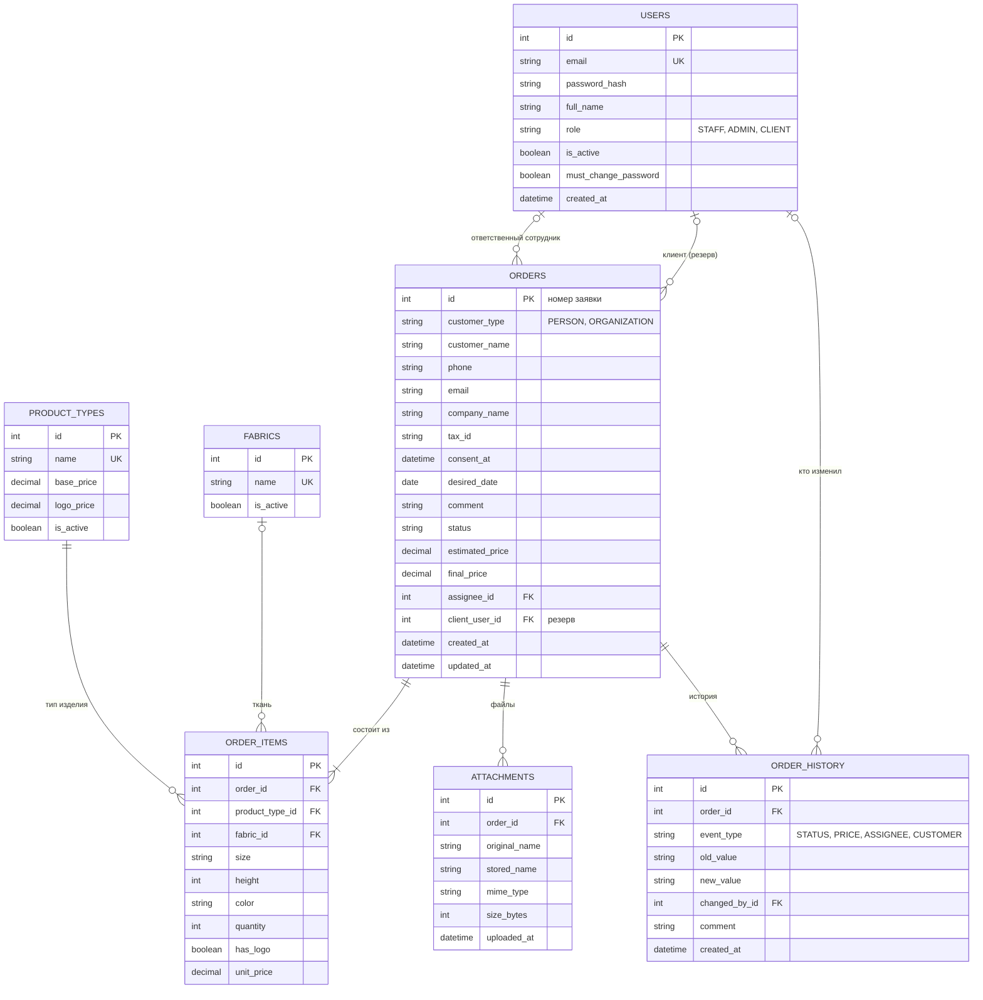

# База данных

> Часть проекта **uniform-orders**. Тот же текст, что в [architecture.md](architecture.md) (разделы 5), вынесен в отдельный файл.

## 5. База данных (PostgreSQL + Prisma)

*Prisma — это инструмент, который позволяет работать с базой данных через JavaScript, не написав ни одного SQL-запроса вручную. Он же создаёт и обновляет таблицы через **миграции** (файлы-инструкции «как изменить структуру базы»).*

### 5.1. Таблицы

**`users`: сотрудники и администраторы** (клиентов в MVP нет)

| Поле | Тип | Пояснение |
|---|---|---|
| id | Int, PK (первичный ключ — уникальный номер строки), автоинкремент | |
| email | String, уникальный | Логин |
| password_hash | String | Хеш пароля (результат необратимого «перемешивания»), сам пароль НЕ хранится |
| full_name | String | ФИО |
| role | Enum (`STAFF`, `ADMIN`, `CLIENT`) | `CLIENT` зарезервирован на будущее |
| is_active | Boolean, по умолчанию `true` | Отключённый не может войти |
| must_change_password | Boolean, по умолчанию `false` | `true` для временного пароля: до его смены работает только смена пароля (BR-19) |
| created_at | DateTime | |

**`product_types`: каталог изделий**

| Поле | Тип | Пояснение |
|---|---|---|
| id | Int, PK | |
| name | String, уникальный | «Рубашка», «Брюки», «Халат» |
| base_price | Decimal(12,2) | Базовая цена за 1 шт. |
| logo_price | Decimal(12,2), по умолчанию 0 | Доплата за нанесение логотипа на 1 шт. |
| is_active | Boolean | Скрыть изделие, не удаляя его из старых заявок |

**`fabrics`: ткани**

| Поле | Тип | Пояснение |
|---|---|---|
| id | Int, PK | |
| name | String, уникальный | «Хлопок», «Габардин» |
| is_active | Boolean | |

**`orders`: заявки (шапка заказа)**

| Поле | Тип | Пояснение |
|---|---|---|
| id | Int, PK, автоинкремент | Он же **номер заявки** для клиента |
| customer_type | Enum (`PERSON`, `ORGANIZATION`) | |
| customer_name | String | Имя контактного лица |
| phone | String | Только цифры (BR-3) |
| email | String | |
| company_name | String, может быть пусто | Только для организации |
| tax_id | String, может быть пусто | БИН/ИИН (ровно 12 цифр) |
| consent_at | DateTime | Когда клиент поставил галочку согласия на обработку персональных данных |
| desired_date | Date, может быть пусто | Желаемый срок |
| comment | Text, может быть пусто | |
| status | Enum (`NEW`, `UNDER_REVIEW`, `IN_PROCESSING`, `IN_PRODUCTION`, `READY`, `ISSUED`, `CANCELLED`) | По умолчанию `NEW` |
| estimated_price | Decimal(12,2) | Ориентировочная сумма (считает сервер). Это снимок суммы позиций на момент заказа |
| final_price | Decimal(12,2), может быть пусто | Ставит админ |
| assignee_id | Int, FK → users, может быть пусто | Назначенный сотрудник |
| client_user_id | Int, FK → users, может быть пусто | **Резерв** для личного кабинета (в MVP всегда пусто) |
| created_at | DateTime | |
| updated_at | DateTime | |

**`order_items`: позиции заявки**

| Поле | Тип | Пояснение |
|---|---|---|
| id | Int, PK | |
| order_id | Int, FK → orders | Удаляется вместе с заявкой |
| product_type_id | Int, FK → product_types | |
| fabric_id | Int, FK → fabrics, может быть пусто | |
| size | String | «M», «48» |
| height | Int, может быть пусто | Рост в см |
| color | String | Цвет свободным текстом |
| quantity | Int | > 0 |
| has_logo | Boolean | |
| unit_price | Decimal(12,2) | **Цена 1 шт. на момент заказа** (BR-7) |

**`attachments`: файлы заявки**

| Поле | Тип | Пояснение |
|---|---|---|
| id | Int, PK | |
| order_id | Int, FK → orders | |
| original_name | String | Как файл назывался у клиента |
| stored_name | String | Случайное имя на диске сервера |
| mime_type | String | Тип файла |
| size_bytes | Int | |
| uploaded_at | DateTime | |

**`order_history`: история изменений заявки**

| Поле | Тип | Пояснение |
|---|---|---|
| id | Int, PK | |
| order_id | Int, FK → orders | |
| event_type | Enum (`STATUS`, `PRICE`, `ASSIGNEE`, `CUSTOMER`) | Что изменили |
| old_value | String, может быть пусто | Было (например, `NEW` или `110000`). Пусто при создании заявки. Для `CUSTOMER` — JSON-строка только с изменёнными полями |
| new_value | String, может быть пусто | Стало |
| changed_by_id | Int, FK → users, может быть пусто | Пусто, если заявку создал гость |
| comment | Text, может быть пусто | Виден только сотрудникам |
| created_at | DateTime | |

Гость видит из истории только события `STATUS` (новый статус и дату).

### 5.2. Связи между таблицами

| Связь | Тип | Что означает |
|---|---|---|
| `orders` → `order_items` | один-ко-многим | В одной заявке много позиций |
| `orders` → `attachments` | один-ко-многим | К одной заявке много файлов |
| `orders` → `order_history` | один-ко-многим | У заявки много записей истории |
| `users` → `orders` (assignee) | один-ко-многим | Один сотрудник отвечает за много заявок |
| `users` → `order_history` | один-ко-многим | Один человек сделал много изменений |
| `product_types` → `order_items` | один-ко-многим | Одно изделие встречается во многих позициях |
| `fabrics` → `order_items` | один-ко-многим | Одна ткань встречается во многих позициях |
| `orders` ↔ `product_types` | **многие-ко-многим** | Заявка содержит много видов изделий, а изделие есть во многих заявках. Таблица **`order_items`** — «мост» между ними, и в ней лежат дополнительные данные (размер, цвет, количество) |

### 5.3. ER-диаграмма (схема связей)

### 5.4. Индексы

*Индекс — это «оглавление» для таблицы: база находит строки быстрее.* Нужны на: `orders.status`, `orders.created_at`, `orders.phone`, `orders.assignee_id` (фильтр «Мои»), `order_items.order_id`, `attachments.order_id`, `order_history.order_id`. Поиск «содержит» по имени или компании (`ILIKE '%Арай%'`) обычный индекс не ускоряет. При сотнях заявок это не нужно, при тысячах можно подключить расширение `pg_trgm`.

> **Почему так:** при сотнях заявок без индексов поиск работал бы нормально, но при тысячах список начал бы «подвисать». Индексы стоят дёшево сейчас и дорого потом.

### 5.5. Проверка: дублирование и расширяемость

**Есть ли дублирование данных?**

- Данные клиента (имя, телефон, email, компания) хранятся прямо в `orders` и повторяются, если один и тот же человек оформил две заявки. Это **осознанное** решение: у клиентов нет аккаунтов, а отдельная таблица «клиенты» заставила бы угадывать, один ли это человек.
- Цена позиции (`unit_price`) хранится в `order_items`, хотя есть в каталоге. Это **тоже осознанно**: цена в каталоге меняется, а старые заказы должны остаться с прежней суммой.
- Сумма `estimated_price` равна сумме позиций, то есть тоже повтор данных. Это **осознанно**: она хранится как снимок на момент заказа и не меняется вместе с каталогом.
- Всё остальное хранится в одном месте. Названия изделий и тканей лежат только в справочниках, в заявках на них ссылки.

> **Почему так:** если вынести клиента в отдельную таблицу сейчас, придётся придумывать правила «слияния» одинаковых людей. А если не хранить цену в позиции, то при изменении каталога у прошлых заказов «поплывёт» сумма.

**Можно ли добавить функции, не ломая старые таблицы?**

- Оплата: новая таблица `payments`, существующие не меняются.
- Письма: нужна только новая таблица `notification_log` (по желанию).
- Личный кабинет: уже есть `client_user_id` и роль `CLIENT`.
- Новые статусы: добавляются в список (Enum) отдельной миграцией. Правила перехода лежат в одном месте кода.

**Деньги** хранятся как `Decimal` (точное десятичное число), а **не** как `Float`. *Float округляет: 0.1 + 0.2 = 0.30000000000000004.*
