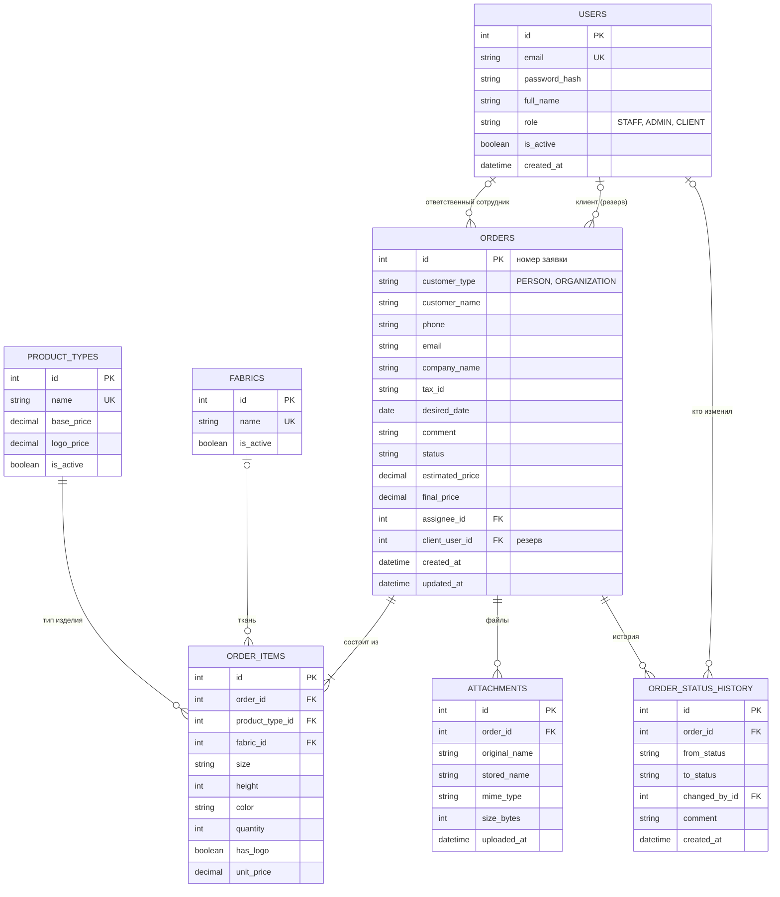
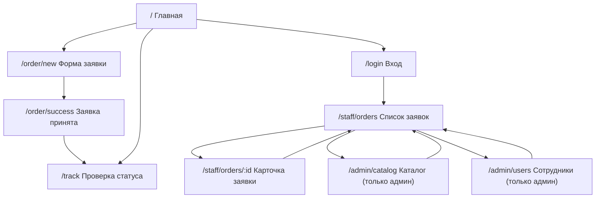

# Архитектура: веб-система управления заявками на пошив униформы

**Стек:** React (Vite) + Node.js + Express + PostgreSQL + Prisma
**Автор:** студент 3 курса колледжа
**Статус:** проектирование (код ещё не написан)

> Как читать документ: к важным решениям добавлена строка **«Почему так»**. В ней простыми словами сказано, что сломается, если сделать иначе. Термины объясняются в скобках.

---

## 0. Исходные решения (из моих ответов)

| Вопрос | Решение |
|---|---|
| Кто заказывает | Физлица и организации (переключатель в форме) |
| Состав заявки | Несколько позиций: тип изделия, размер, рост, цвет, ткань, количество, галочка «Логотип». На весь заказ: желаемый срок и комментарий |
| Статусы | Новая → На рассмотрении → В обработке → В производстве → Готова → Выдана, плюс Отменена |
| Роли | Гость (клиент), Сотрудник, Администратор |
| Цены | Ориентировочная цена считается при оформлении, итоговую вручную ставит администратор. Онлайн-оплаты нет |
| Файлы | Нужны: логотип, эскиз, Excel с размерами |
| Письма | Не входят в MVP (клиент сам проверяет статус на сайте) |
| Регистрация | Клиент оформляет заявку как гость. Вход по паролю только у сотрудников и администратора |
| Объём | Десятки или сотни заявок в месяц. Нужны поиск, фильтр по статусу и простая пагинация (разбивка списка по страницам) |

Два решения принял я при проектировании. Если они вам не подходят, их легко поменять:

1. **Сотрудник видит общий список всех заявок**, а фильтр «Мои» показывает только назначенные ему. Это проще, чем жёстко прятать чужие заявки.
2. **Гость проверяет статус по двум данным: номер заявки + телефон.** Один номер был бы слишком слабой защитой (см. раздел 4).

---

## 1. Пользователи и роли

| Роль | Кто это | Вход по паролю | Что может |
|---|---|---|---|
| **Гость (клиент)** | Родитель, школа, кафе, клиника | Нет | Смотреть каталог, оформить заявку, прикрепить файлы, получить номер заявки, проверить статус по номеру и телефону |
| **Сотрудник** | Менеджер, швея, закройщик | Да | Видеть список и карточки заявок, искать и фильтровать, скачивать файлы клиента, менять статус заявки |
| **Администратор** | Руководитель | Да | Всё, что сотрудник, и ещё: ставить итоговую цену, назначать сотрудника на заявку, управлять каталогом (изделия, ткани), управлять сотрудниками, отменять заявки и откатывать статус |

> **Почему так:** клиентам не нужны аккаунты. Регистрация отпугивает людей, которые хотят просто оставить заявку. Если бы цену и персонал мог менять любой сотрудник, один неосторожный человек испортил бы данные всей компании.

**Запас на будущее:** в списке ролей в базе сразу заводим значение `CLIENT`, но в MVP его не используем (подробнее в разделе 10).

---

## 2. MVP — минимальная первая версия

### Что входит (8 функций)

1. **Форма заявки** с переключателем «Физлицо / Организация» и кнопкой «+ Добавить изделие».
2. **Загрузка файлов** к заявке (логотип, эскиз, Excel).
3. **Ориентировочная стоимость** при оформлении (считает сервер по каталогу).
4. **Номер заявки** после оформления и **страница проверки статуса** (номер + телефон).
5. **Вход сотрудников и администратора** (логин и пароль).
6. **Список заявок** с поиском (по номеру, имени, компании, телефону), фильтром по статусу и пагинацией.
7. **Карточка заявки:** просмотр, скачивание файлов, смена статуса с историей изменений.
8. **Панель администратора:** итоговая цена, назначение сотрудника, управление каталогом и сотрудниками.

### Что НЕ входит в первую версию и почему

| Функция | Почему не в MVP |
|---|---|
| Письма клиенту при смене статуса | Нужен почтовый сервис и настройка. Клиент и так видит статус на сайте |
| Личный кабинет клиента | Требует регистрации, восстановления пароля. Гостевая заявка решает основную задачу |
| Онлайн-оплата | Нужны договор с платёжной системой и безопасность платежей. Вы сами решили, что она не нужна |
| Редактирование состава заявки после отправки | Усложняет правила (что менять можно, а что нет). В MVP ошибку исправляют отменой и новой заявкой |
| Разные роли внутри сотрудников (закройщик, швея) | Вы решили, что это лишнее. Сейчас достаточно одной роли |
| Внутренние заметки, чат с клиентом, отчёты, графики | Полезно, но не нужно для главной цели: заменить ручной учёт заявок |
| Печать накладной и PDF | Можно добавить позже на готовых данных |

> **Почему так:** если в MVP попытаться сделать всё, проект не будет готов к защите. Лучше сделать меньше, но чтобы работало от начала до конца.

---

## 3. Пользовательские истории

| № | История | MVP? |
|---|---|---|
| US-1 | Как **клиент**, я хочу оформить заявку с несколькими разными изделиями, чтобы заказать всю форму за один раз | ✅ |
| US-2 | Как **клиент**, я хочу выбрать «Физлицо» или «Организация» (с названием и БИН/ИНН), чтобы оформить заказ от своего имени или от компании | ✅ |
| US-3 | Как **клиент**, я хочу прикрепить логотип, эскиз или Excel с размерами, чтобы мастера точно поняли заказ | ✅ |
| US-4 | Как **клиент**, я хочу сразу видеть ориентировочную стоимость, чтобы понимать бюджет | ✅ |
| US-5 | Как **клиент**, я хочу получить номер заявки после отправки, чтобы потом найти её | ✅ |
| US-6 | Как **клиент**, я хочу проверить статус заявки по номеру и телефону, чтобы не звонить в ателье | ✅ |
| US-7 | Как **сотрудник**, я хочу войти по логину и паролю, чтобы работать с заявками | ✅ |
| US-8 | Как **сотрудник**, я хочу видеть список заявок с поиском и фильтром по статусу, чтобы быстро находить нужную | ✅ |
| US-9 | Как **сотрудник**, я хочу открыть карточку заявки и скачать файлы клиента, чтобы увидеть все детали заказа | ✅ |
| US-10 | Как **сотрудник**, я хочу менять статус заявки, чтобы отражать ход работы | ✅ |
| US-11 | Как **администратор**, я хочу проставить итоговую цену заказа, чтобы клиент знал точную сумму | ✅ |
| US-12 | Как **администратор**, я хочу назначить сотрудника на заявку, чтобы было понятно, кто за неё отвечает | ✅ |
| US-13 | Как **администратор**, я хочу управлять каталогом изделий и тканей, чтобы менять цены и список без программиста | ✅ |
| US-14 | Как **администратор**, я хочу добавлять и отключать сотрудников, чтобы управлять доступом | ✅ |
| US-15 | Как **клиент**, я хочу получать письмо при смене статуса, чтобы не заходить на сайт | ❌ (позже) |

---

## 4. Бизнес-правила

Бизнес-правила проверяет **сервер**. Проверки в браузере нужны только для удобства (подсказать ошибку сразу). Браузер можно обойти: открыть консоль разработчика или отправить запрос программой.

| № | Правило | Почему нельзя проверять только в браузере |
|---|---|---|
| BR-1 | В заявке минимум 1 позиция и не больше 50. Количество в позиции — целое число от 1 до 1000 | Злоумышленник отправит запрос напрямую с пустым списком или количеством «-5» |
| BR-2 | Обязательны: имя, телефон, email (правильный формат). Если выбрана «Организация», то обязательно название компании. БИН/ИНН (если указан) состоит только из цифр, 10–12 символов | Скрытое поле «компания» браузер можно просто убрать. Сервер должен сам убедиться, что данные полные |
| BR-3 | Телефон хранится в одном формате (только цифры, например `77011234567`) | Люди пишут телефон по-разному. Без единого формата поиск и проверка «номер + телефон» ломаются |
| BR-4 | Выбрать можно только активные изделия и ткани из каталога | Старый открытый вкладки каталог мог устареть, а запрос можно подделать |
| BR-5 | Желаемый срок не может быть в прошлом | Браузерный календарь можно обойти |
| BR-6 | **Цену считает сервер** по каталогу. Цену из браузера игнорируем | Иначе клиент отправит «стоимость: 1 ₸» и она сохранится |
| BR-7 | Цена позиции фиксируется в заявке в момент создания, и изменение каталога позже не меняет старые заявки | Это правило данных. Браузер к нему вообще не имеет отношения |
| BR-8 | Файлы: максимум 5 на заявку, до 5 МБ каждый, разрешены только `png, jpg, pdf, xlsx, xls, csv`. Сервер проверяет и расширение, и тип содержимого | Браузер можно обмануть, переименовав вирус в `logo.png`. Тяжёлые файлы забьют диск сервера |
| BR-9 | Статус можно менять только по разрешённой цепочке (таблица ниже) | Кнопки в интерфейсе можно спрятать, но запрос «поставить Выдана» всё равно можно отправить вручную |
| BR-10 | Перед статусом «В производстве» обязательно проставлена итоговая цена | Иначе заявка уйдёт в работу без согласованной суммы |
| BR-11 | Итоговую цену, назначение сотрудника, каталог и пользователей меняет только администратор | Сотрудник может узнать адрес запроса и отправить его сам |
| BR-12 | Любая смена статуса записывается в историю (кто, когда, с какого на какой) | История нужна, чтобы разбираться в спорных ситуациях. Браузер её подделать не должен |
| BR-13 | Гость видит заявку только при совпадении **номера и телефона**. Гость не видит данные сотрудников и внутренние комментарии | Иначе, перебирая числа 1, 2, 3…, можно прочитать чужие заказы с персональными данными |
| BR-14 | Сотрудник не может войти, если его аккаунт отключён. Сотрудников с заявками не удаляем, а отключаем. Нельзя отключить или понизить последнего администратора | Иначе потеряется история («кто менял статус?») или никто не сможет управлять системой |
| BR-15 | Ограничение частоты запросов: например, не более 5 создаваний заявки с одного IP в час и 10 проверок статуса в час | Иначе боты завалят базу мусорными заявками или будут подбирать номера |

### Таблица разрешённых смен статуса

| Из статуса | Можно перейти в | Кто может |
|---|---|---|
| Новая | На рассмотрении, Отменена | Сотрудник, Админ |
| На рассмотрении | В обработке, Отменена | Сотрудник, Админ |
| В обработке | В производстве (нужна итоговая цена), Отменена | Сотрудник, Админ |
| В производстве | Готова | Сотрудник, Админ |
| В производстве | Отменена | **Только Админ** |
| Готова | Выдана | Сотрудник, Админ |
| Готова | Отменена | **Только Админ** |
| Выдана, Отменена | (конечные статусы, менять нельзя) | — |
| Любой, кроме конечных | Шаг назад (на один статус) | **Только Админ**, комментарий обязателен |

> **Почему так:** без жёсткой цепочки заявку можно случайно перевести из «Новая» сразу в «Выдана», и статистика и доверие клиентов пропадут.

---

## 5. База данных (PostgreSQL + Prisma)

*Prisma — это инструмент, который позволяет работать с базой данных через JavaScript, не написав ни одного SQL-запроса вручную. Он же создаёт и обновляет таблицы через **миграции** (файлы-инструкции «как изменить структуру базы»).*

### 5.1. Таблицы

**`users`: сотрудники и администраторы** (клиентов в MVP нет)

| Поле | Тип | Пояснение |
|---|---|---|
| id | Int, PK (первичный ключ — уникальный номер строки), автоинкремент | |
| email | String, уникальный | Логин |
| password_hash | String | Хеш пароля (результат необратимого «перемешивания»), сам пароль НЕ хранится |
| full_name | String | ФИО |
| role | Enum (`STAFF`, `ADMIN`, `CLIENT`) | `CLIENT` зарезервирован на будущее |
| is_active | Boolean, по умолчанию `true` | Отключённый не может войти |
| created_at | DateTime | |

**`product_types`: каталог изделий**

| Поле | Тип | Пояснение |
|---|---|---|
| id | Int, PK | |
| name | String, уникальный | «Рубашка», «Брюки», «Халат» |
| base_price | Decimal(12,2) | Базовая цена за 1 шт. |
| logo_price | Decimal(12,2), по умолчанию 0 | Доплата за нанесение логотипа на 1 шт. |
| is_active | Boolean | Скрыть изделие, не удаляя его из старых заявок |

**`fabrics`: ткани**

| Поле | Тип | Пояснение |
|---|---|---|
| id | Int, PK | |
| name | String, уникальный | «Хлопок», «Габардин» |
| is_active | Boolean | |

**`orders`: заявки (шапка заказа)**

| Поле | Тип | Пояснение |
|---|---|---|
| id | Int, PK, автоинкремент | Он же **номер заявки** для клиента |
| customer_type | Enum (`PERSON`, `ORGANIZATION`) | |
| customer_name | String | Имя контактного лица |
| phone | String | Только цифры (BR-3) |
| email | String | |
| company_name | String, может быть пусто | Только для организации |
| tax_id | String, может быть пусто | БИН/ИНН |
| desired_date | Date, может быть пусто | Желаемый срок |
| comment | Text, может быть пусто | |
| status | Enum (`NEW`, `UNDER_REVIEW`, `IN_PROCESSING`, `IN_PRODUCTION`, `READY`, `ISSUED`, `CANCELLED`) | По умолчанию `NEW` |
| estimated_price | Decimal(12,2) | Ориентировочная сумма (считает сервер) |
| final_price | Decimal(12,2), может быть пусто | Ставит админ |
| assignee_id | Int, FK → users, может быть пусто | Назначенный сотрудник |
| client_user_id | Int, FK → users, может быть пусто | **Резерв** для личного кабинета (в MVP всегда пусто) |
| created_at | DateTime | |
| updated_at | DateTime | |

**`order_items`: позиции заявки**

| Поле | Тип | Пояснение |
|---|---|---|
| id | Int, PK | |
| order_id | Int, FK → orders | Удаляется вместе с заявкой |
| product_type_id | Int, FK → product_types | |
| fabric_id | Int, FK → fabrics, может быть пусто | |
| size | String | «M», «48» |
| height | Int, может быть пусто | Рост в см |
| color | String | Цвет свободным текстом |
| quantity | Int | > 0 |
| has_logo | Boolean | |
| unit_price | Decimal(12,2) | **Цена 1 шт. на момент заказа** (BR-7) |

**`attachments`: файлы заявки**

| Поле | Тип | Пояснение |
|---|---|---|
| id | Int, PK | |
| order_id | Int, FK → orders | |
| original_name | String | Как файл назывался у клиента |
| stored_name | String | Случайное имя на диске сервера |
| mime_type | String | Тип файла |
| size_bytes | Int | |
| uploaded_at | DateTime | |

**`order_status_history`: история статусов**

| Поле | Тип | Пояснение |
|---|---|---|
| id | Int, PK | |
| order_id | Int, FK → orders | |
| from_status | Enum, может быть пусто | Пусто при создании заявки |
| to_status | Enum | |
| changed_by_id | Int, FK → users, может быть пусто | Пусто, если заявку создал гость |
| comment | Text, может быть пусто | Виден только сотрудникам |
| created_at | DateTime | |

### 5.2. Связи между таблицами

| Связь | Тип | Что означает |
|---|---|---|
| `orders` → `order_items` | один-ко-многим | В одной заявке много позиций |
| `orders` → `attachments` | один-ко-многим | К одной заявке много файлов |
| `orders` → `order_status_history` | один-ко-многим | У заявки много записей истории |
| `users` → `orders` (assignee) | один-ко-многим | Один сотрудник отвечает за много заявок |
| `users` → `order_status_history` | один-ко-многим | Один человек сделал много изменений |
| `product_types` → `order_items` | один-ко-многим | Одно изделие встречается во многих позициях |
| `fabrics` → `order_items` | один-ко-многим | Одна ткань встречается во многих позициях |
| `orders` ↔ `product_types` | **многие-ко-многим** | Заявка содержит много видов изделий, а изделие есть во многих заявках. Таблица **`order_items`** — «мост» между ними, и в ней лежат дополнительные данные (размер, цвет, количество) |

### 5.3. ER-диаграмма (схема связей)



### 5.4. Индексы

*Индекс — это «оглавление» для таблицы: база находит строки быстрее.* Нужны на: `orders.status`, `orders.created_at`, `orders.phone`, `orders.customer_name`, `order_items.order_id`, `attachments.order_id`, `order_status_history.order_id`.

> **Почему так:** при сотнях заявок без индексов поиск работал бы нормально, но при тысячах список начал бы «подвисать». Индексы стоят дёшево сейчас и дорого потом.

### 5.5. Проверка: дублирование и расширяемость

**Есть ли дублирование данных?**

- Данные клиента (имя, телефон, email, компания) хранятся прямо в `orders` и повторяются, если один и тот же человек оформил две заявки. Это **осознанное** решение: у клиентов нет аккаунтов, а отдельная таблица «клиенты» заставила бы угадывать, один ли это человек.
- Цена позиции (`unit_price`) хранится в `order_items`, хотя есть в каталоге. Это **тоже осознанно**: цена в каталоге меняется, а старые заказы должны остаться с прежней суммой.
- Всё остальное хранится в одном месте. Названия изделий и тканей лежат только в справочниках, в заявках на них ссылки.

> **Почему так:** если вынести клиента в отдельную таблицу сейчас, придётся придумывать правила «слияния» одинаковых людей. А если не хранить цену в позиции, то при изменении каталога у прошлых заказов «поплывёт» сумма.

**Можно ли добавить функции, не ломая старые таблицы?**

- Оплата: новая таблица `payments`, существующие не меняются.
- Письма: нужна только новая таблица `notification_log` (по желанию).
- Личный кабинет: уже есть `client_user_id` и роль `CLIENT`.
- Новые статусы: добавляются в список (Enum) отдельной миграцией. Правила перехода лежат в одном месте кода.

**Деньги** хранятся как `Decimal` (точное десятичное число), а **не** как `Float`. *Float округляет: 0.1 + 0.2 = 0.30000000000000004.*

---

## 6. API

*API — это набор адресов (эндпоинтов) на сервере, по которым React-приложение просит у сервера данные или отправляет команды.*

**Общие правила:**
- Все адреса начинаются с `/api`.
- Формат обмена — JSON (кроме создания заявки: там ещё и файлы).
- Защищённые запросы содержат заголовок `Authorization: Bearer <токен>`.
- Ошибки всегда в одном виде: `{ "error": { "code": "VALIDATION_ERROR", "message": "Укажите телефон" } }`.
- Коды ответов: `200` успех, `201` создано, `400` неверные данные, `401` не вошёл, `403` нет прав, `404` не найдено, `409` нельзя в этом состоянии (например, неверный переход статуса), `429` слишком много запросов.

### 6.1. Таблица эндпоинтов

| № | Метод | Адрес | Что делает | Кто имеет доступ | История |
|---|---|---|---|---|---|
| 1 | GET | `/api/catalog` | Активные изделия и ткани для формы | Все | US-1, 2, 4 |
| 2 | POST | `/api/orders` | Создать заявку (с файлами) | Все (гость) | US-1, 2, 3, 4, 5 |
| 3 | POST | `/api/orders/track` | Проверить статус по номеру и телефону | Все (гость) | US-6 |
| 4 | POST | `/api/auth/login` | Вход сотрудника и админа | Все | US-7 |
| 5 | GET | `/api/auth/me` | Кто я (по токену) | Сотрудник, Админ | US-7 |
| 6 | GET | `/api/orders` | Список заявок: поиск, фильтры, страницы | Сотрудник, Админ | US-8 |
| 7 | GET | `/api/orders/:id` | Карточка заявки с позициями, файлами, историей | Сотрудник, Админ | US-9 |
| 8 | GET | `/api/orders/:id/files/:fileId` | Скачать файл заявки | Сотрудник, Админ | US-9 |
| 9 | PATCH | `/api/orders/:id/status` | Сменить статус | Сотрудник, Админ (см. BR-9) | US-10 |
| 10 | PATCH | `/api/orders/:id/price` | Проставить итоговую цену | Админ | US-11 |
| 11 | PATCH | `/api/orders/:id/assignee` | Назначить сотрудника | Админ | US-12 |
| 12 | GET | `/api/admin/product-types` | Все изделия (и скрытые) | Админ | US-13 |
| 13 | POST | `/api/admin/product-types` | Добавить изделие | Админ | US-13 |
| 14 | PATCH | `/api/admin/product-types/:id` | Изменить цену, название, скрыть | Админ | US-13 |
| 15 | GET | `/api/admin/fabrics` | Все ткани | Админ | US-13 |
| 16 | POST | `/api/admin/fabrics` | Добавить ткань | Админ | US-13 |
| 17 | PATCH | `/api/admin/fabrics/:id` | Изменить или скрыть ткань | Админ | US-13 |
| 18 | GET | `/api/admin/users` | Список сотрудников | Админ | US-14 |
| 19 | POST | `/api/admin/users` | Создать сотрудника | Админ | US-14 |
| 20 | PATCH | `/api/admin/users/:id` | Изменить ФИО, роль, отключить/включить | Админ | US-14 |

> **Почему так:** путь с `/admin/` сразу показывает, что адрес только для админа. Проверку роли можно поставить на всю группу адресов одной строкой, и забыть защитить один из них будет сложнее.
>
> **Почему проверка статуса — POST, а не GET:** телефон — персональные данные. В GET он попадёт в адресную строку и в журналы серверов. В POST он лежит в теле запроса.

### 6.2. Примеры запросов и ответов

**№1. GET `/api/catalog`**

Ответ `200`:
```json
{
  "productTypes": [
    { "id": 1, "name": "Рубашка", "basePrice": 6000, "logoPrice": 800 },
    { "id": 2, "name": "Брюки", "basePrice": 7500, "logoPrice": 0 }
  ],
  "fabrics": [
    { "id": 1, "name": "Хлопок" },
    { "id": 2, "name": "Габардин" }
  ]
}
```

**№2. POST `/api/orders`**

Запрос: `multipart/form-data` (формат, который позволяет отправить файлы вместе с данными). Поле `data` содержит JSON, поле `files` содержит файлы:
```json
{
  "customerType": "ORGANIZATION",
  "customerName": "Айгерим Серикова",
  "companyName": "Кафе «Арай»",
  "taxId": "123456789012",
  "phone": "+7 701 123 45 67",
  "email": "aigerim@example.com",
  "desiredDate": "2026-12-20",
  "comment": "Логотип во вложении",
  "items": [
    { "productTypeId": 1, "size": "M", "height": 170, "color": "Белый",
      "fabricId": 2, "quantity": 10, "hasLogo": true },
    { "productTypeId": 2, "size": "L", "height": 180, "color": "Чёрный",
      "fabricId": 1, "quantity": 5, "hasLogo": false }
  ]
}
```
Ответ `201`:
```json
{
  "orderNumber": 128,
  "status": "NEW",
  "estimatedPrice": 105500,
  "message": "Заявка принята. Сохраните номер и телефон, чтобы проверять статус."
}
```
*(Расчёт: 10 × (6000 + 800) + 5 × 7500 = 105 500.)*

> **Почему так:** одна общая отправка (данные + файлы) означает, что заявка либо создаётся целиком, либо не создаётся. Если бы файлы отправлялись отдельным запросом, гость мог бы прикрепить файл к чужой заявке, и пришлось бы придумывать для этого защиту.

**№3. POST `/api/orders/track`**

Запрос:
```json
{ "orderNumber": 128, "phone": "+7 701 123 45 67" }
```
Ответ `200`:
```json
{
  "orderNumber": 128,
  "status": "IN_PROCESSING",
  "estimatedPrice": 105500,
  "finalPrice": null,
  "createdAt": "2026-11-16T09:30:00Z",
  "items": [
    { "productName": "Рубашка", "size": "M", "quantity": 10, "hasLogo": true }
  ],
  "files": [ { "originalName": "logo.png" } ],
  "history": [
    { "status": "NEW", "date": "2026-11-16T09:30:00Z" },
    { "status": "UNDER_REVIEW", "date": "2026-11-16T11:00:00Z" }
  ]
}
```
Ошибка `404` при неверной паре (одинаково для «нет такого номера» и «не тот телефон»):
```json
{ "error": { "code": "NOT_FOUND", "message": "Заявка не найдена. Проверьте номер и телефон." } }
```

**№4. POST `/api/auth/login`**

Запрос:
```json
{ "email": "staff@example.com", "password": "мой-пароль" }
```
Ответ `200`:
```json
{
  "token": "eyJhbGciOi...",
  "user": { "id": 2, "fullName": "Алия Нурлан", "role": "STAFF" }
}
```
Ошибка `401`: `{ "error": { "code": "INVALID_CREDENTIALS", "message": "Неверный email или пароль" } }`

**№5. GET `/api/auth/me`** (с токеном)

Ответ `200`: `{ "id": 2, "fullName": "Алия Нурлан", "role": "STAFF" }`

**№6. GET `/api/orders?q=Арай&status=NEW&assignedToMe=true&page=1&limit=20`**

Параметры (всё необязательно): `q` — поиск по номеру, имени, компании, телефону; `status` — фильтр; `assignedToMe` — только мои; `page` и `limit` (по умолчанию 20, максимум 50). Сортировка: сначала новые.

Ответ `200`:
```json
{
  "items": [
    {
      "id": 128, "customerType": "ORGANIZATION", "customerName": "Айгерим Серикова",
      "companyName": "Кафе «Арай»", "status": "NEW", "itemsCount": 2,
      "estimatedPrice": 105500, "finalPrice": null,
      "assignee": null, "createdAt": "2026-11-16T09:30:00Z"
    }
  ],
  "page": 1, "limit": 20, "total": 1, "totalPages": 1
}
```

**№7. GET `/api/orders/128`**

Ответ `200` (сокращённо):
```json
{
  "id": 128, "status": "NEW", "customerType": "ORGANIZATION",
  "customerName": "Айгерим Серикова", "companyName": "Кафе «Арай»",
  "taxId": "123456789012", "phone": "77011234567", "email": "aigerim@example.com",
  "desiredDate": "2026-12-20", "comment": "Логотип во вложении",
  "estimatedPrice": 105500, "finalPrice": null,
  "assignee": null,
  "items": [ { "id": 1, "productName": "Рубашка", "size": "M", "height": 170,
               "color": "Белый", "fabricName": "Габардин", "quantity": 10,
               "hasLogo": true, "unitPrice": 6800 } ],
  "files": [ { "id": 7, "originalName": "logo.png", "sizeBytes": 204800 } ],
  "history": [ { "fromStatus": null, "toStatus": "NEW", "changedBy": null,
                 "comment": null, "createdAt": "2026-11-16T09:30:00Z" } ]
}
```

**№8. GET `/api/orders/128/files/7`**

Ответ `200`: сам файл (в заголовках указано имя и тип). Ошибка `404`, если файл не принадлежит этой заявке.

**№9. PATCH `/api/orders/128/status`**

Запрос: `{ "status": "UNDER_REVIEW", "comment": "Макет получен" }`
Ответ `200`: `{ "id": 128, "status": "UNDER_REVIEW" }`
Ошибка `409`: `{ "error": { "code": "INVALID_TRANSITION", "message": "Из «Новая» нельзя перейти в «Выдана»" } }`

**№10. PATCH `/api/orders/128/price`**

Запрос: `{ "finalPrice": 110000 }`
Ответ `200`: `{ "id": 128, "finalPrice": 110000 }`

**№11. PATCH `/api/orders/128/assignee`**

Запрос: `{ "assigneeId": 2 }` (`null` — снять назначение)
Ответ `200`: `{ "id": 128, "assignee": { "id": 2, "fullName": "Алия Нурлан" } }`

**№12–14. Изделия** (ткани №15–17 устроены так же, но с одним полем `name`)

- GET `/api/admin/product-types`: ответ `200` — массив изделий, как в каталоге, плюс поле `isActive`.
- POST `/api/admin/product-types`: запрос `{ "name": "Халат", "basePrice": 5500, "logoPrice": 700 }`, ответ `201` — созданное изделие с `id`.
- PATCH `/api/admin/product-types/3`: запрос `{ "basePrice": 5800, "isActive": true }`, ответ `200` — обновлённое изделие.

**№18–20. Сотрудники**

- GET `/api/admin/users`: ответ `200` — `[ { "id": 2, "email": "...", "fullName": "...", "role": "STAFF", "isActive": true } ]`.
- POST `/api/admin/users`: запрос `{ "email": "new@example.com", "fullName": "Дана Ахметова", "password": "временный-пароль", "role": "STAFF" }`, ответ `201` — пользователь без пароля.
- PATCH `/api/admin/users/2`: запрос `{ "isActive": false }`, ответ `200` — обновлённый пользователь. Ошибка `409`, если пытаются отключить последнего администратора.

> **Почему так:** сервер никогда не возвращает `password_hash`, и в каждый ответ попадают только нужные поля. Иначе по ошибке можно «отдать» лишнее.

---

## 7. Страницы сайта

### 7.1. Список страниц по ролям

| Страница | Адрес | Кто видит | Что на ней |
|---|---|---|---|
| Главная | `/` | Все | Краткое описание, кнопки «Оформить заявку», «Проверить статус», «Вход для сотрудников» |
| Форма заявки | `/order/new` | Все | Переключатель Физлицо/Организация, контакты, позиции («+ Добавить изделие»), срок, комментарий, файлы, ориентировочная цена |
| Заявка принята | `/order/success` | Все | Номер заявки и подсказка «Сохраните номер» |
| Проверка статуса | `/track` | Все | Поля «номер» и «телефон», результат со статусами и историей |
| Вход | `/login` | Все | Email и пароль |
| Список заявок | `/staff/orders` | Сотрудник, Админ | Таблица, поиск, фильтр по статусу, фильтр «Мои», пагинация |
| Карточка заявки | `/staff/orders/:id` | Сотрудник, Админ | Данные клиента, позиции, файлы, смена статуса, история. Для админа ещё: цена и назначение |
| Каталог | `/admin/catalog` | Админ | Изделия и ткани |
| Сотрудники | `/admin/users` | Админ | Список, добавление, отключение |
| Страница «Нет доступа» / «Не найдено» | `/403`, `*` | Все | Сообщение об ошибке |

### 7.2. Карта страниц



> **Почему так:** страницы `/staff/*` и `/admin/*` на клиенте закрыты специальной «охраной маршрутов» (компонент, который проверяет вход и роль перед показом страницы). Это только удобство. Настоящую защиту делает сервер (раздел 9).

---

## 8. Структура папок проекта

```text
uniform-orders/
├── docs/
│   └── architecture.md
├── client/                      # React (Vite) — то, что видит пользователь
│   ├── index.html
│   ├── package.json
│   ├── .env.example             # VITE_API_URL=http://localhost:3000/api
│   └── src/
│       ├── main.jsx             # Точка входа
│       ├── App.jsx              # Список маршрутов
│       ├── api/                 # Функции-запросы к серверу (одно место для всех fetch)
│       ├── context/             # AuthContext: кто сейчас вошёл
│       ├── components/          # Мелкие переиспользуемые части: кнопки, таблицы, StatusBadge
│       ├── pages/
│       │   ├── public/          # Home, NewOrder, Success, Track, Login
│       │   ├── staff/           # OrdersList, OrderCard
│       │   └── admin/           # Catalog, Users
│       ├── routes/              # ProtectedRoute (охрана маршрутов)
│       └── utils/               # Форматирование телефона, дат, денег, перевод статусов
└── server/                      # Node.js + Express — мозг системы
    ├── package.json
    ├── .env                     # Секреты (НЕ в Git)
    ├── .env.example             # Шаблон без секретов (в Git)
    ├── prisma/
    │   ├── schema.prisma        # Описание таблиц
    │   ├── migrations/          # История изменений базы
    │   └── seed.js              # Первый админ, начальный каталог
    ├── uploads/                 # Файлы клиентов (НЕ в Git, НЕ открыт публично)
    └── src/
        ├── server.js            # Запуск сервера
        ├── app.js               # Настройка Express: JSON, CORS, защита, маршруты
        ├── config/              # Чтение .env в одном месте
        ├── routes/              # Слой 1
        ├── controllers/         # Слой 2
        ├── services/            # Слой 3
        ├── database/            # Слой 4: подключение Prisma
        ├── middleware/          # auth (проверка токена), requireRole, upload, rateLimit, errorHandler
        ├── validators/          # Схемы проверки входных данных
        └── utils/               # Расчёт цены, правила статусов, нормализация телефона
```

### Слои сервера

| Слой | За что отвечает (одной строкой) |
|---|---|
| **routes** | Привязывает адрес и метод к нужной функции и подключает проверки доступа (кто может зайти). Больше ничего не решает |
| **controllers** | Берёт данные из запроса, вызывает сервис и формирует ответ (код и JSON). Бизнес-логики в нём нет |
| **services** | Вся «умная» часть: правила из раздела 4, расчёт цены, цепочка статусов. Не знает ни про запросы, ни про ответы |
| **database** | Единственное место, где подключается Prisma и выполняются запросы к PostgreSQL |

> **Почему так:** если смешать всё в один файл, то при смене правила (например, нового статуса) придётся искать его по десяткам мест. А в слоях правила статусов лежат в одном месте (`services` и `utils`), и менять их безопасно. Ещё один плюс: позже письмо можно отправить из сервиса, не трогая маршруты.

**Что такое middleware:** «промежуточная проверка» в Express. Запрос по пути проходит через неё, как через турникет: токен проверен, роль подходит, файл допустим. Если нет, запрос останавливается до контроллера.

---

## 9. Безопасность

### 9.1. Пароли

- В базе хранится только **хеш** пароля (необратимый результат, из которого пароль нельзя восстановить), созданный алгоритмом **bcrypt** (стандартный алгоритм хеширования паролей, намеренно медленный, чтобы замедлить подбор).
- При входе сервер хеширует введённый пароль и сравнивает хеши.
- Первый админ создаётся скриптом `seed.js`, а его пароль берётся из `.env`, а не из кода.

> **Почему так:** если базу украдут и пароли лежат открыто, злоумышленник сразу войдёт под админом, а люди, использующие этот пароль на других сайтах, пострадают тоже.

### 9.2. Вход и JWT

*JWT (JSON Web Token) — это «электронный пропуск»: строка, которую сервер выдаёт после входа. Внутри: номер пользователя, роль и срок действия. Сервер подписывает её секретным ключом, и подделать пропуск без ключа нельзя.*

Как это работает:

1. Сотрудник отправляет email и пароль на `/api/auth/login`.
2. Сервер проверяет пароль и активность аккаунта, подписывает JWT (срок жизни, например, 8 часов) и возвращает его.
3. React сохраняет токен и добавляет его к каждому защищённому запросу в заголовок `Authorization: Bearer <токен>`.
4. Middleware на сервере проверяет подпись и срок. Если всё хорошо, он кладёт данные пользователя в запрос.
5. Выход: клиент просто удаляет токен.

**Компромисс для учебного проекта:** токен хранится в `localStorage` браузера, это проще всего. Более защищённый вариант — `httpOnly`-cookie (куки, недоступные для JavaScript). Его можно описать на защите как улучшение. Чтобы снизить риск, токен живёт недолго, а React по умолчанию экранирует вставляемый текст.

> **Почему так:** при коротком сроке жизни украденный токен перестаёт работать сам. Если сделать токен «вечным», любая утечка превратится в постоянный доступ.

### 9.3. Файл `.env` — что в нём скрыто

| Переменная | Для чего |
|---|---|
| `DATABASE_URL` | Адрес и пароль от PostgreSQL |
| `JWT_SECRET` | Секретный ключ для подписи пропусков (длинная случайная строка) |
| `JWT_EXPIRES_IN` | Срок жизни токена (например, `8h`) |
| `PORT` | Порт сервера |
| `CLIENT_URL` | Адрес сайта, которому разрешено обращаться к API (для CORS) |
| `UPLOAD_DIR` | Папка для файлов |
| `MAX_FILE_SIZE_MB` | Максимальный размер файла |
| `ADMIN_EMAIL`, `ADMIN_PASSWORD` | Данные первого админа для `seed.js` |

- В `.gitignore` обязательно добавить `.env` и `uploads/`.
- В Git кладём `.env.example` (те же названия, но без значений).

> **Почему так:** если секреты окажутся на GitHub, их читает весь мир. Утёкший `JWT_SECRET` позволяет выписать себе пропуск администратора.

### 9.4. Проверки доступа

| Что проверяем | Где | Как |
|---|---|---|
| Пользователь вошёл | middleware `auth` на всех `/api/orders` (кроме POST создания и `/track`), `/api/auth/me`, `/api/admin/*` | Проверка подписи и срока токена, плюс проверка в базе, что аккаунт ещё активен |
| Роль подходит | middleware `requireRole('ADMIN')` на `/api/admin/*`, `/price`, `/assignee` | Сравнение роли из токена с разрешённой |
| Гость видит только свою заявку | сервис `/track` | Поиск по паре «номер + телефон» (BR-13) |
| Файл принадлежит заявке | сервис скачивания | Файл ищется по `fileId` **и** `orderId` |
| Данные верны | `validators/` на каждом входящем запросе | Схема проверки типов, длины, форматов (BR-1…BR-5) |

### 9.5. Дополнительная защита

- **Prisma** сам подставляет значения в запросы, что защищает от SQL-инъекции (когда злоумышленник вписывает в поле формы SQL-команду).
- **CORS** (правило, какие сайты могут обращаться к API) разрешает только `CLIENT_URL`.
- **helmet** (набор защитных HTTP-заголовков) подключаем одной строкой.
- **Ограничение частоты запросов** (BR-15) подключается для `POST /api/orders`, `/track`, `/login`.
- **Файлы:** хранятся в папке вне публичного доступа под случайными именами, а скачиваются только через защищённый адрес (№8). Имя клиента файлу не доверяем.
- **Ошибки:** клиенту показываем короткое понятное сообщение, подробности (стек ошибки) только в журнал сервера.
- **Логин:** при неверных данных всегда одно и то же сообщение, чтобы нельзя было узнать, существует ли такой email.
- **При публикации:** сайт работает по HTTPS (шифрованное соединение), иначе пароли и телефоны ходят открытым текстом.

---

## 10. Расширение: 3 будущие функции

### 10.1. Письма клиенту при смене статуса (US-15)

**Что изменится:**
- Добавится сервис отправки (`emailService`) и библиотека для почты. Например, Nodemailer.
- В настройки (`.env`) добавятся данные почтового сервера.
- В одном месте, в сервисе смены статуса, добавится вызов «отправить письмо».

**Нужно ли переписывать много кода?** Нет, потому что смена статуса проходит через **одну функцию** (BR-9, BR-12), а email клиента уже лежит в `orders`.

**Что сделать сейчас:** ни за что не менять статус «напрямую» в нескольких местах. Только через одну функцию сервиса.

### 10.2. Личный кабинет клиента (регистрация, «мои заказы»)

**Что изменится:** клиент сможет войти и увидеть все свои заявки, повторить заказ.

**Здесь есть риск переписывать много кода**, потому что все прошлые заявки гостевые и ни к кому не привязаны.

**Как спроектировать сейчас, чтобы этого избежать:**
- Роль `CLIENT` уже есть в списке ролей.
- В `orders` уже есть поле `client_user_id` (пока пустое).
- Телефон хранится в едином формате (BR-3), поэтому после регистрации старые заявки можно привязать по совпадению телефона/email, предварительно подтвердив владение (код из письма или SMS).
- Адреса API разделены: `/api/orders` — для персонала, а клиентские адреса станут, например, `/api/my/orders`. Старые не изменятся.

> **Почему так:** добавить пустое поле сейчас — одна строчка. Добавлять поле и переносить старые заявки в рабочей системе — это уже миграция данных, и ошибка может испортить заказы.

### 10.3. Онлайн-оплата или учёт предоплаты

**Что изменится:** появится таблица `payments` (заявка, сумма, дата, способ, статус платежа), страница оплаты, обработка ответа от платёжной системы.

**Нужно ли переписывать много кода?** Не будет, если сейчас **не** добавлять в `orders` поля вроде `is_paid`.

**Как спроектировать сейчас:**
- Не хранить «оплачено / не оплачено» флажком в заявке. Сумма долга в будущем считается как `final_price − сумма платежей`.
- Итоговая цена (`final_price`) уже отдельно от ориентировочной, а значит, понятно, от какой суммы считать оплату.
- Хранение файлов спрятать в одном модуле (`services`), чтобы при переходе на облачное хранилище поменять один файл.

---

## Вопросы на защиту (с короткими ответами)

**1. Почему позиции заказа вынесены в отдельную таблицу `order_items`, а не записаны в сам заказ?**
В одном заказе разное количество изделий: 2, 5 или 20 позиций. Столбцов под них заранее не придумаешь. Отдельная таблица позволяет добавлять сколько нужно, и она же служит «мостом» (связь многие-ко-многим) между заказами и видами изделий.

**2. Почему расчёт цены и проверки данных нельзя оставить только в браузере?**
Браузер полностью под контролем пользователя. Он может изменить код страницы или отправить запрос в обход сайта. Поэтому сервер пересчитывает цену и проверяет каждое правило сам, а браузер только подсказывает ошибки.

**3. Как работает вход через JWT и где хранится пароль?**
Сервер проверяет логин и пароль (в базе лежит только хеш bcrypt), после чего выдаёт подписанный токен с номером пользователя, ролью и сроком жизни. Клиент присылает его с каждым запросом, а сервер проверяет подпись. Сам пароль нигде не хранится.

**4. Как гость без регистрации видит только свою заявку и как это защищено?**
Для просмотра нужны две вещи: номер заявки и телефон. Одного номера мало, иначе можно перебирать числа. Ответ не показывает данные сотрудников и внутренние комментарии, а количество попыток ограничено (rate limit).

**5. Для чего разделение на слои routes → controllers → services → database?**
Каждый слой решает одну задачу: маршруты связывают адреса, контроллеры работают с запросом и ответом, сервисы содержат бизнес-правила, база выполняет запросы. Благодаря этому правила лежат в одном месте, их легко менять и тестировать, а новые функции (например, письма) добавляются без переписывания всего.
