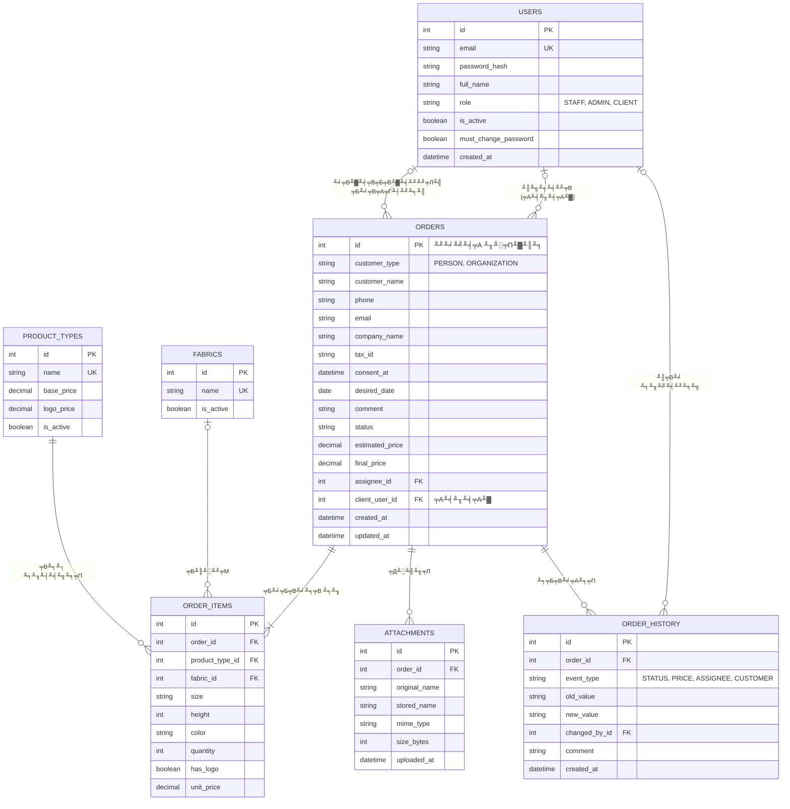
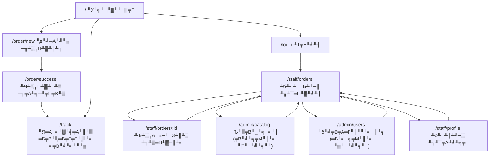

# ╨Р╤А╤Е╨╕╤В╨╡╨║╤В╤Г╤А╨░: ╨▓╨╡╨▒-╤Б╨╕╤Б╤В╨╡╨╝╨░ ╤Г╨┐╤А╨░╨▓╨╗╨╡╨╜╨╕╤П ╨╖╨░╤П╨▓╨║╨░╨╝╨╕ ╨╜╨░ ╨┐╨╛╤И╨╕╨▓ ╤Г╨╜╨╕╤Д╨╛╤А╨╝╤Л

**╨б╤В╨╡╨║:** React (Vite) + Node.js + Express + PostgreSQL + Prisma
**╨Р╨▓╤В╨╛╤А:** ╤Б╤В╤Г╨┤╨╡╨╜╤В 3 ╨║╤Г╤А╤Б╨░ ╨║╨╛╨╗╨╗╨╡╨┤╨╢╨░
**╨б╤В╨░╤В╤Г╤Б:** ╨┐╤А╨╛╨╡╨║╤В╨╕╤А╨╛╨▓╨░╨╜╨╕╨╡ (╨║╨╛╨┤ ╨╡╤Й╤С ╨╜╨╡ ╨╜╨░╨┐╨╕╤Б╨░╨╜)

> ╨Ъ╨░╨║ ╤З╨╕╤В╨░╤В╤М ╨┤╨╛╨║╤Г╨╝╨╡╨╜╤В: ╨║ ╨▓╨░╨╢╨╜╤Л╨╝ ╤А╨╡╤И╨╡╨╜╨╕╤П╨╝ ╨┤╨╛╨▒╨░╨▓╨╗╨╡╨╜╨░ ╤Б╤В╤А╨╛╨║╨░ **┬л╨Я╨╛╤З╨╡╨╝╤Г ╤В╨░╨║┬╗**. ╨Т ╨╜╨╡╨╣ ╨┐╤А╨╛╤Б╤В╤Л╨╝╨╕ ╤Б╨╗╨╛╨▓╨░╨╝╨╕ ╤Б╨║╨░╨╖╨░╨╜╨╛, ╤З╤В╨╛ ╤Б╨╗╨╛╨╝╨░╨╡╤В╤Б╤П, ╨╡╤Б╨╗╨╕ ╤Б╨┤╨╡╨╗╨░╤В╤М ╨╕╨╜╨░╤З╨╡. ╨в╨╡╤А╨╝╨╕╨╜╤Л ╨╛╨▒╤К╤П╤Б╨╜╤П╤О╤В╤Б╤П ╨▓ ╤Б╨║╨╛╨▒╨║╨░╤Е.

---

## ╨Т╨▓╨╡╨┤╨╡╨╜╨╕╨╡: ╨╝╨╛╨╕ ╤А╨╡╤И╨╡╨╜╨╕╤П ╨╕ ╨╕╤Б╤Е╨╛╨┤╨╜╤Л╨╡ ╤Г╤Б╨╗╨╛╨▓╨╕╤П

| ╨Т╨╛╨┐╤А╨╛╤Б | ╨а╨╡╤И╨╡╨╜╨╕╨╡ |
|---|---|
| ╨Ъ╤В╨╛ ╨╖╨░╨║╨░╨╖╤Л╨▓╨░╨╡╤В | ╨д╨╕╨╖╨╗╨╕╤Ж╨░ ╨╕ ╨╛╤А╨│╨░╨╜╨╕╨╖╨░╤Ж╨╕╨╕ (╨┐╨╡╤А╨╡╨║╨╗╤О╤З╨░╤В╨╡╨╗╤М ╨▓ ╤Д╨╛╤А╨╝╨╡) |
| ╨б╨╛╤Б╤В╨░╨▓ ╨╖╨░╤П╨▓╨║╨╕ | ╨Э╨╡╤Б╨║╨╛╨╗╤М╨║╨╛ ╨┐╨╛╨╖╨╕╤Ж╨╕╨╣: ╤В╨╕╨┐ ╨╕╨╖╨┤╨╡╨╗╨╕╤П, ╤А╨░╨╖╨╝╨╡╤А, ╤А╨╛╤Б╤В, ╤Ж╨▓╨╡╤В, ╤В╨║╨░╨╜╤М, ╨║╨╛╨╗╨╕╤З╨╡╤Б╤В╨▓╨╛, ╨│╨░╨╗╨╛╤З╨║╨░ ┬л╨Ы╨╛╨│╨╛╤В╨╕╨┐┬╗. ╨Э╨░ ╨▓╨╡╤Б╤М ╨╖╨░╨║╨░╨╖: ╨╢╨╡╨╗╨░╨╡╨╝╤Л╨╣ ╤Б╤А╨╛╨║ ╨╕ ╨║╨╛╨╝╨╝╨╡╨╜╤В╨░╤А╨╕╨╣ |
| ╨б╤В╨░╤В╤Г╤Б╤Л | ╨Э╨╛╨▓╨░╤П тЖТ ╨Э╨░ ╤А╨░╤Б╤Б╨╝╨╛╤В╤А╨╡╨╜╨╕╨╕ тЖТ ╨Т ╨╛╨▒╤А╨░╨▒╨╛╤В╨║╨╡ тЖТ ╨Т ╨┐╤А╨╛╨╕╨╖╨▓╨╛╨┤╤Б╤В╨▓╨╡ тЖТ ╨У╨╛╤В╨╛╨▓╨░ тЖТ ╨Т╤Л╨┤╨░╨╜╨░, ╨┐╨╗╤О╤Б ╨Ю╤В╨╝╨╡╨╜╨╡╨╜╨░ |
| ╨а╨╛╨╗╨╕ | ╨У╨╛╤Б╤В╤М (╨║╨╗╨╕╨╡╨╜╤В), ╨б╨╛╤В╤А╤Г╨┤╨╜╨╕╨║, ╨Р╨┤╨╝╨╕╨╜╨╕╤Б╤В╤А╨░╤В╨╛╤А |
| ╨ж╨╡╨╜╤Л | ╨Ю╤А╨╕╨╡╨╜╤В╨╕╤А╨╛╨▓╨╛╤З╨╜╨░╤П ╤Ж╨╡╨╜╨░ ╤Б╤З╨╕╤В╨░╨╡╤В╤Б╤П ╨┐╤А╨╕ ╨╛╤Д╨╛╤А╨╝╨╗╨╡╨╜╨╕╨╕, ╨╕╤В╨╛╨│╨╛╨▓╤Г╤О ╨▓╤А╤Г╤З╨╜╤Г╤О ╤Б╤В╨░╨▓╨╕╤В ╨░╨┤╨╝╨╕╨╜╨╕╤Б╤В╤А╨░╤В╨╛╤А. ╨Ю╨╜╨╗╨░╨╣╨╜-╨╛╨┐╨╗╨░╤В╤Л ╨╜╨╡╤В |
| ╨д╨░╨╣╨╗╤Л | ╨Э╤Г╨╢╨╜╤Л: ╨╗╨╛╨│╨╛╤В╨╕╨┐, ╤Н╤Б╨║╨╕╨╖, Excel ╤Б ╤А╨░╨╖╨╝╨╡╤А╨░╨╝╨╕ |
| ╨Я╨╕╤Б╤М╨╝╨░ | ╨Э╨╡ ╨▓╤Е╨╛╨┤╤П╤В ╨▓ MVP (╨║╨╗╨╕╨╡╨╜╤В ╤Б╨░╨╝ ╨┐╤А╨╛╨▓╨╡╤А╤П╨╡╤В ╤Б╤В╨░╤В╤Г╤Б ╨╜╨░ ╤Б╨░╨╣╤В╨╡) |
| ╨а╨╡╨│╨╕╤Б╤В╤А╨░╤Ж╨╕╤П | ╨Ъ╨╗╨╕╨╡╨╜╤В ╨╛╤Д╨╛╤А╨╝╨╗╤П╨╡╤В ╨╖╨░╤П╨▓╨║╤Г ╨║╨░╨║ ╨│╨╛╤Б╤В╤М. ╨Т╤Е╨╛╨┤ ╨┐╨╛ ╨┐╨░╤А╨╛╨╗╤О ╤В╨╛╨╗╤М╨║╨╛ ╤Г ╤Б╨╛╤В╤А╤Г╨┤╨╜╨╕╨║╨╛╨▓ ╨╕ ╨░╨┤╨╝╨╕╨╜╨╕╤Б╤В╤А╨░╤В╨╛╤А╨░ |
| ╨Ю╤В╨╝╨╡╨╜╨░ ╨╖╨░╤П╨▓╨║╨╕ | ╨Ъ╨╗╨╕╨╡╨╜╤В ╤Б╨░╨╝ ╨╛╤В╨╝╨╡╨╜╤П╨╡╤В ╨╖╨░╤П╨▓╨║╤Г, ╨┐╨╛╨║╨░ ╨╛╨╜╨░ ╨▓ ╤Б╤В╨░╤В╤Г╤Б╨╡ ┬л╨Э╨╛╨▓╨░╤П┬╗ ╨╕╨╗╨╕ ┬л╨Э╨░ ╤А╨░╤Б╤Б╨╝╨╛╤В╤А╨╡╨╜╨╕╨╕┬╗. ╨Я╨╛╨╖╨╢╨╡ ╨╛╤В╨╝╨╡╨╜╤Г ╨╛╤Д╨╛╤А╨╝╨╗╤П╨╡╤В ╤Б╨╛╤В╤А╤Г╨┤╨╜╨╕╨║ ╨╕╨╗╨╕ ╨░╨┤╨╝╨╕╨╜╨╕╤Б╤В╤А╨░╤В╨╛╤А ╨┐╨╛ ╨┐╤А╨╛╤Б╤М╨▒╨╡ ╨║╨╗╨╕╨╡╨╜╤В╨░ |
| ╨Ю╨▒╤К╤С╨╝ | ╨Ф╨╡╤Б╤П╤В╨║╨╕ ╨╕╨╗╨╕ ╤Б╨╛╤В╨╜╨╕ ╨╖╨░╤П╨▓╨╛╨║ ╨▓ ╨╝╨╡╤Б╤П╤Ж. ╨Э╤Г╨╢╨╜╤Л ╨┐╨╛╨╕╤Б╨║, ╤Д╨╕╨╗╤М╤В╤А ╨┐╨╛ ╤Б╤В╨░╤В╤Г╤Б╤Г ╨╕ ╨┐╤А╨╛╤Б╤В╨░╤П ╨┐╨░╨│╨╕╨╜╨░╤Ж╨╕╤П (╤А╨░╨╖╨▒╨╕╨▓╨║╨░ ╤Б╨┐╨╕╤Б╨║╨░ ╨┐╨╛ ╤Б╤В╤А╨░╨╜╨╕╤Ж╨░╨╝) |

╨Ъ╤А╨╛╨╝╨╡ ╤Г╤Б╨╗╨╛╨▓╨╕╨╣ ╨╕╨╖ ╤В╨░╨▒╨╗╨╕╤Ж╤Л, ╨┐╤А╨╕ ╨┐╤А╨╛╨╡╨║╤В╨╕╤А╨╛╨▓╨░╨╜╨╕╨╕ ╤П ╨┐╤А╨╕╨╜╤П╨╗ ╨╡╤Й╤С ╨╜╨╡╤Б╨║╨╛╨╗╤М╨║╨╛ ╤А╨╡╤И╨╡╨╜╨╕╨╣. ╨Ш╤Е ╨╝╨╛╨╢╨╜╨╛ ╨┐╨╛╨╝╨╡╨╜╤П╤В╤М, ╨╜╨╡ ╨┐╨╡╤А╨╡╨┤╨╡╨╗╤Л╨▓╨░╤П ╨╛╤Б╤В╨░╨╗╤М╨╜╨╛╨╡:

1. **╨б╨╛╤В╤А╤Г╨┤╨╜╨╕╨║ ╨▓╨╕╨┤╨╕╤В ╨╛╨▒╤Й╨╕╨╣ ╤Б╨┐╨╕╤Б╨╛╨║ ╨▓╤Б╨╡╤Е ╨╖╨░╤П╨▓╨╛╨║**, ╨░ ╤Д╨╕╨╗╤М╤В╤А ┬л╨Ь╨╛╨╕┬╗ ╨┐╨╛╨║╨░╨╖╤Л╨▓╨░╨╡╤В ╤В╨╛╨╗╤М╨║╨╛ ╨╜╨░╨╖╨╜╨░╤З╨╡╨╜╨╜╤Л╨╡ ╨╡╨╝╤Г. ╨н╤В╨╛ ╨┐╤А╨╛╤Й╨╡, ╤З╨╡╨╝ ╨╢╤С╤Б╤В╨║╨╛ ╨┐╤А╤П╤В╨░╤В╤М ╤З╤Г╨╢╨╕╨╡ ╨╖╨░╤П╨▓╨║╨╕.
2. **╨У╨╛╤Б╤В╤М ╨┐╤А╨╛╨▓╨╡╤А╤П╨╡╤В ╤Б╤В╨░╤В╤Г╤Б ╨┐╨╛ ╨┤╨▓╤Г╨╝ ╨┤╨░╨╜╨╜╤Л╨╝: ╨╜╨╛╨╝╨╡╤А ╨╖╨░╤П╨▓╨║╨╕ + ╤В╨╡╨╗╨╡╤Д╨╛╨╜.** ╨Ю╨┤╨╕╨╜ ╨╜╨╛╨╝╨╡╤А ╨▒╤Л╨╗ ╨▒╤Л ╤Б╨╗╨╕╤И╨║╨╛╨╝ ╤Б╨╗╨░╨▒╨╛╨╣ ╨╖╨░╤Й╨╕╤В╨╛╨╣ (╤Б╨╝. ╤А╨░╨╖╨┤╨╡╨╗ 4).
3. **╨Ъ╨╗╨╕╨╡╨╜╤В ╤Б╨░╨╝ ╨╝╨╛╨╢╨╡╤В ╨╛╤В╨╝╨╡╨╜╨╕╤В╤М ╨╖╨░╤П╨▓╨║╤Г**, ╨┐╨╛╨║╨░ ╨╛╨╜╨░ ╨▓ ╤Б╤В╨░╤В╤Г╤Б╨╡ ┬л╨Э╨╛╨▓╨░╤П┬╗ ╨╕╨╗╨╕ ┬л╨Э╨░ ╤А╨░╤Б╤Б╨╝╨╛╤В╤А╨╡╨╜╨╕╨╕┬╗. ╨Я╨╛╨╖╨╢╨╡ ╨╖╨░╤П╨▓╨║╨░ ╤Г╨╢╨╡ ╨┐╨╡╤А╨╡╨┤╨░╨╜╨░ ╨▓ ╤А╨░╨▒╨╛╤В╤Г, ╨╕ ╨╛╤В╨╝╨╡╨╜╤Г ╨┤╨╡╨╗╨░╨╡╤В ╤Б╨╛╤В╤А╤Г╨┤╨╜╨╕╨║ ╨┐╨╛ ╨╖╨▓╨╛╨╜╨║╤Г ╨║╨╗╨╕╨╡╨╜╤В╨░. ╨Ш╨╜╨░╤З╨╡ ╨║╨╗╨╕╨╡╨╜╤В ╨╛╤Б╤В╨░╨╗╤Б╤П ╨▒╤Л ╨▒╨╡╨╖ ╤Б╨┐╨╛╤Б╨╛╨▒╨░ ╨╕╤Б╨┐╤А╨░╨▓╨╕╤В╤М ╨╛╤И╨╕╨▒╨║╤Г.
4. **╨Ю╤А╨╕╨╡╨╜╤В╨╕╤А╨╛╨▓╨╛╤З╨╜╤Г╤О ╤Ж╨╡╨╜╤Г ╨▓ ╤Д╨╛╤А╨╝╨╡ ╨┐╨╛╨║╨░╨╖╤Л╨▓╨░╨╡╤В ╨▒╤А╨░╤Г╨╖╨╡╤А** ╨┐╨╛ ╤Ж╨╡╨╜╨░╨╝ ╨╕╨╖ ╨║╨░╤В╨░╨╗╨╛╨│╨░ (╨║╨░╨║ ╨┐╨╛╨┤╤Б╨║╨░╨╖╨║╤Г), ╨░ **╤Б╨╡╤А╨▓╨╡╤А ╨┐╨╡╤А╨╡╤Б╤З╨╕╤В╤Л╨▓╨░╨╡╤В ╨╡╤С ╤Б╨░╨╝** ╨┐╤А╨╕ ╤Б╨╛╨╖╨┤╨░╨╜╨╕╨╕ ╨╖╨░╤П╨▓╨║╨╕ ╨╕ ╤Б╨╛╤Е╤А╨░╨╜╤П╨╡╤В ╤Б╨▓╨╛╤О ╤Ж╨╕╤Д╤А╤Г (BR-6). ╨д╨╛╤А╨╝╤Г╨╗╨░ ╨▓ ╨┤╨▓╤Г╤Е ╨╝╨╡╤Б╤В╨░╤Е, ╨╜╨╛ ╤А╨╡╤И╨░╨╡╤В ╤В╨╛╨╗╤М╨║╨╛ ╤Б╨╡╤А╨▓╨╡╤А.
5. **╨С╨Ш╨Э/╨Ш╨Ш╨Э тАФ ╤А╨╛╨▓╨╜╨╛ 12 ╤Ж╨╕╤Д╤А** (╨┐╤А╨╛╨╡╨║╤В ╤А╨░╤Б╤Б╤З╨╕╤В╨░╨╜ ╨╜╨░ ╨Ъ╨░╨╖╨░╤Е╤Б╤В╨░╨╜), ╨╕ ╨▓ ╤Д╨╛╤А╨╝╨╡ ╨╛╨▒╤П╨╖╨░╤В╨╡╨╗╤М╨╜╨░ ╨│╨░╨╗╨╛╤З╨║╨░ ╤Б╨╛╨│╨╗╨░╤Б╨╕╤П ╨╜╨░ ╨╛╨▒╤А╨░╨▒╨╛╤В╨║╤Г ╨┐╨╡╤А╤Б╨╛╨╜╨░╨╗╤М╨╜╤Л╤Е ╨┤╨░╨╜╨╜╤Л╤Е.

---

## 1. ╨Я╨╛╨╗╤М╨╖╨╛╨▓╨░╤В╨╡╨╗╨╕ ╨╕ ╤А╨╛╨╗╨╕

| ╨а╨╛╨╗╤М | ╨Ъ╤В╨╛ ╤Н╤В╨╛ | ╨Т╤Е╨╛╨┤ ╨┐╨╛ ╨┐╨░╤А╨╛╨╗╤О | ╨з╤В╨╛ ╨╝╨╛╨╢╨╡╤В |
|---|---|---|---|
| **╨У╨╛╤Б╤В╤М (╨║╨╗╨╕╨╡╨╜╤В)** | ╨а╨╛╨┤╨╕╤В╨╡╨╗╤М, ╤И╨║╨╛╨╗╨░, ╨║╨░╤Д╨╡, ╨║╨╗╨╕╨╜╨╕╨║╨░ | ╨Э╨╡╤В | ╨Т╨╕╨┤╨╡╤В╤М ╨║╨░╤В╨░╨╗╨╛╨│ ╨╕╨╖╨┤╨╡╨╗╨╕╨╣ ╨╕ ╤Ж╨╡╨╜ ╨▓ ╤Д╨╛╤А╨╝╨╡ ╨╖╨░╤П╨▓╨║╨╕, ╨╛╤Д╨╛╤А╨╝╨╕╤В╤М ╨╖╨░╤П╨▓╨║╤Г, ╨┐╤А╨╕╨║╤А╨╡╨┐╨╕╤В╤М ╤Д╨░╨╣╨╗╤Л, ╨┐╨╛╨╗╤Г╤З╨╕╤В╤М ╨╜╨╛╨╝╨╡╤А ╨╖╨░╤П╨▓╨║╨╕, ╨┐╤А╨╛╨▓╨╡╤А╨╕╤В╤М ╤Б╤В╨░╤В╤Г╤Б ╨┐╨╛ ╨╜╨╛╨╝╨╡╤А╤Г ╨╕ ╤В╨╡╨╗╨╡╤Д╨╛╨╜╤Г, ╨╛╤В╨╝╨╡╨╜╨╕╤В╤М ╤Б╨▓╨╛╤О ╨╖╨░╤П╨▓╨║╤Г, ╨┐╨╛╨║╨░ ╨╛╨╜╨░ ╨╜╨╡ ╨▓╨╖╤П╤В╨░ ╨▓ ╤А╨░╨▒╨╛╤В╤Г |
| **╨б╨╛╤В╤А╤Г╨┤╨╜╨╕╨║** | ╨Ь╨╡╨╜╨╡╨┤╨╢╨╡╤А, ╤И╨▓╨╡╤П, ╨╖╨░╨║╤А╨╛╨╣╤Й╨╕╨║ | ╨Ф╨░ | ╨Т╨╕╨┤╨╡╤В╤М ╤Б╨┐╨╕╤Б╨╛╨║ ╨╕ ╨║╨░╤А╤В╨╛╤З╨║╨╕ ╨╖╨░╤П╨▓╨╛╨║, ╨╕╤Б╨║╨░╤В╤М ╨╕ ╤Д╨╕╨╗╤М╤В╤А╨╛╨▓╨░╤В╤М, ╤Б╨║╨░╤З╨╕╨▓╨░╤В╤М ╤Д╨░╨╣╨╗╤Л ╨║╨╗╨╕╨╡╨╜╤В╨░, ╨╝╨╡╨╜╤П╤В╤М ╤Б╤В╨░╤В╤Г╤Б ╨╖╨░╤П╨▓╨║╨╕ (╨▓ ╤В╨╛╨╝ ╤З╨╕╤Б╨╗╨╡ ╨╛╤В╨╝╨╡╨╜╤П╤В╤М ╨╖╨░╤П╨▓╨║╤Г ╨┐╨╛ ╨┐╤А╨╛╤Б╤М╨▒╨╡ ╨║╨╗╨╕╨╡╨╜╤В╨░ ╨┤╨╛ ╨╜╨░╤З╨░╨╗╨░ ╨┐╤А╨╛╨╕╨╖╨▓╨╛╨┤╤Б╤В╨▓╨░, ╤Б ╨╛╨▒╤П╨╖╨░╤В╨╡╨╗╤М╨╜╨╛╨╣ ╨┐╤А╨╕╤З╨╕╨╜╨╛╨╣), ╨╕╤Б╨┐╤А╨░╨▓╨╗╤П╤В╤М ╨║╨╛╨╜╤В╨░╨║╤В╨╜╤Л╨╡ ╨┤╨░╨╜╨╜╤Л╨╡ ╨║╨╗╨╕╨╡╨╜╤В╨░ |
| **╨Р╨┤╨╝╨╕╨╜╨╕╤Б╤В╤А╨░╤В╨╛╤А** | ╨а╤Г╨║╨╛╨▓╨╛╨┤╨╕╤В╨╡╨╗╤М | ╨Ф╨░ | ╨Т╤Б╤С, ╤З╤В╨╛ ╤Б╨╛╤В╤А╤Г╨┤╨╜╨╕╨║, ╨╕ ╨╡╤Й╤С: ╤Б╤В╨░╨▓╨╕╤В╤М ╨╕╤В╨╛╨│╨╛╨▓╤Г╤О ╤Ж╨╡╨╜╤Г, ╨╜╨░╨╖╨╜╨░╤З╨░╤В╤М ╤Б╨╛╤В╤А╤Г╨┤╨╜╨╕╨║╨░ ╨╜╨░ ╨╖╨░╤П╨▓╨║╤Г, ╤Г╨┐╤А╨░╨▓╨╗╤П╤В╤М ╨║╨░╤В╨░╨╗╨╛╨│╨╛╨╝ (╨╕╨╖╨┤╨╡╨╗╨╕╤П, ╤В╨║╨░╨╜╨╕), ╤Г╨┐╤А╨░╨▓╨╗╤П╤В╤М ╤Б╨╛╤В╤А╤Г╨┤╨╜╨╕╨║╨░╨╝╨╕ (╨▓╨║╨╗╤О╤З╨░╤П ╤Б╨▒╤А╨╛╤Б ╨┐╨░╤А╨╛╨╗╤П), ╨╛╤В╨╝╨╡╨╜╤П╤В╤М ╨╖╨░╤П╨▓╨║╨╕ ╨╜╨░ ╨╗╤О╨▒╨╛╨╝ ╤Н╤В╨░╨┐╨╡ (╤Б╨╛╤В╤А╤Г╨┤╨╜╨╕╨║ тАФ ╤В╨╛╨╗╤М╨║╨╛ ╨┤╨╛ ╨╜╨░╤З╨░╨╗╨░ ╨┐╤А╨╛╨╕╨╖╨▓╨╛╨┤╤Б╤В╨▓╨░) ╨╕ ╨╛╤В╨║╨░╤В╤Л╨▓╨░╤В╤М ╤Б╤В╨░╤В╤Г╤Б ╨╜╨░ ╤И╨░╨│ ╨╜╨░╨╖╨░╨┤ |

> **╨Я╨╛╤З╨╡╨╝╤Г ╤В╨░╨║:** ╨║╨╗╨╕╨╡╨╜╤В╨░╨╝ ╨╜╨╡ ╨╜╤Г╨╢╨╜╤Л ╨░╨║╨║╨░╤Г╨╜╤В╤Л. ╨а╨╡╨│╨╕╤Б╤В╤А╨░╤Ж╨╕╤П ╨╛╤В╨┐╤Г╨│╨╕╨▓╨░╨╡╤В ╨╗╤О╨┤╨╡╨╣, ╨║╨╛╤В╨╛╤А╤Л╨╡ ╤Е╨╛╤В╤П╤В ╨┐╤А╨╛╤Б╤В╨╛ ╨╛╤Б╤В╨░╨▓╨╕╤В╤М ╨╖╨░╤П╨▓╨║╤Г. ╨Х╤Б╨╗╨╕ ╨▒╤Л ╤Ж╨╡╨╜╤Г ╨╕ ╨┐╨╡╤А╤Б╨╛╨╜╨░╨╗ ╨╝╨╛╨│ ╨╝╨╡╨╜╤П╤В╤М ╨╗╤О╨▒╨╛╨╣ ╤Б╨╛╤В╤А╤Г╨┤╨╜╨╕╨║, ╨╛╨┤╨╕╨╜ ╨╜╨╡╨╛╤Б╤В╨╛╤А╨╛╨╢╨╜╤Л╨╣ ╤З╨╡╨╗╨╛╨▓╨╡╨║ ╨╕╤Б╨┐╨╛╤А╤В╨╕╨╗ ╨▒╤Л ╨┤╨░╨╜╨╜╤Л╨╡ ╨▓╤Б╨╡╨╣ ╨║╨╛╨╝╨┐╨░╨╜╨╕╨╕.

**╨Ч╨░╨┐╨░╤Б ╨╜╨░ ╨▒╤Г╨┤╤Г╤Й╨╡╨╡:** ╨▓ ╤Б╨┐╨╕╤Б╨║╨╡ ╤А╨╛╨╗╨╡╨╣ ╨▓ ╨▒╨░╨╖╨╡ ╤Б╤А╨░╨╖╤Г ╨╖╨░╨▓╨╛╨┤╨╕╨╝ ╨╖╨╜╨░╤З╨╡╨╜╨╕╨╡ `CLIENT`, ╨╜╨╛ ╨▓ MVP ╨╡╨│╨╛ ╨╜╨╡ ╨╕╤Б╨┐╨╛╨╗╤М╨╖╤Г╨╡╨╝ (╨┐╨╛╨┤╤А╨╛╨▒╨╜╨╡╨╡ ╨▓ ╤А╨░╨╖╨┤╨╡╨╗╨╡ 10).

---

## 2. MVP тАФ ╨╝╨╕╨╜╨╕╨╝╨░╨╗╤М╨╜╨░╤П ╨┐╨╡╤А╨▓╨░╤П ╨▓╨╡╤А╤Б╨╕╤П

### ╨з╤В╨╛ ╨▓╤Е╨╛╨┤╨╕╤В (8 ╤Д╤Г╨╜╨║╤Ж╨╕╨╣)

1. **╨д╨╛╤А╨╝╨░ ╨╖╨░╤П╨▓╨║╨╕** ╤Б ╨┐╨╡╤А╨╡╨║╨╗╤О╤З╨░╤В╨╡╨╗╨╡╨╝ ┬л╨д╨╕╨╖╨╗╨╕╤Ж╨╛ / ╨Ю╤А╨│╨░╨╜╨╕╨╖╨░╤Ж╨╕╤П┬╗ ╨╕ ╨║╨╜╨╛╨┐╨║╨╛╨╣ ┬л+ ╨Ф╨╛╨▒╨░╨▓╨╕╤В╤М ╨╕╨╖╨┤╨╡╨╗╨╕╨╡┬╗.
2. **╨Ч╨░╨│╤А╤Г╨╖╨║╨░ ╤Д╨░╨╣╨╗╨╛╨▓** ╨║ ╨╖╨░╤П╨▓╨║╨╡ (╨╗╨╛╨│╨╛╤В╨╕╨┐, ╤Н╤Б╨║╨╕╨╖, Excel).
3. **╨Ю╤А╨╕╨╡╨╜╤В╨╕╤А╨╛╨▓╨╛╤З╨╜╨░╤П ╤Б╤В╨╛╨╕╨╝╨╛╤Б╤В╤М** ╨┐╤А╨╕ ╨╛╤Д╨╛╤А╨╝╨╗╨╡╨╜╨╕╨╕ (╤Б╤З╨╕╤В╨░╨╡╤В ╤Б╨╡╤А╨▓╨╡╤А ╨┐╨╛ ╨║╨░╤В╨░╨╗╨╛╨│╤Г).
4. **╨Э╨╛╨╝╨╡╤А ╨╖╨░╤П╨▓╨║╨╕** ╨┐╨╛╤Б╨╗╨╡ ╨╛╤Д╨╛╤А╨╝╨╗╨╡╨╜╨╕╤П, **╤Б╤В╤А╨░╨╜╨╕╤Ж╨░ ╨┐╤А╨╛╨▓╨╡╤А╨║╨╕ ╤Б╤В╨░╤В╤Г╤Б╨░** (╨╜╨╛╨╝╨╡╤А + ╤В╨╡╨╗╨╡╤Д╨╛╨╜) ╨╕ **╨╛╤В╨╝╨╡╨╜╨░ ╤Б╨▓╨╛╨╡╨╣ ╨╖╨░╤П╨▓╨║╨╕**, ╨┐╨╛╨║╨░ ╨╛╨╜╨░ ╨╜╨╡ ╨▓╨╖╤П╤В╨░ ╨▓ ╤А╨░╨▒╨╛╤В╤Г.
5. **╨Т╤Е╨╛╨┤ ╤Б╨╛╤В╤А╤Г╨┤╨╜╨╕╨║╨╛╨▓ ╨╕ ╨░╨┤╨╝╨╕╨╜╨╕╤Б╤В╤А╨░╤В╨╛╤А╨░** (╨╗╨╛╨│╨╕╨╜ ╨╕ ╨┐╨░╤А╨╛╨╗╤М) ╨╕ ╤Б╨╝╨╡╨╜╨░ ╤Б╨▓╨╛╨╡╨│╨╛ ╨┐╨░╤А╨╛╨╗╤П.
6. **╨б╨┐╨╕╤Б╨╛╨║ ╨╖╨░╤П╨▓╨╛╨║** ╤Б ╨┐╨╛╨╕╤Б╨║╨╛╨╝ (╨┐╨╛ ╨╜╨╛╨╝╨╡╤А╤Г, ╨╕╨╝╨╡╨╜╨╕, ╨║╨╛╨╝╨┐╨░╨╜╨╕╨╕, ╤В╨╡╨╗╨╡╤Д╨╛╨╜╤Г), ╤Д╨╕╨╗╤М╤В╤А╨╛╨╝ ╨┐╨╛ ╤Б╤В╨░╤В╤Г╤Б╤Г ╨╕ ╨┐╨░╨│╨╕╨╜╨░╤Ж╨╕╨╡╨╣.
7. **╨Ъ╨░╤А╤В╨╛╤З╨║╨░ ╨╖╨░╤П╨▓╨║╨╕:** ╨┐╤А╨╛╤Б╨╝╨╛╤В╤А, ╤Б╨║╨░╤З╨╕╨▓╨░╨╜╨╕╨╡ ╤Д╨░╨╣╨╗╨╛╨▓, ╤Б╨╝╨╡╨╜╨░ ╤Б╤В╨░╤В╤Г╤Б╨░, ╨╕╤Б╨┐╤А╨░╨▓╨╗╨╡╨╜╨╕╨╡ ╨║╨╛╨╜╤В╨░╨║╤В╨╛╨▓ ╨║╨╗╨╕╨╡╨╜╤В╨░, ╨╕╤Б╤В╨╛╤А╨╕╤П ╨╕╨╖╨╝╨╡╨╜╨╡╨╜╨╕╨╣ (╤Б╤В╨░╤В╤Г╤Б, ╤Ж╨╡╨╜╨░, ╨╛╤В╨▓╨╡╤В╤Б╤В╨▓╨╡╨╜╨╜╤Л╨╣).
8. **╨Я╨░╨╜╨╡╨╗╤М ╨░╨┤╨╝╨╕╨╜╨╕╤Б╤В╤А╨░╤В╨╛╤А╨░:** ╨╕╤В╨╛╨│╨╛╨▓╨░╤П ╤Ж╨╡╨╜╨░, ╨╜╨░╨╖╨╜╨░╤З╨╡╨╜╨╕╨╡ ╤Б╨╛╤В╤А╤Г╨┤╨╜╨╕╨║╨░, ╤Г╨┐╤А╨░╨▓╨╗╨╡╨╜╨╕╨╡ ╨║╨░╤В╨░╨╗╨╛╨│╨╛╨╝ ╨╕ ╤Б╨╛╤В╤А╤Г╨┤╨╜╨╕╨║╨░╨╝╨╕.

### ╨з╤В╨╛ ╨Э╨Х ╨▓╤Е╨╛╨┤╨╕╤В ╨▓ ╨┐╨╡╤А╨▓╤Г╤О ╨▓╨╡╤А╤Б╨╕╤О ╨╕ ╨┐╨╛╤З╨╡╨╝╤Г

| ╨д╤Г╨╜╨║╤Ж╨╕╤П | ╨Я╨╛╤З╨╡╨╝╤Г ╨╜╨╡ ╨▓ MVP |
|---|---|
| ╨Я╨╕╤Б╤М╨╝╨░ ╨║╨╗╨╕╨╡╨╜╤В╤Г ╨┐╤А╨╕ ╤Б╨╝╨╡╨╜╨╡ ╤Б╤В╨░╤В╤Г╤Б╨░ | ╨Э╤Г╨╢╨╡╨╜ ╨┐╨╛╤З╤В╨╛╨▓╤Л╨╣ ╤Б╨╡╤А╨▓╨╕╤Б ╨╕ ╨╜╨░╤Б╤В╤А╨╛╨╣╨║╨░. ╨Ъ╨╗╨╕╨╡╨╜╤В ╨╕ ╤В╨░╨║ ╨▓╨╕╨┤╨╕╤В ╤Б╤В╨░╤В╤Г╤Б ╨╜╨░ ╤Б╨░╨╣╤В╨╡ |
| ╨Ы╨╕╤З╨╜╤Л╨╣ ╨║╨░╨▒╨╕╨╜╨╡╤В ╨║╨╗╨╕╨╡╨╜╤В╨░ | ╨в╤А╨╡╨▒╤Г╨╡╤В ╤А╨╡╨│╨╕╤Б╤В╤А╨░╤Ж╨╕╨╕, ╨▓╨╛╤Б╤Б╤В╨░╨╜╨╛╨▓╨╗╨╡╨╜╨╕╤П ╨┐╨░╤А╨╛╨╗╤П. ╨У╨╛╤Б╤В╨╡╨▓╨░╤П ╨╖╨░╤П╨▓╨║╨░ ╤А╨╡╤И╨░╨╡╤В ╨╛╤Б╨╜╨╛╨▓╨╜╤Г╤О ╨╖╨░╨┤╨░╤З╤Г |
| ╨Ю╨╜╨╗╨░╨╣╨╜-╨╛╨┐╨╗╨░╤В╨░ | ╨Э╤Г╨╢╨╜╤Л ╨┤╨╛╨│╨╛╨▓╨╛╤А ╤Б ╨┐╨╗╨░╤В╤С╨╢╨╜╨╛╨╣ ╤Б╨╕╤Б╤В╨╡╨╝╨╛╨╣ ╨╕ ╨▒╨╡╨╖╨╛╨┐╨░╤Б╨╜╨╛╤Б╤В╤М ╨┐╨╗╨░╤В╨╡╨╢╨╡╨╣. ╨а╨╡╤И╨╡╨╜╨╛, ╤З╤В╨╛ ╨╛╨╜╨░ ╨╜╨╡ ╨╜╤Г╨╢╨╜╨░ |
| ╨а╨╡╨┤╨░╨║╤В╨╕╤А╨╛╨▓╨░╨╜╨╕╨╡ ╤Б╨╛╤Б╤В╨░╨▓╨░ ╨╖╨░╤П╨▓╨║╨╕ ╨┐╨╛╤Б╨╗╨╡ ╨╛╤В╨┐╤А╨░╨▓╨║╨╕ | ╨г╤Б╨╗╨╛╨╢╨╜╤П╨╡╤В ╨┐╤А╨░╨▓╨╕╨╗╨░ (╤З╤В╨╛ ╨╝╨╡╨╜╤П╤В╤М ╨╝╨╛╨╢╨╜╨╛, ╨░ ╤З╤В╨╛ ╨╜╨╡╤В). ╨Т MVP ╨╛╤И╨╕╨▒╨║╤Г ╨╕╤Б╨┐╤А╨░╨▓╨╗╤П╤О╤В ╤В╨░╨║: ╨║╨╗╨╕╨╡╨╜╤В ╤Б╨░╨╝ ╨╛╤В╨╝╨╡╨╜╤П╨╡╤В ╨╖╨░╤П╨▓╨║╤Г (╨┐╨╛╨║╨░ ╨╛╨╜╨░ ┬л╨Э╨╛╨▓╨░╤П┬╗ ╨╕╨╗╨╕ ┬л╨Э╨░ ╤А╨░╤Б╤Б╨╝╨╛╤В╤А╨╡╨╜╨╕╨╕┬╗) ╨╕ ╨╛╤Д╨╛╤А╨╝╨╗╤П╨╡╤В ╨╜╨╛╨▓╤Г╤О. ╨Х╤Б╨╗╨╕ ╨╖╨░╤П╨▓╨║╨░ ╤Г╨╢╨╡ ╨▓ ╤А╨░╨▒╨╛╤В╨╡, ╨║╨╗╨╕╨╡╨╜╤В ╨╖╨▓╨╛╨╜╨╕╤В ╨▓ ╨░╤В╨╡╨╗╤М╨╡ |
| ╨Т╨╛╤Б╤Б╤В╨░╨╜╨╛╨▓╨╗╨╡╨╜╨╕╨╡ ╨┐╨╛╤В╨╡╤А╤П╨╜╨╜╨╛╨│╨╛ ╨╜╨╛╨╝╨╡╤А╨░ ╨╖╨░╤П╨▓╨║╨╕ ╨┐╨╛ email | ╨Э╤Г╨╢╨╜╨╛ ╨┐╨╕╤Б╤М╨╝╨╛ ╤Б ╨║╨╛╨┤╨╛╨╝. ╨Т MVP ╤Б╨╛╤В╤А╤Г╨┤╨╜╨╕╨║ ╨╜╨░╤Е╨╛╨┤╨╕╤В ╨╖╨░╤П╨▓╨║╤Г ╤З╨╡╤А╨╡╨╖ ╨┐╨╛╨╕╤Б╨║ ╨┐╨╛ ╤В╨╡╨╗╨╡╤Д╨╛╨╜╤Г |
| ╨а╨░╨╖╨╜╤Л╨╡ ╤А╨╛╨╗╨╕ ╨▓╨╜╤Г╤В╤А╨╕ ╤Б╨╛╤В╤А╤Г╨┤╨╜╨╕╨║╨╛╨▓ (╨╖╨░╨║╤А╨╛╨╣╤Й╨╕╨║, ╤И╨▓╨╡╤П) | ╨а╨╡╤И╨╡╨╜╨╛, ╤З╤В╨╛ ╤Н╤В╨╛ ╨╗╨╕╤И╨╜╨╡╨╡. ╨б╨╡╨╣╤З╨░╤Б ╨┤╨╛╤Б╤В╨░╤В╨╛╤З╨╜╨╛ ╨╛╨┤╨╜╨╛╨╣ ╤А╨╛╨╗╨╕ |
| ╨Т╨╜╤Г╤В╤А╨╡╨╜╨╜╨╕╨╡ ╨╖╨░╨╝╨╡╤В╨║╨╕, ╤З╨░╤В ╤Б ╨║╨╗╨╕╨╡╨╜╤В╨╛╨╝, ╨╛╤В╤З╤С╤В╤Л, ╨│╤А╨░╤Д╨╕╨║╨╕ | ╨Я╨╛╨╗╨╡╨╖╨╜╨╛, ╨╜╨╛ ╨╜╨╡ ╨╜╤Г╨╢╨╜╨╛ ╨┤╨╗╤П ╨│╨╗╨░╨▓╨╜╨╛╨╣ ╤Ж╨╡╨╗╨╕: ╨╖╨░╨╝╨╡╨╜╨╕╤В╤М ╤А╤Г╤З╨╜╨╛╨╣ ╤Г╤З╤С╤В ╨╖╨░╤П╨▓╨╛╨║ |
| ╨Я╨╡╤З╨░╤В╤М ╨╜╨░╨║╨╗╨░╨┤╨╜╨╛╨╣ ╨╕ PDF | ╨Ь╨╛╨╢╨╜╨╛ ╨┤╨╛╨▒╨░╨▓╨╕╤В╤М ╨┐╨╛╨╖╨╢╨╡ ╨╜╨░ ╨│╨╛╤В╨╛╨▓╤Л╤Е ╨┤╨░╨╜╨╜╤Л╤Е |

> **╨Я╨╛╤З╨╡╨╝╤Г ╤В╨░╨║:** ╨╡╤Б╨╗╨╕ ╨▓ MVP ╨┐╨╛╨┐╤Л╤В╨░╤В╤М╤Б╤П ╤Б╨┤╨╡╨╗╨░╤В╤М ╨▓╤Б╤С, ╨┐╤А╨╛╨╡╨║╤В ╨╜╨╡ ╨▒╤Г╨┤╨╡╤В ╨│╨╛╤В╨╛╨▓ ╨║ ╨╖╨░╤Й╨╕╤В╨╡. ╨Ы╤Г╤З╤И╨╡ ╤Б╨┤╨╡╨╗╨░╤В╤М ╨╝╨╡╨╜╤М╤И╨╡, ╨╜╨╛ ╤З╤В╨╛╨▒╤Л ╤А╨░╨▒╨╛╤В╨░╨╗╨╛ ╨╛╤В ╨╜╨░╤З╨░╨╗╨░ ╨┤╨╛ ╨║╨╛╨╜╤Ж╨░.

---

## 3. ╨Я╨╛╨╗╤М╨╖╨╛╨▓╨░╤В╨╡╨╗╤М╤Б╨║╨╕╨╡ ╨╕╤Б╤В╨╛╤А╨╕╨╕

| тДЦ | ╨Ш╤Б╤В╨╛╤А╨╕╤П | MVP? |
|---|---|---|
| US-1 | ╨Ъ╨░╨║ **╨║╨╗╨╕╨╡╨╜╤В**, ╤П ╤Е╨╛╤З╤Г ╨╛╤Д╨╛╤А╨╝╨╕╤В╤М ╨╖╨░╤П╨▓╨║╤Г ╤Б ╨╜╨╡╤Б╨║╨╛╨╗╤М╨║╨╕╨╝╨╕ ╤А╨░╨╖╨╜╤Л╨╝╨╕ ╨╕╨╖╨┤╨╡╨╗╨╕╤П╨╝╨╕, ╤З╤В╨╛╨▒╤Л ╨╖╨░╨║╨░╨╖╨░╤В╤М ╨▓╤Б╤О ╤Д╨╛╤А╨╝╤Г ╨╖╨░ ╨╛╨┤╨╕╨╜ ╤А╨░╨╖ | тЬЕ |
| US-2 | ╨Ъ╨░╨║ **╨║╨╗╨╕╨╡╨╜╤В**, ╤П ╤Е╨╛╤З╤Г ╨▓╤Л╨▒╤А╨░╤В╤М ┬л╨д╨╕╨╖╨╗╨╕╤Ж╨╛┬╗ ╨╕╨╗╨╕ ┬л╨Ю╤А╨│╨░╨╜╨╕╨╖╨░╤Ж╨╕╤П┬╗ (╤Б ╨╜╨░╨╖╨▓╨░╨╜╨╕╨╡╨╝ ╨╕ ╨С╨Ш╨Э/╨Ш╨Ш╨Э), ╤З╤В╨╛╨▒╤Л ╨╛╤Д╨╛╤А╨╝╨╕╤В╤М ╨╖╨░╨║╨░╨╖ ╨╛╤В ╤Б╨▓╨╛╨╡╨│╨╛ ╨╕╨╝╨╡╨╜╨╕ ╨╕╨╗╨╕ ╨╛╤В ╨║╨╛╨╝╨┐╨░╨╜╨╕╨╕ | тЬЕ |
| US-3 | ╨Ъ╨░╨║ **╨║╨╗╨╕╨╡╨╜╤В**, ╤П ╤Е╨╛╤З╤Г ╨┐╤А╨╕╨║╤А╨╡╨┐╨╕╤В╤М ╨╗╨╛╨│╨╛╤В╨╕╨┐, ╤Н╤Б╨║╨╕╨╖ ╨╕╨╗╨╕ Excel ╤Б ╤А╨░╨╖╨╝╨╡╤А╨░╨╝╨╕, ╤З╤В╨╛╨▒╤Л ╨╝╨░╤Б╤В╨╡╤А╨░ ╤В╨╛╤З╨╜╨╛ ╨┐╨╛╨╜╤П╨╗╨╕ ╨╖╨░╨║╨░╨╖ | тЬЕ |
| US-4 | ╨Ъ╨░╨║ **╨║╨╗╨╕╨╡╨╜╤В**, ╤П ╤Е╨╛╤З╤Г ╤Б╤А╨░╨╖╤Г ╨▓╨╕╨┤╨╡╤В╤М ╨╛╤А╨╕╨╡╨╜╤В╨╕╤А╨╛╨▓╨╛╤З╨╜╤Г╤О ╤Б╤В╨╛╨╕╨╝╨╛╤Б╤В╤М ╨╕ ╨┐╨╛╨╗╤Г╤З╨╕╤В╤М ╨╜╨╛╨╝╨╡╤А ╨╖╨░╤П╨▓╨║╨╕ ╨┐╨╛╤Б╨╗╨╡ ╨╛╤В╨┐╤А╨░╨▓╨║╨╕, ╤З╤В╨╛╨▒╤Л ╨┐╨╛╨╜╨╕╨╝╨░╤В╤М ╨▒╤О╨┤╨╢╨╡╤В ╨╕ ╨┐╨╛╤В╨╛╨╝ ╨╜╨░╨╣╤В╨╕ ╨╖╨░╤П╨▓╨║╤Г | тЬЕ |
| US-5 | ╨Ъ╨░╨║ **╨║╨╗╨╕╨╡╨╜╤В**, ╤П ╤Е╨╛╤З╤Г ╨┐╤А╨╛╨▓╨╡╤А╨╕╤В╤М ╤Б╤В╨░╤В╤Г╤Б ╨╖╨░╤П╨▓╨║╨╕ ╨┐╨╛ ╨╜╨╛╨╝╨╡╤А╤Г ╨╕ ╤В╨╡╨╗╨╡╤Д╨╛╨╜╤Г, ╤З╤В╨╛╨▒╤Л ╨╜╨╡ ╨╖╨▓╨╛╨╜╨╕╤В╤М ╨▓ ╨░╤В╨╡╨╗╤М╨╡ | тЬЕ |
| US-6 | ╨Ъ╨░╨║ **╨║╨╗╨╕╨╡╨╜╤В**, ╤П ╤Е╨╛╤З╤Г ╨╛╤В╨╝╨╡╨╜╨╕╤В╤М ╤Б╨▓╨╛╤О ╨╖╨░╤П╨▓╨║╤Г, ╨┐╨╛╨║╨░ ╨╛╨╜╨░ ╨╜╨╡ ╨▓╨╖╤П╤В╨░ ╨▓ ╤А╨░╨▒╨╛╤В╤Г, ╤З╤В╨╛╨▒╤Л ╨╕╤Б╨┐╤А╨░╨▓╨╕╤В╤М ╨╛╤И╨╕╨▒╨║╤Г ╨╕╨╗╨╕ ╨╛╤В╨║╨░╨╖╨░╤В╤М╤Б╤П ╨╛╤В ╨╖╨░╨║╨░╨╖╨░ | тЬЕ |
| US-7 | ╨Ъ╨░╨║ **╤Б╨╛╤В╤А╤Г╨┤╨╜╨╕╨║**, ╤П ╤Е╨╛╤З╤Г ╨▓╨╛╨╣╤В╨╕ ╨┐╨╛ ╨╗╨╛╨│╨╕╨╜╤Г ╨╕ ╨┐╨░╤А╨╛╨╗╤О ╨╕ ╤Б╨╝╨╡╨╜╨╕╤В╤М ╨▓╤А╨╡╨╝╨╡╨╜╨╜╤Л╨╣ ╨┐╨░╤А╨╛╨╗╤М ╨╜╨░ ╤Б╨▓╨╛╨╣, ╤З╤В╨╛╨▒╤Л ╨▒╨╡╨╖╨╛╨┐╨░╤Б╨╜╨╛ ╤А╨░╨▒╨╛╤В╨░╤В╤М ╤Б ╨╖╨░╤П╨▓╨║╨░╨╝╨╕ | тЬЕ |
| US-8 | ╨Ъ╨░╨║ **╤Б╨╛╤В╤А╤Г╨┤╨╜╨╕╨║**, ╤П ╤Е╨╛╤З╤Г ╨▓╨╕╨┤╨╡╤В╤М ╤Б╨┐╨╕╤Б╨╛╨║ ╨╖╨░╤П╨▓╨╛╨║ ╤Б ╨┐╨╛╨╕╤Б╨║╨╛╨╝ ╨╕ ╤Д╨╕╨╗╤М╤В╤А╨╛╨╝ ╨┐╨╛ ╤Б╤В╨░╤В╤Г╤Б╤Г, ╤З╤В╨╛╨▒╤Л ╨▒╤Л╤Б╤В╤А╨╛ ╨╜╨░╤Е╨╛╨┤╨╕╤В╤М ╨╜╤Г╨╢╨╜╤Г╤О | тЬЕ |
| US-9 | ╨Ъ╨░╨║ **╤Б╨╛╤В╤А╤Г╨┤╨╜╨╕╨║**, ╤П ╤Е╨╛╤З╤Г ╨╛╤В╨║╤А╤Л╤В╤М ╨║╨░╤А╤В╨╛╤З╨║╤Г ╨╖╨░╤П╨▓╨║╨╕, ╤Б╨║╨░╤З╨░╤В╤М ╤Д╨░╨╣╨╗╤Л ╨║╨╗╨╕╨╡╨╜╤В╨░ ╨╕ ╨╕╤Б╨┐╤А╨░╨▓╨╕╤В╤М ╨╡╨│╨╛ ╨║╨╛╨╜╤В╨░╨║╤В╤Л, ╨╡╤Б╨╗╨╕ ╨╛╨╜ ╨╛╤И╨╕╨▒╤Б╤П, ╤З╤В╨╛╨▒╤Л ╨▓╨╕╨┤╨╡╤В╤М ╨▓╤Б╨╡ ╨┤╨╡╤В╨░╨╗╨╕ ╨╖╨░╨║╨░╨╖╨░ ╨╕ ╤Б╨▓╤П╨╖╨░╤В╤М╤Б╤П ╤Б ╨║╨╗╨╕╨╡╨╜╤В╨╛╨╝ | тЬЕ |
| US-10 | ╨Ъ╨░╨║ **╤Б╨╛╤В╤А╤Г╨┤╨╜╨╕╨║**, ╤П ╤Е╨╛╤З╤Г ╨╝╨╡╨╜╤П╤В╤М ╤Б╤В╨░╤В╤Г╤Б ╨╖╨░╤П╨▓╨║╨╕ (╨▓ ╤В╨╛╨╝ ╤З╨╕╤Б╨╗╨╡ ╨╛╤В╨╝╨╡╨╜╨╕╤В╤М ╨╡╤С ╨┐╨╛ ╨┐╤А╨╛╤Б╤М╨▒╨╡ ╨║╨╗╨╕╨╡╨╜╤В╨░), ╤З╤В╨╛╨▒╤Л ╨╛╤В╤А╨░╨╢╨░╤В╤М ╤Е╨╛╨┤ ╤А╨░╨▒╨╛╤В╤Л | тЬЕ |
| US-11 | ╨Ъ╨░╨║ **╨░╨┤╨╝╨╕╨╜╨╕╤Б╤В╤А╨░╤В╨╛╤А**, ╤П ╤Е╨╛╤З╤Г ╨┐╤А╨╛╤Б╤В╨░╨▓╨╕╤В╤М ╨╕╤В╨╛╨│╨╛╨▓╤Г╤О ╤Ж╨╡╨╜╤Г ╨╖╨░╨║╨░╨╖╨░, ╤З╤В╨╛╨▒╤Л ╨║╨╗╨╕╨╡╨╜╤В ╨╖╨╜╨░╨╗ ╤В╨╛╤З╨╜╤Г╤О ╤Б╤Г╨╝╨╝╤Г | тЬЕ |
| US-12 | ╨Ъ╨░╨║ **╨░╨┤╨╝╨╕╨╜╨╕╤Б╤В╤А╨░╤В╨╛╤А**, ╤П ╤Е╨╛╤З╤Г ╨╜╨░╨╖╨╜╨░╤З╨╕╤В╤М ╤Б╨╛╤В╤А╤Г╨┤╨╜╨╕╨║╨░ ╨╜╨░ ╨╖╨░╤П╨▓╨║╤Г, ╤З╤В╨╛╨▒╤Л ╨▒╤Л╨╗╨╛ ╨┐╨╛╨╜╤П╤В╨╜╨╛, ╨║╤В╨╛ ╨╖╨░ ╨╜╨╡╤С ╨╛╤В╨▓╨╡╤З╨░╨╡╤В | тЬЕ |
| US-13 | ╨Ъ╨░╨║ **╨░╨┤╨╝╨╕╨╜╨╕╤Б╤В╤А╨░╤В╨╛╤А**, ╤П ╤Е╨╛╤З╤Г ╤Г╨┐╤А╨░╨▓╨╗╤П╤В╤М ╨║╨░╤В╨░╨╗╨╛╨│╨╛╨╝ ╨╕╨╖╨┤╨╡╨╗╨╕╨╣ ╨╕ ╤В╨║╨░╨╜╨╡╨╣, ╤З╤В╨╛╨▒╤Л ╨╝╨╡╨╜╤П╤В╤М ╤Ж╨╡╨╜╤Л ╨╕ ╤Б╨┐╨╕╤Б╨╛╨║ ╨▒╨╡╨╖ ╨┐╤А╨╛╨│╤А╨░╨╝╨╝╨╕╤Б╤В╨░ | тЬЕ |
| US-14 | ╨Ъ╨░╨║ **╨░╨┤╨╝╨╕╨╜╨╕╤Б╤В╤А╨░╤В╨╛╤А**, ╤П ╤Е╨╛╤З╤Г ╨┤╨╛╨▒╨░╨▓╨╗╤П╤В╤М ╨╕ ╨╛╤В╨║╨╗╤О╤З╨░╤В╤М ╤Б╨╛╤В╤А╤Г╨┤╨╜╨╕╨║╨╛╨▓, ╤З╤В╨╛╨▒╤Л ╤Г╨┐╤А╨░╨▓╨╗╤П╤В╤М ╨┤╨╛╤Б╤В╤Г╨┐╨╛╨╝ | тЬЕ |
| US-15 | ╨Ъ╨░╨║ **╨║╨╗╨╕╨╡╨╜╤В**, ╤П ╤Е╨╛╤З╤Г ╨┐╨╛╨╗╤Г╤З╨░╤В╤М ╨┐╨╕╤Б╤М╨╝╨╛ ╨┐╤А╨╕ ╤Б╨╝╨╡╨╜╨╡ ╤Б╤В╨░╤В╤Г╤Б╨░, ╤З╤В╨╛╨▒╤Л ╨╜╨╡ ╨╖╨░╤Е╨╛╨┤╨╕╤В╤М ╨╜╨░ ╤Б╨░╨╣╤В | тЭМ (╨┐╨╛╨╖╨╢╨╡) |

---

## 4. ╨С╨╕╨╖╨╜╨╡╤Б-╨┐╤А╨░╨▓╨╕╨╗╨░

╨С╨╕╨╖╨╜╨╡╤Б-╨┐╤А╨░╨▓╨╕╨╗╨░ ╨┐╤А╨╛╨▓╨╡╤А╤П╨╡╤В **╤Б╨╡╤А╨▓╨╡╤А**. ╨Я╤А╨╛╨▓╨╡╤А╨║╨╕ ╨▓ ╨▒╤А╨░╤Г╨╖╨╡╤А╨╡ ╨╜╤Г╨╢╨╜╤Л ╤В╨╛╨╗╤М╨║╨╛ ╨┤╨╗╤П ╤Г╨┤╨╛╨▒╤Б╤В╨▓╨░ (╨┐╨╛╨┤╤Б╨║╨░╨╖╨░╤В╤М ╨╛╤И╨╕╨▒╨║╤Г ╤Б╤А╨░╨╖╤Г). ╨С╤А╨░╤Г╨╖╨╡╤А ╨╝╨╛╨╢╨╜╨╛ ╨╛╨▒╨╛╨╣╤В╨╕: ╨╛╤В╨║╤А╤Л╤В╤М ╨║╨╛╨╜╤Б╨╛╨╗╤М ╤А╨░╨╖╤А╨░╨▒╨╛╤В╤З╨╕╨║╨░ ╨╕╨╗╨╕ ╨╛╤В╨┐╤А╨░╨▓╨╕╤В╤М ╨╖╨░╨┐╤А╨╛╤Б ╨┐╤А╨╛╨│╤А╨░╨╝╨╝╨╛╨╣.

| тДЦ | ╨Я╤А╨░╨▓╨╕╨╗╨╛ | ╨Я╨╛╤З╨╡╨╝╤Г ╨╜╨╡╨╗╤М╨╖╤П ╨┐╤А╨╛╨▓╨╡╤А╤П╤В╤М ╤В╨╛╨╗╤М╨║╨╛ ╨▓ ╨▒╤А╨░╤Г╨╖╨╡╤А╨╡ |
|---|---|---|
| BR-1 | ╨Т ╨╖╨░╤П╨▓╨║╨╡ ╨╝╨╕╨╜╨╕╨╝╤Г╨╝ 1 ╨┐╨╛╨╖╨╕╤Ж╨╕╤П ╨╕ ╨╜╨╡ ╨▒╨╛╨╗╤М╤И╨╡ 50. ╨Ъ╨╛╨╗╨╕╤З╨╡╤Б╤В╨▓╨╛ ╨▓ ╨┐╨╛╨╖╨╕╤Ж╨╕╨╕ тАФ ╤Ж╨╡╨╗╨╛╨╡ ╤З╨╕╤Б╨╗╨╛ ╨╛╤В 1 ╨┤╨╛ 1000 | ╨Ч╨╗╨╛╤Г╨╝╤Л╤И╨╗╨╡╨╜╨╜╨╕╨║ ╨╛╤В╨┐╤А╨░╨▓╨╕╤В ╨╖╨░╨┐╤А╨╛╤Б ╨╜╨░╨┐╤А╤П╨╝╤Г╤О ╤Б ╨┐╤Г╤Б╤В╤Л╨╝ ╤Б╨┐╨╕╤Б╨║╨╛╨╝ ╨╕╨╗╨╕ ╨║╨╛╨╗╨╕╤З╨╡╤Б╤В╨▓╨╛╨╝ ┬л-5┬╗ |
| BR-2 | ╨Ю╨▒╤П╨╖╨░╤В╨╡╨╗╤М╨╜╤Л: ╨╕╨╝╤П, ╤В╨╡╨╗╨╡╤Д╨╛╨╜, email (╨┐╤А╨░╨▓╨╕╨╗╤М╨╜╤Л╨╣ ╤Д╨╛╤А╨╝╨░╤В). ╨Х╤Б╨╗╨╕ ╨▓╤Л╨▒╤А╨░╨╜╨░ ┬л╨Ю╤А╨│╨░╨╜╨╕╨╖╨░╤Ж╨╕╤П┬╗, ╤В╨╛ ╨╛╨▒╤П╨╖╨░╤В╨╡╨╗╤М╨╜╨╛ ╨╜╨░╨╖╨▓╨░╨╜╨╕╨╡ ╨║╨╛╨╝╨┐╨░╨╜╨╕╨╕. ╨С╨Ш╨Э/╨Ш╨Ш╨Э (╨╡╤Б╨╗╨╕ ╤Г╨║╨░╨╖╨░╨╜) ╤Б╨╛╤Б╤В╨╛╨╕╤В ╤А╨╛╨▓╨╜╨╛ ╨╕╨╖ 12 ╤Ж╨╕╤Д╤А. ╨Ю╨▒╤П╨╖╨░╤В╨╡╨╗╤М╨╜╨░ ╨│╨░╨╗╨╛╤З╨║╨░ ╤Б╨╛╨│╨╗╨░╤Б╨╕╤П ╨╜╨░ ╨╛╨▒╤А╨░╨▒╨╛╤В╨║╤Г ╨┐╨╡╤А╤Б╨╛╨╜╨░╨╗╤М╨╜╤Л╤Е ╨┤╨░╨╜╨╜╤Л╤Е | ╨б╨║╤А╤Л╤В╨╛╨╡ ╨┐╨╛╨╗╨╡ ┬л╨║╨╛╨╝╨┐╨░╨╜╨╕╤П┬╗ ╨▒╤А╨░╤Г╨╖╨╡╤А ╨╝╨╛╨╢╨╜╨╛ ╨┐╤А╨╛╤Б╤В╨╛ ╤Г╨▒╤А╨░╤В╤М. ╨б╨╡╤А╨▓╨╡╤А ╨┤╨╛╨╗╨╢╨╡╨╜ ╤Б╨░╨╝ ╤Г╨▒╨╡╨┤╨╕╤В╤М╤Б╤П, ╤З╤В╨╛ ╨┤╨░╨╜╨╜╤Л╨╡ ╨┐╨╛╨╗╨╜╤Л╨╡ |
| BR-3 | ╨в╨╡╨╗╨╡╤Д╨╛╨╜ ╤Е╤А╨░╨╜╨╕╤В╤Б╤П ╨▓ ╨╛╨┤╨╜╨╛╨╝ ╤Д╨╛╤А╨╝╨░╤В╨╡: ╤В╨╛╨╗╤М╨║╨╛ ╤Ж╨╕╤Д╤А╤Л. ╨Х╤Б╨╗╨╕ ╨╜╨╛╨╝╨╡╤А ╨╜╨░╤З╨╕╨╜╨░╨╡╤В╤Б╤П ╤Б 8 ╨╕ ╨▓ ╨╜╤С╨╝ 11 ╤Ж╨╕╤Д╤А, ╨┐╨╡╤А╨▓╨░╤П ╤Ж╨╕╤Д╤А╨░ ╨╖╨░╨╝╨╡╨╜╤П╨╡╤В╤Б╤П ╨╜╨░ 7. ╨Я╤А╨╕╨╝╨╡╤А: `8 701 123 45 67` ╨╕ `+7 701 123 45 67` ╨┐╤А╨╡╨▓╤А╨░╤Й╨░╤О╤В╤Б╤П ╨▓ `77011234567` | ╨Ы╤О╨┤╨╕ ╨┐╨╕╤И╤Г╤В ╤В╨╡╨╗╨╡╤Д╨╛╨╜ ╨┐╨╛-╤А╨░╨╖╨╜╨╛╨╝╤Г. ╨С╨╡╨╖ ╨╡╨┤╨╕╨╜╨╛╨│╨╛ ╤Д╨╛╤А╨╝╨░╤В╨░ ╨┐╨╛╨╕╤Б╨║ ╨╕ ╨┐╤А╨╛╨▓╨╡╤А╨║╨░ ┬л╨╜╨╛╨╝╨╡╤А + ╤В╨╡╨╗╨╡╤Д╨╛╨╜┬╗ ╨╗╨╛╨╝╨░╤О╤В╤Б╤П: ╨║╨╗╨╕╨╡╨╜╤В ╨▓╨▓╨╡╨┤╤С╤В `8тАж`, ╨░ ╨▓ ╨▒╨░╨╖╨╡ `7тАж`, ╨╕ ╨╖╨░╤П╨▓╨║╨░ ┬л╨╜╨╡ ╨╜╨░╨╣╨┤╤С╤В╤Б╤П┬╗ |
| BR-4 | ╨Т╤Л╨▒╤А╨░╤В╤М ╨╝╨╛╨╢╨╜╨╛ ╤В╨╛╨╗╤М╨║╨╛ ╨░╨║╤В╨╕╨▓╨╜╤Л╨╡ ╨╕╨╖╨┤╨╡╨╗╨╕╤П ╨╕ ╤В╨║╨░╨╜╨╕ ╨╕╨╖ ╨║╨░╤В╨░╨╗╨╛╨│╨░ | ╨Ъ╨░╤В╨░╨╗╨╛╨│ ╨╜╨░ ╨╛╤В╨║╤А╤Л╤В╨╛╨╣ ╤Б╤В╤А╨░╨╜╨╕╤Ж╨╡ ╨╝╨╛╨│ ╤Г╤Б╤В╨░╤А╨╡╤В╤М (╨░╨┤╨╝╨╕╨╜ ╤Г╨╢╨╡ ╤Б╨║╤А╤Л╨╗ ╨╕╨╖╨┤╨╡╨╗╨╕╨╡), ╨░ ╨╖╨░╨┐╤А╨╛╤Б ╨╝╨╛╨╢╨╜╨╛ ╨┐╨╛╨┤╨┤╨╡╨╗╨░╤В╤М |
| BR-5 | ╨Ц╨╡╨╗╨░╨╡╨╝╤Л╨╣ ╤Б╤А╨╛╨║ ╨╜╨╡ ╨╝╨╛╨╢╨╡╤В ╨▒╤Л╤В╤М ╨▓ ╨┐╤А╨╛╤И╨╗╨╛╨╝. ╨Ф╨░╤В╨░ ╤Б╤З╨╕╤В╨░╨╡╤В╤Б╤П ╨┐╨╛ ╨▓╤А╨╡╨╝╨╡╨╜╨╕ Asia/Almaty, ╨░ ╨╜╨╡ ╨┐╨╛ ╨▓╤А╨╡╨╝╨╡╨╜╨╕ ╤Б╨╡╤А╨▓╨╡╤А╨░ | ╨С╤А╨░╤Г╨╖╨╡╤А╨╜╤Л╨╣ ╨║╨░╨╗╨╡╨╜╨┤╨░╤А╤М ╨╝╨╛╨╢╨╜╨╛ ╨╛╨▒╨╛╨╣╤В╨╕, ╨░ ╤Б╨╡╤А╨▓╨╡╤А ╨▓ ╤З╨░╤Б╨╛╨▓╨╛╨╝ ╨┐╨╛╤П╤Б╨╡ UTC ╤Б 00:00 ╨┤╨╛ 05:00 ╨┐╨╛ ╨Р╨╗╨╝╨░╤В╤Л ╤Б╤З╨╕╤В╨░╨╗ ╨▒╤Л ┬л╤Б╨╡╨│╨╛╨┤╨╜╤П┬╗ ╨▓╤З╨╡╤А╨░╤И╨╜╨╕╨╝ ╨┤╨╜╤С╨╝ |
| BR-6 | **╨Ю╨║╨╛╨╜╤З╨░╤В╨╡╨╗╤М╨╜╤Г╤О ╤Ж╨╡╨╜╤Г ╤Б╤З╨╕╤В╨░╨╡╤В ╤Б╨╡╤А╨▓╨╡╤А** ╨┐╨╛ ╨║╨░╤В╨░╨╗╨╛╨│╤Г ╨╕ ╤Б╨╛╤Е╤А╨░╨╜╤П╨╡╤В ╨╡╤С. ╨С╤А╨░╤Г╨╖╨╡╤А ╨┐╨╛╨║╨░╨╖╤Л╨▓╨░╨╡╤В ╤Ж╨╡╨╜╤Г ╨╖╨░╤А╨░╨╜╨╡╨╡ ╤В╨╛╨╗╤М╨║╨╛ ╨║╨░╨║ ╨┐╨╛╨┤╤Б╨║╨░╨╖╨║╤Г, ╨░ ╤Ж╨╡╨╜╤Г ╨╕╨╖ ╨╖╨░╨┐╤А╨╛╤Б╨░ ╤Б╨╡╤А╨▓╨╡╤А ╨╕╨│╨╜╨╛╤А╨╕╤А╤Г╨╡╤В | ╨Ш╨╜╨░╤З╨╡ ╨║╨╗╨╕╨╡╨╜╤В ╨╛╤В╨┐╤А╨░╨▓╨╕╤В ┬л╤Б╤В╨╛╨╕╨╝╨╛╤Б╤В╤М: 1 тВ╕┬╗ ╨╕ ╨╛╨╜╨░ ╤Б╨╛╤Е╤А╨░╨╜╨╕╤В╤Б╤П |
| BR-7 | ╨ж╨╡╨╜╨░ ╨┐╨╛╨╖╨╕╤Ж╨╕╨╕ ╤Д╨╕╨║╤Б╨╕╤А╤Г╨╡╤В╤Б╤П ╨▓ ╨╖╨░╤П╨▓╨║╨╡ ╨▓ ╨╝╨╛╨╝╨╡╨╜╤В ╤Б╨╛╨╖╨┤╨░╨╜╨╕╤П, ╨╕ ╨╕╨╖╨╝╨╡╨╜╨╡╨╜╨╕╨╡ ╨║╨░╤В╨░╨╗╨╛╨│╨░ ╨┐╨╛╨╖╨╢╨╡ ╨╜╨╡ ╨╝╨╡╨╜╤П╨╡╤В ╤Б╤В╨░╤А╤Л╨╡ ╨╖╨░╤П╨▓╨║╨╕ | ╨н╤В╨╛ ╨┐╤А╨░╨▓╨╕╨╗╨╛ ╨┤╨░╨╜╨╜╤Л╤Е. ╨С╤А╨░╤Г╨╖╨╡╤А ╨║ ╨╜╨╡╨╝╤Г ╨▓╨╛╨╛╨▒╤Й╨╡ ╨╜╨╡ ╨╕╨╝╨╡╨╡╤В ╨╛╤В╨╜╨╛╤И╨╡╨╜╨╕╤П |
| BR-8 | ╨д╨░╨╣╨╗╤Л: ╨╝╨░╨║╤Б╨╕╨╝╤Г╨╝ 5 ╨╜╨░ ╨╖╨░╤П╨▓╨║╤Г, ╨┤╨╛ 5 ╨Ь╨С ╨║╨░╨╢╨┤╤Л╨╣, ╤А╨░╨╖╤А╨╡╤И╨╡╨╜╤Л ╤В╨╛╨╗╤М╨║╨╛ `png, jpg, pdf, xlsx, xls, csv`. ╨б╨╡╤А╨▓╨╡╤А ╨┐╤А╨╛╨▓╨╡╤А╤П╨╡╤В ╤А╨░╤Б╤И╨╕╤А╨╡╨╜╨╕╨╡ ╨╕ ╤В╨╕╨┐ ╤Б╨╛╨┤╨╡╤А╨╢╨╕╨╝╨╛╨│╨╛ (╨┤╨╗╤П `csv` ╤В╨╛╨╗╤М╨║╨╛ ╤А╨░╤Б╤И╨╕╤А╨╡╨╜╨╕╨╡ ╨╕ ╤А╨░╨╖╨╝╨╡╤А, ╨┐╨╛╤В╨╛╨╝╤Г ╤З╤В╨╛ ╤Н╤В╨╛ ╨╛╨▒╤Л╤З╨╜╤Л╨╣ ╤В╨╡╨║╤Б╤В). ╨д╨░╨╣╨╗╤Л ╤Б╨╜╨░╤З╨░╨╗╨░ ╨┐╨╕╤И╤Г╤В╤Б╤П ╨▓╨╛ ╨▓╤А╨╡╨╝╨╡╨╜╨╜╤Г╤О ╨┐╨░╨┐╨║╤Г ╨╕ ╨┐╨╡╤А╨╡╨╜╨╛╤Б╤П╤В╤Б╤П ╨▓ `uploads/` ╤В╨╛╨╗╤М╨║╨╛ ╨┐╨╛╤Б╨╗╨╡ ╤Г╤Б╨┐╨╡╤И╨╜╨╛╨│╨╛ ╤Б╨╛╤Е╤А╨░╨╜╨╡╨╜╨╕╤П ╨╖╨░╤П╨▓╨║╨╕; ┬л╤Б╨╕╤А╨╛╤В╤Л┬╗ ╨▒╨╡╨╖ ╨╖╨░╤П╨▓╨║╨╕ ╤Г╨┤╨░╨╗╤П╤О╤В╤Б╤П | ╨С╤А╨░╤Г╨╖╨╡╤А ╨╝╨╛╨╢╨╜╨╛ ╨╛╨▒╨╝╨░╨╜╤Г╤В╤М, ╨┐╨╡╤А╨╡╨╕╨╝╨╡╨╜╨╛╨▓╨░╨▓ ╨▓╨╕╤А╤Г╤Б ╨▓ `logo.png`. ╨в╤П╨╢╤С╨╗╤Л╨╡ ╤Д╨░╨╣╨╗╤Л ╨╕ ┬л╤Б╨╕╤А╨╛╤В╤Л┬╗ ╨▒╨╡╨╖ ╨╖╨░╤П╨▓╨║╨╕ ╨╖╨░╨▒╤М╤О╤В ╨┤╨╕╤Б╨║ ╤Б╨╡╤А╨▓╨╡╤А╨░ |
| BR-9 | ╨б╤В╨░╤В╤Г╤Б ╨╝╨╛╨╢╨╜╨╛ ╨╝╨╡╨╜╤П╤В╤М ╤В╨╛╨╗╤М╨║╨╛ ╨┐╨╛ ╤А╨░╨╖╤А╨╡╤И╤С╨╜╨╜╨╛╨╣ ╤Ж╨╡╨┐╨╛╤З╨║╨╡ (╤В╨░╨▒╨╗╨╕╤Ж╨░ ╨╜╨╕╨╢╨╡). ╨Ы╤О╨▒╨░╤П ╤Б╨╝╨╡╨╜╨░, ╨▓╨║╨╗╤О╤З╨░╤П ╨╛╤В╨╝╨╡╨╜╤Г ╨║╨╗╨╕╨╡╨╜╤В╨╛╨╝, ╨┐╤А╨╛╤Е╨╛╨┤╨╕╤В ╤З╨╡╤А╨╡╨╖ ╨╛╨┤╨╜╤Г ╤Д╤Г╨╜╨║╤Ж╨╕╤О ╤Б╨╡╤А╨▓╨╕╤Б╨░ | ╨Ъ╨╜╨╛╨┐╨║╨╕ ╨▓ ╨╕╨╜╤В╨╡╤А╤Д╨╡╨╣╤Б╨╡ ╨╝╨╛╨╢╨╜╨╛ ╤Б╨┐╤А╤П╤В╨░╤В╤М, ╨╜╨╛ ╨╖╨░╨┐╤А╨╛╤Б ┬л╨┐╨╛╤Б╤В╨░╨▓╨╕╤В╤М ╨Т╤Л╨┤╨░╨╜╨░┬╗ ╨▓╤Б╤С ╤А╨░╨▓╨╜╨╛ ╨╝╨╛╨╢╨╜╨╛ ╨╛╤В╨┐╤А╨░╨▓╨╕╤В╤М ╨▓╤А╤Г╤З╨╜╤Г╤О |
| BR-10 | ╨Я╨╡╤А╨╡╨┤ ╤Б╤В╨░╤В╤Г╤Б╨╛╨╝ ┬л╨Т ╨┐╤А╨╛╨╕╨╖╨▓╨╛╨┤╤Б╤В╨▓╨╡┬╗ ╨╛╨▒╤П╨╖╨░╤В╨╡╨╗╤М╨╜╨╛ ╨┐╤А╨╛╤Б╤В╨░╨▓╨╗╨╡╨╜╨░ ╨╕╤В╨╛╨│╨╛╨▓╨░╤П ╤Ж╨╡╨╜╨░. ╨Я╨╛╨║╨░ ╤Ж╨╡╨╜╤Л ╨╜╨╡╤В, ╨║╨╜╨╛╨┐╨║╨░ ╤Г ╤Б╨╛╤В╤А╤Г╨┤╨╜╨╕╨║╨░ ╨╜╨╡╨░╨║╤В╨╕╨▓╨╜╨░ ╤Б ╨┐╨╛╨┤╤Б╨║╨░╨╖╨║╨╛╨╣ ┬л╨Я╨╛╨┐╤А╨╛╤Б╨╕╤В╨╡ ╨░╨┤╨╝╨╕╨╜╨╕╤Б╤В╤А╨░╤В╨╛╤А╨░ ╨┐╤А╨╛╤Б╤В╨░╨▓╨╕╤В╤М ╤Ж╨╡╨╜╤Г┬╗ | ╨Ш╨╜╨░╤З╨╡ ╨╖╨░╤П╨▓╨║╨░ ╤Г╨╣╨┤╤С╤В ╨▓ ╤А╨░╨▒╨╛╤В╤Г ╨▒╨╡╨╖ ╤Б╨╛╨│╨╗╨░╤Б╨╛╨▓╨░╨╜╨╜╨╛╨╣ ╤Б╤Г╨╝╨╝╤Л |
| BR-11 | ╨Ш╤В╨╛╨│╨╛╨▓╤Г╤О ╤Ж╨╡╨╜╤Г, ╨╜╨░╨╖╨╜╨░╤З╨╡╨╜╨╕╨╡ ╤Б╨╛╤В╤А╤Г╨┤╨╜╨╕╨║╨░, ╨║╨░╤В╨░╨╗╨╛╨│ ╨╕ ╨┐╨╛╨╗╤М╨╖╨╛╨▓╨░╤В╨╡╨╗╨╡╨╣ ╨╝╨╡╨╜╤П╨╡╤В ╤В╨╛╨╗╤М╨║╨╛ ╨░╨┤╨╝╨╕╨╜╨╕╤Б╤В╤А╨░╤В╨╛╤А | ╨б╨╛╤В╤А╤Г╨┤╨╜╨╕╨║ ╨╝╨╛╨╢╨╡╤В ╤Г╨╖╨╜╨░╤В╤М ╨░╨┤╤А╨╡╤Б ╨╖╨░╨┐╤А╨╛╤Б╨░ ╨╕ ╨╛╤В╨┐╤А╨░╨▓╨╕╤В╤М ╨╡╨│╨╛ ╤Б╨░╨╝ |
| BR-12 | ╨Ы╤О╨▒╨╛╨╡ ╨▓╨░╨╢╨╜╨╛╨╡ ╨╕╨╖╨╝╨╡╨╜╨╡╨╜╨╕╨╡ ╨╖╨░╤П╨▓╨║╨╕ (╤Б╤В╨░╤В╤Г╤Б, ╤Ж╨╡╨╜╨░, ╨╛╤В╨▓╨╡╤В╤Б╤В╨▓╨╡╨╜╨╜╤Л╨╣, ╨║╨╛╨╜╤В╨░╨║╤В╤Л ╨║╨╗╨╕╨╡╨╜╤В╨░) ╨╖╨░╨┐╨╕╤Б╤Л╨▓╨░╨╡╤В╤Б╤П ╨▓ ╨╕╤Б╤В╨╛╤А╨╕╤О: ╨║╤В╨╛, ╨║╨╛╨│╨┤╨░, ╤З╤В╨╛ ╨▒╤Л╨╗╨╛ ╨╕ ╤З╤В╨╛ ╤Б╤В╨░╨╗╨╛ | ╨Ш╤Б╤В╨╛╤А╨╕╤П ╨╜╤Г╨╢╨╜╨░, ╤З╤В╨╛╨▒╤Л ╤А╨░╨╖╨▒╨╕╤А╨░╤В╤М╤Б╤П ╨▓ ╤Б╨┐╨╛╤А╨╜╤Л╤Е ╤Б╨╕╤В╤Г╨░╤Ж╨╕╤П╤Е. ╨С╤А╨░╤Г╨╖╨╡╤А ╨╡╤С ╨┐╨╛╨┤╨┤╨╡╨╗╨░╤В╤М ╨╜╨╡ ╨┤╨╛╨╗╨╢╨╡╨╜ |
| BR-13 | ╨У╨╛╤Б╤В╤М ╨▓╨╕╨┤╨╕╤В ╨╕╨╗╨╕ ╨╛╤В╨╝╨╡╨╜╤П╨╡╤В ╨╖╨░╤П╨▓╨║╤Г ╤В╨╛╨╗╤М╨║╨╛ ╨┐╤А╨╕ ╤Б╨╛╨▓╨┐╨░╨┤╨╡╨╜╨╕╨╕ **╨╜╨╛╨╝╨╡╤А╨░ ╨╕ ╤В╨╡╨╗╨╡╤Д╨╛╨╜╨░**. ╨У╨╛╤Б╤В╤М ╨╜╨╡ ╨▓╨╕╨┤╨╕╤В ╨┤╨░╨╜╨╜╤Л╨╡ ╤Б╨╛╤В╤А╤Г╨┤╨╜╨╕╨║╨╛╨▓ ╨╕ ╨▓╨╜╤Г╤В╤А╨╡╨╜╨╜╨╕╨╡ ╨║╨╛╨╝╨╝╨╡╨╜╤В╨░╤А╨╕╨╕ | ╨Ш╨╜╨░╤З╨╡, ╨┐╨╡╤А╨╡╨▒╨╕╤А╨░╤П ╤З╨╕╤Б╨╗╨░ 1, 2, 3тАж, ╨╝╨╛╨╢╨╜╨╛ ╨┐╤А╨╛╤З╨╕╤В╨░╤В╤М ╨╕╨╗╨╕ ╨╛╤В╨╝╨╡╨╜╨╕╤В╤М ╤З╤Г╨╢╨╕╨╡ ╨╖╨░╨║╨░╨╖╤Л ╤Б ╨┐╨╡╤А╤Б╨╛╨╜╨░╨╗╤М╨╜╤Л╨╝╨╕ ╨┤╨░╨╜╨╜╤Л╨╝╨╕ |
| BR-14 | ╨Т╨╛╨╣╤В╨╕ ╨╝╨╛╨│╤Г╤В ╤В╨╛╨╗╤М╨║╨╛ ╨░╨║╤В╨╕╨▓╨╜╤Л╨╡ ╨┐╨╛╨╗╤М╨╖╨╛╨▓╨░╤В╨╡╨╗╨╕ ╤Б ╤А╨╛╨╗╤М╤О ┬л╨б╨╛╤В╤А╤Г╨┤╨╜╨╕╨║┬╗ ╨╕╨╗╨╕ ┬л╨Р╨┤╨╝╨╕╨╜╨╕╤Б╤В╤А╨░╤В╨╛╤А┬╗ (╤А╨╛╨╗╤М `CLIENT` ╨▓ MVP ╨▓╤Е╨╛╨┤╨░ ╨╜╨╡ ╨╕╨╝╨╡╨╡╤В). ╨б╨╛╤В╤А╤Г╨┤╨╜╨╕╨║╨╛╨▓ ╤Б ╨╖╨░╤П╨▓╨║╨░╨╝╨╕ ╨╜╨╡ ╤Г╨┤╨░╨╗╤П╨╡╨╝, ╨░ ╨╛╤В╨║╨╗╤О╤З╨░╨╡╨╝. ╨Э╨╡╨╗╤М╨╖╤П ╨╛╤В╨║╨╗╤О╤З╨╕╤В╤М ╨╕╨╗╨╕ ╨┐╨╛╨╜╨╕╨╖╨╕╤В╤М ╨┐╨╛╤Б╨╗╨╡╨┤╨╜╨╡╨│╨╛ ╨░╨┤╨╝╨╕╨╜╨╕╤Б╤В╤А╨░╤В╨╛╤А╨░ | ╨Ш╨╜╨░╤З╨╡ ╨┐╨╛╤В╨╡╤А╤П╨╡╤В╤Б╤П ╨╕╤Б╤В╨╛╤А╨╕╤П (┬л╨║╤В╨╛ ╨╝╨╡╨╜╤П╨╗ ╤Б╤В╨░╤В╤Г╤Б?┬╗) ╨╕╨╗╨╕ ╨╜╨╕╨║╤В╨╛ ╨╜╨╡ ╤Б╨╝╨╛╨╢╨╡╤В ╤Г╨┐╤А╨░╨▓╨╗╤П╤В╤М ╤Б╨╕╤Б╤В╨╡╨╝╨╛╨╣ |
| BR-15 | ╨Ю╨│╤А╨░╨╜╨╕╤З╨╡╨╜╨╕╨╡ ╤З╨░╤Б╤В╨╛╤В╤Л ╨╖╨░╨┐╤А╨╛╤Б╨╛╨▓: ╨╜╨░╨┐╤А╨╕╨╝╨╡╤А, ╨╜╨╡ ╨▒╨╛╨╗╨╡╨╡ 10 ╤Б╨╛╨╖╨┤╨░╨╜╨╕╨╣ ╨╖╨░╤П╨▓╨║╨╕ ╤Б ╨╛╨┤╨╜╨╛╨│╨╛ IP ╨▓ ╤З╨░╤Б, ╨┐╤А╨╛╨▓╨╡╤А╨║╨╕ ╤Б╤В╨░╤В╤Г╤Б╨░ ╨╕ ╨╛╤В╨╝╨╡╨╜╤Л ╨╛╨│╤А╨░╨╜╨╕╤З╨╕╨▓╨░╤О╤В╤Б╤П ╨┐╨╛ ╨┐╨░╤А╨╡ ┬лIP + ╨╜╨╛╨╝╨╡╤А ╨╖╨░╤П╨▓╨║╨╕┬╗ (╨╜╨╡ ╨▒╨╛╨╗╨╡╨╡ 10 ╨▓ ╤З╨░╤Б), ╤З╤В╨╛╨▒╤Л ╨║╨╗╨╕╨╡╨╜╤В╤Л ╨╖╨░ ╨╛╨▒╤Й╨╕╨╝ IP, ╨╜╨░╨┐╤А╨╕╨╝╨╡╤А ╤Б╨╛╤В╤А╤Г╨┤╨╜╨╕╨║╨╕ ╨╛╨┤╨╜╨╛╨╣ ╨╛╤А╨│╨░╨╜╨╕╨╖╨░╤Ж╨╕╨╕, ╨╜╨╡ ╨╝╨╡╤И╨░╨╗╨╕ ╨┤╤А╤Г╨│ ╨┤╤А╤Г╨│╤Г, ╨╜╨╡ ╨▒╨╛╨╗╨╡╨╡ 10 ╨┐╨╛╨┐╤Л╤В╨╛╨║ ╨▓╤Е╨╛╨┤╨░ ╨▓ 15 ╨╝╨╕╨╜╤Г╤В | ╨Ш╨╜╨░╤З╨╡ ╨▒╨╛╤В╤Л ╨╖╨░╨▓╨░╨╗╤П╤В ╨▒╨░╨╖╤Г ╨╝╤Г╤Б╨╛╤А╨╜╤Л╨╝╨╕ ╨╖╨░╤П╨▓╨║╨░╨╝╨╕ ╨╕╨╗╨╕ ╨▒╤Г╨┤╤Г╤В ╨┐╨╛╨┤╨▒╨╕╤А╨░╤В╤М ╨╜╨╛╨╝╨╡╤А╨░ ╨╕ ╨┐╨░╤А╨╛╨╗╨╕ |
| BR-16 | ╨Ъ╨╗╨╕╨╡╨╜╤В ╨╝╨╛╨╢╨╡╤В ╨╛╤В╨╝╨╡╨╜╨╕╤В╤М ╨╖╨░╤П╨▓╨║╤Г ╤Б╨░╨╝ ╤В╨╛╨╗╤М╨║╨╛ ╨▓ ╤Б╤В╨░╤В╤Г╤Б╨░╤Е ┬л╨Э╨╛╨▓╨░╤П┬╗ ╨╕ ┬л╨Э╨░ ╤А╨░╤Б╤Б╨╝╨╛╤В╤А╨╡╨╜╨╕╨╕┬╗. ╨Я╨╛╨╖╨╢╨╡ ╤Б╨╡╤А╨▓╨╡╤А ╨╛╤В╨▓╨╡╤З╨░╨╡╤В: ┬л╨Ч╨░╤П╨▓╨║╨░ ╤Г╨╢╨╡ ╨▓ ╤А╨░╨▒╨╛╤В╨╡, ╨┐╨╛╨╖╨▓╨╛╨╜╨╕╤В╨╡ ╨▓ ╨░╤В╨╡╨╗╤М╨╡┬╗. ╨Ы╤О╨▒╨░╤П ╨╛╤В╨╝╨╡╨╜╨░ ╤Б╨╛╤В╤А╤Г╨┤╨╜╨╕╨║╨╛╨╝ ╨╕╨╗╨╕ ╨░╨┤╨╝╨╕╨╜╨╕╤Б╤В╤А╨░╤В╨╛╤А╨╛╨╝ ╤В╤А╨╡╨▒╤Г╨╡╤В ╨║╨╛╨╝╨╝╨╡╨╜╤В╨░╤А╨╕╨╣ ╤Б ╨┐╤А╨╕╤З╨╕╨╜╨╛╨╣ | ╨Ъ╨╜╨╛╨┐╨║╤Г ┬л╨Ю╤В╨╝╨╡╨╜╨╕╤В╤М┬╗ ╨╝╨╛╨╢╨╜╨╛ ╤Б╨┐╤А╤П╤В╨░╤В╤М, ╨╜╨╛ ╨╖╨░╨┐╤А╨╛╤Б ╨╜╨░ ╨╛╤В╨╝╨╡╨╜╤Г ╨╖╨░╨║╨░╨╖╨░, ╨╜╨░ ╨║╨╛╤В╨╛╤А╤Л╨╣ ╤Г╨╢╨╡ ╨┐╨╛╤В╤А╨░╤З╨╡╨╜╨░ ╤В╨║╨░╨╜╤М, ╨╝╨╛╨╢╨╜╨╛ ╨╛╤В╨┐╤А╨░╨▓╨╕╤В╤М ╨▓╤А╤Г╤З╨╜╤Г╤О |
| BR-17 | ╨Ш╤В╨╛╨│╨╛╨▓╤Г╤О ╤Ж╨╡╨╜╤Г ╨╝╨╛╨╢╨╜╨╛ ╨╝╨╡╨╜╤П╤В╤М ╤В╨╛╨╗╤М╨║╨╛ ╨▓ ╤Б╤В╨░╤В╤Г╤Б╨░╤Е ┬л╨Э╨╛╨▓╨░╤П┬╗, ┬л╨Э╨░ ╤А╨░╤Б╤Б╨╝╨╛╤В╤А╨╡╨╜╨╕╨╕┬╗ ╨╕ ┬л╨Т ╨╛╨▒╤А╨░╨▒╨╛╤В╨║╨╡┬╗. ╨Я╨╛╤Б╨╗╨╡ ╨╜╨░╤З╨░╨╗╨░ ╨┐╤А╨╛╨╕╨╖╨▓╨╛╨┤╤Б╤В╨▓╨░ ╤Ж╨╡╨╜╨░ ╨╜╨╡ ╨╝╨╡╨╜╤П╨╡╤В╤Б╤П | ╨Ш╨╜╨░╤З╨╡ ╤Ж╨╡╨╜╤Г ╨╝╨╛╨╢╨╜╨╛ ┬л╨┐╨╛╨┐╤А╨░╨▓╨╕╤В╤М┬╗ ╨╖╨░╨┤╨╜╨╕╨╝ ╤З╨╕╤Б╨╗╨╛╨╝ ╨┐╨╛╤Б╨╗╨╡ ╤Б╨╛╨│╨╗╨░╤Б╨╛╨▓╨░╨╜╨╕╤П ╤Б ╨║╨╗╨╕╨╡╨╜╤В╨╛╨╝, ╨╕ ╤Б╨┐╨╛╤А ╨╜╨╡╨▓╨╛╨╖╨╝╨╛╨╢╨╜╨╛ ╤А╨░╨╖╤А╨╡╤И╨╕╤В╤М |
| BR-18 | ╨Ъ╨╛╨╜╤В╨░╨║╤В╤Л ╨║╨╗╨╕╨╡╨╜╤В╨░ (╨╕╨╝╤П, ╤В╨╡╨╗╨╡╤Д╨╛╨╜, email, ╨║╨╛╨╝╨┐╨░╨╜╨╕╤О, ╨С╨Ш╨Э/╨Ш╨Ш╨Э) ╨╝╨╛╨│╤Г╤В ╨╕╤Б╨┐╤А╨░╨▓╨╗╤П╤В╤М ╤Б╨╛╤В╤А╤Г╨┤╨╜╨╕╨║ ╨╕ ╨░╨┤╨╝╨╕╨╜╨╕╤Б╤В╤А╨░╤В╨╛╤А ╨▓ ╨╗╤О╨▒╨╛╨╝ ╤Б╤В╨░╤В╤Г╤Б╨╡, ╨║╤А╨╛╨╝╨╡ ┬л╨Т╤Л╨┤╨░╨╜╨░┬╗ ╨╕ ┬л╨Ю╤В╨╝╨╡╨╜╨╡╨╜╨░┬╗. ╨Э╨╛╨▓╤Л╨╣ ╤В╨╡╨╗╨╡╤Д╨╛╨╜ ╨┐╤А╨╛╤Е╨╛╨┤╨╕╤В ╤В╤Г ╨╢╨╡ ╨╜╨╛╤А╨╝╨░╨╗╨╕╨╖╨░╤Ж╨╕╤О (BR-3), ╨░ ╨╕╤Б╨┐╤А╨░╨▓╨╗╨╡╨╜╨╕╨╡ ╨╖╨░╨┐╨╕╤Б╤Л╨▓╨░╨╡╤В╤Б╤П ╨▓ ╨╕╤Б╤В╨╛╤А╨╕╤О ╤Б ╨┐╤А╨╕╤З╨╕╨╜╨╛╨╣ | ╨Ш╨╜╨░╤З╨╡ ╨║╨╗╨╕╨╡╨╜╤В, ╨╛╤И╨╕╨▒╨╕╨▓╤И╨╕╨╣╤Б╤П ╨▓ ╤В╨╡╨╗╨╡╤Д╨╛╨╜╨╡, ╨╜╨╕╨║╨╛╨│╨┤╨░ ╨╜╨╡ ╤Б╨╝╨╛╨╢╨╡╤В ╨┐╤А╨╛╨▓╨╡╤А╨╕╤В╤М ╤Б╤В╨░╤В╤Г╤Б. ╨Р ╨┐╤А╨░╨▓╨║╨░ ╨┤╨░╨╜╨╜╤Л╤Е ╨▒╨╡╨╖ ╤Б╨╗╨╡╨┤╨░ ╨╖╨░╤В╤А╤Г╨┤╨╜╤П╨╡╤В ╤Б╨┐╨╛╤А╤Л |
| BR-19 | ╨Т╤А╨╡╨╝╨╡╨╜╨╜╤Л╨╣ ╨┐╨░╤А╨╛╨╗╤М, ╨║╨╛╤В╨╛╤А╤Л╨╣ ╨▓╤Л╨┤╨░╨╗ ╨░╨┤╨╝╨╕╨╜╨╕╤Б╤В╤А╨░╤В╨╛╤А, ╤А╨░╨▒╨╛╤В╨░╨╡╤В ╤В╨╛╨╗╤М╨║╨╛ ╨┤╨╛ ╨┐╨╡╤А╨▓╨╛╨╣ ╤Б╨╝╨╡╨╜╤Л. ╨Я╨╛╨║╨░ ╨┐╨░╤А╨╛╨╗╤М ╨╜╨╡ ╤Б╨╝╨╡╨╜╤С╨╜, ╤Б╨╡╤А╨▓╨╡╤А ╨┐╤А╨╕╨╜╨╕╨╝╨░╨╡╤В ╨╛╤В ╨┐╨╛╨╗╤М╨╖╨╛╨▓╨░╤В╨╡╨╗╤П ╤В╨╛╨╗╤М╨║╨╛ ╨╖╨░╨┐╤А╨╛╤Б ╤Б╨╝╨╡╨╜╤Л ╨┐╨░╤А╨╛╨╗╤П. ╨Э╨╛╨▓╤Л╨╣ ╨┐╨░╤А╨╛╨╗╤М ╨╜╨╡ ╨║╨╛╤А╨╛╤З╨╡ 8 ╤Б╨╕╨╝╨▓╨╛╨╗╨╛╨▓ | ╨Р╨┤╨╝╨╕╨╜╨╕╤Б╤В╤А╨░╤В╨╛╤А ╨╖╨╜╨░╨╡╤В ╨▓╤А╨╡╨╝╨╡╨╜╨╜╤Л╨╣ ╨┐╨░╤А╨╛╨╗╤М, ╨┐╨╛╤Н╤В╨╛╨╝╤Г ╨╛╨╜ ╨╜╨╡ ╨┤╨╛╨╗╨╢╨╡╨╜ ╨╛╤Б╤В╨░╨▓╨░╤В╤М╤Б╤П ╤А╨░╨▒╨╛╤З╨╕╨╝. ╨Ю╨┤╨╜╨╛╨╣ ╤Б╤В╤А╨░╨╜╨╕╤Ж╨╡╨╣ ╨▓ ╨▒╤А╨░╤Г╨╖╨╡╤А╨╡ ╤Н╤В╨╛ ╨╜╨╡ ╨╛╨▒╨╡╤Б╨┐╨╡╤З╨╕╤В╤М: ╤В╨╛╨║╨╡╨╜ ╨╝╨╛╨╢╨╜╨╛ ╨╕╤Б╨┐╨╛╨╗╤М╨╖╨╛╨▓╨░╤В╤М ╨╕ ╨▓ ╨╛╨▒╤Е╨╛╨┤ ╤Б╤В╤А╨░╨╜╨╕╤Ж╤Л ╤Б╨╝╨╡╨╜╤Л ╨┐╨░╤А╨╛╨╗╤П |

> **╨Я╨╛╤З╨╡╨╝╤Г ╤В╨╛╨╗╤М╨║╨╛ ╤Н╤В╨╕ ╤Д╨╛╤А╨╝╨░╤В╤Л ╤Д╨░╨╣╨╗╨╛╨▓:** ╨╗╨╛╨│╨╛╤В╨╕╨┐ ╨┤╨╗╤П ╨▓╤Л╤И╨╕╨▓╨║╨╕ ╨╗╤Г╤З╤И╨╡ ╨┐╤А╨╕╤Б╤Л╨╗╨░╤В╤М ╨▓ PDF (╨▓ ╨╜╤С╨╝ ╨╝╨╛╨╢╨╜╨╛ ╤Е╤А╨░╨╜╨╕╤В╤М ╨▓╨╡╨║╤В╨╛╤А). ╨д╨╛╤А╨╝╨░╤В╤Л `svg, ai, eps, cdr` ╨▓ MVP ╨╜╨╡ ╨┐╤А╨╕╨╜╨╕╨╝╨░╨╡╨╝: ╨▓ `svg` ╨╝╨╛╨╢╨╡╤В ╨▒╤Л╤В╤М ╤Б╨║╤А╨╕╨┐╤В, ╨░ ╨╛╤Б╤В╨░╨╗╤М╨╜╤Л╨╡ ╨╜╨╡╨╗╤М╨╖╤П ╨╜╨░╨┤╤С╨╢╨╜╨╛ ╨┐╤А╨╛╨▓╨╡╤А╨╕╤В╤М. ╨Х╤Б╨╗╨╕ ╤Ж╨╡╤Е╤Г ╨┐╨╛╨╜╨░╨┤╨╛╨▒╨╕╤В╤Б╤П ╨▓╨╡╨║╤В╨╛╤А, ╤Н╤В╨╛ ╨╛╤В╨┤╨╡╨╗╤М╨╜╨╛╨╡ ╤А╨░╤Б╤И╨╕╤А╨╡╨╜╨╕╨╡.
>
> **╨Я╨╛╤З╨╡╨╝╤Г email ╨╛╨▒╤П╨╖╨░╤В╨╡╨╗╨╡╨╜, ╤Е╨╛╤В╤П ╨┐╨╕╤Б╤М╨╝╨░ ╨╜╨╡ ╨▓╤Е╨╛╨┤╤П╤В ╨▓ MVP:** ╨░╨┤╤А╨╡╤Б ╤Б╨╛╨▒╨╕╤А╨░╨╡╤В╤Б╤П ╨╖╨░╤А╨░╨╜╨╡╨╡, ╤З╤В╨╛╨▒╤Л ╨▒╤Г╨┤╤Г╤Й╨╕╨╡ ╨┐╨╕╤Б╤М╨╝╨░ (US-15) ╤А╨░╨▒╨╛╤В╨░╨╗╨╕ ╨╕ ╨┤╨╗╤П ╨┐╨╡╤А╨▓╤Л╤Е ╨╖╨░╤П╨▓╨╛╨║. ╨Х╤Б╨╗╨╕ ╤Б╨╛╨▒╨╕╤А╨░╤В╤М ╨╡╨│╨╛ ╨┐╨╛╨╖╨╢╨╡, ╤Г ╤Б╤В╨░╤А╤Л╤Е ╨╖╨░╤П╨▓╨╛╨║ ╨╡╨│╨╛ ╨╜╨╡ ╨▒╤Г╨┤╨╡╤В.
>
> **╨Я╨╛╤З╨╡╨╝╤Г ╤Ж╨╡╨╜╨░ ╨╜╨╡ ╨╖╨░╨▓╨╕╤Б╨╕╤В ╨╛╤В ╤В╨║╨░╨╜╨╕ ╨╕ ╤А╨░╨╖╨╝╨╡╤А╨░:** ╨┤╨╗╤П MVP ╨╛╨╜╨░ ╨╖╨░╨▓╨╕╤Б╨╕╤В ╨╛╤В ╨╕╨╖╨┤╨╡╨╗╨╕╤П, ╨║╨╛╨╗╨╕╤З╨╡╤Б╤В╨▓╨░ ╨╕ ╨╗╨╛╨│╨╛╤В╨╕╨┐╨░. ╨Ф╨╛╨┐╨╗╨░╤В╨░ ╨╖╨░ ╤В╨║╨░╨╜╤М тАФ ╤А╨░╤Б╤И╨╕╤А╨╡╨╜╨╕╨╡ (╨┐╨╛╨╗╨╡ `price_extra` ╨▓ ╤В╨░╨▒╨╗╨╕╤Ж╨╡ `fabrics`).

### ╨в╨░╨▒╨╗╨╕╤Ж╨░ ╤А╨░╨╖╤А╨╡╤И╤С╨╜╨╜╤Л╤Е ╤Б╨╝╨╡╨╜ ╤Б╤В╨░╤В╤Г╤Б╨░

| ╨Ш╨╖ ╤Б╤В╨░╤В╤Г╤Б╨░ | ╨Ь╨╛╨╢╨╜╨╛ ╨┐╨╡╤А╨╡╨╣╤В╨╕ ╨▓ | ╨Ъ╤В╨╛ ╨╝╨╛╨╢╨╡╤В |
|---|---|---|
| ╨Э╨╛╨▓╨░╤П | ╨Э╨░ ╤А╨░╤Б╤Б╨╝╨╛╤В╤А╨╡╨╜╨╕╨╕ | ╨б╨╛╤В╤А╤Г╨┤╨╜╨╕╨║, ╨Р╨┤╨╝╨╕╨╜ |
| ╨Э╨╛╨▓╨░╤П | ╨Ю╤В╨╝╨╡╨╜╨╡╨╜╨░ | **╨Ъ╨╗╨╕╨╡╨╜╤В** (╨╜╨╛╨╝╨╡╤А + ╤В╨╡╨╗╨╡╤Д╨╛╨╜), ╨б╨╛╤В╤А╤Г╨┤╨╜╨╕╨║, ╨Р╨┤╨╝╨╕╨╜ |
| ╨Э╨░ ╤А╨░╤Б╤Б╨╝╨╛╤В╤А╨╡╨╜╨╕╨╕ | ╨Т ╨╛╨▒╤А╨░╨▒╨╛╤В╨║╨╡ | ╨б╨╛╤В╤А╤Г╨┤╨╜╨╕╨║, ╨Р╨┤╨╝╨╕╨╜ |
| ╨Э╨░ ╤А╨░╤Б╤Б╨╝╨╛╤В╤А╨╡╨╜╨╕╨╕ | ╨Ю╤В╨╝╨╡╨╜╨╡╨╜╨░ | **╨Ъ╨╗╨╕╨╡╨╜╤В** (╨╜╨╛╨╝╨╡╤А + ╤В╨╡╨╗╨╡╤Д╨╛╨╜), ╨б╨╛╤В╤А╤Г╨┤╨╜╨╕╨║, ╨Р╨┤╨╝╨╕╨╜ |
| ╨Т ╨╛╨▒╤А╨░╨▒╨╛╤В╨║╨╡ | ╨Т ╨┐╤А╨╛╨╕╨╖╨▓╨╛╨┤╤Б╤В╨▓╨╡ (╨╜╤Г╨╢╨╜╨░ ╨╕╤В╨╛╨│╨╛╨▓╨░╤П ╤Ж╨╡╨╜╨░) | ╨б╨╛╤В╤А╤Г╨┤╨╜╨╕╨║, ╨Р╨┤╨╝╨╕╨╜ |
| ╨Т ╨╛╨▒╤А╨░╨▒╨╛╤В╨║╨╡ | ╨Ю╤В╨╝╨╡╨╜╨╡╨╜╨░ | ╨б╨╛╤В╤А╤Г╨┤╨╜╨╕╨║, ╨Р╨┤╨╝╨╕╨╜ (╨║╨╗╨╕╨╡╨╜╤В ╨╖╨▓╨╛╨╜╨╕╤В ╨▓ ╨░╤В╨╡╨╗╤М╨╡) |
| ╨Т ╨┐╤А╨╛╨╕╨╖╨▓╨╛╨┤╤Б╤В╨▓╨╡ | ╨У╨╛╤В╨╛╨▓╨░ | ╨б╨╛╤В╤А╤Г╨┤╨╜╨╕╨║, ╨Р╨┤╨╝╨╕╨╜ |
| ╨Т ╨┐╤А╨╛╨╕╨╖╨▓╨╛╨┤╤Б╤В╨▓╨╡ | ╨Ю╤В╨╝╨╡╨╜╨╡╨╜╨░ | **╨в╨╛╨╗╤М╨║╨╛ ╨Р╨┤╨╝╨╕╨╜** |
| ╨У╨╛╤В╨╛╨▓╨░ | ╨Т╤Л╨┤╨░╨╜╨░ | ╨б╨╛╤В╤А╤Г╨┤╨╜╨╕╨║, ╨Р╨┤╨╝╨╕╨╜ |
| ╨У╨╛╤В╨╛╨▓╨░ | ╨Ю╤В╨╝╨╡╨╜╨╡╨╜╨░ | **╨в╨╛╨╗╤М╨║╨╛ ╨Р╨┤╨╝╨╕╨╜** |
| ╨Т╤Л╨┤╨░╨╜╨░, ╨Ю╤В╨╝╨╡╨╜╨╡╨╜╨░ | (╨║╨╛╨╜╨╡╤З╨╜╤Л╨╡ ╤Б╤В╨░╤В╤Г╤Б╤Л, ╨╝╨╡╨╜╤П╤В╤М ╨╜╨╡╨╗╤М╨╖╤П) | тАФ |
| ╨Ы╤О╨▒╨╛╨╣, ╨║╤А╨╛╨╝╨╡ ┬л╨Э╨╛╨▓╨░╤П┬╗ ╨╕ ╨║╨╛╨╜╨╡╤З╨╜╤Л╤Е | ╨и╨░╨│ ╨╜╨░╨╖╨░╨┤ (╨╜╨░ ╨╛╨┤╨╕╨╜ ╤Б╤В╨░╤В╤Г╤Б) | **╨в╨╛╨╗╤М╨║╨╛ ╨Р╨┤╨╝╨╕╨╜**, ╨║╨╛╨╝╨╝╨╡╨╜╤В╨░╤А╨╕╨╣ ╨╛╨▒╤П╨╖╨░╤В╨╡╨╗╨╡╨╜ |

╨Ю╤В╨╝╨╡╨╜╨░ ╤Б╨╛╤В╤А╤Г╨┤╨╜╨╕╨║╨╛╨╝ ╨╕╨╗╨╕ ╨░╨┤╨╝╨╕╨╜╨╕╤Б╤В╤А╨░╤В╨╛╤А╨╛╨╝ ╨▓╤Б╨╡╨│╨┤╨░ ╨╖╨░╨┐╨╕╤Б╤Л╨▓╨░╨╡╤В╤Б╤П ╤Б ╨┐╤А╨╕╤З╨╕╨╜╨╛╨╣ (BR-16). ╨Ю╤В╨╝╨╡╨╜╨░ ╨║╨╗╨╕╨╡╨╜╤В╨╛╨╝ ╨╖╨░╨┐╨╕╤Б╤Л╨▓╨░╨╡╤В╤Б╤П ╨▓ ╨╕╤Б╤В╨╛╤А╨╕╤О ╨║╨░╨║ ┬л╨Ю╤В╨╝╨╡╨╜╨╡╨╜╨╛ ╨║╨╗╨╕╨╡╨╜╤В╨╛╨╝┬╗.

> **╨Я╨╛╤З╨╡╨╝╤Г ╤В╨░╨║:** ╨▒╨╡╨╖ ╨╢╤С╤Б╤В╨║╨╛╨╣ ╤Ж╨╡╨┐╨╛╤З╨║╨╕ ╨╖╨░╤П╨▓╨║╤Г ╨╝╨╛╨╢╨╜╨╛ ╤Б╨╗╤Г╤З╨░╨╣╨╜╨╛ ╨┐╨╡╤А╨╡╨▓╨╡╤Б╤В╨╕ ╨╕╨╖ ┬л╨Э╨╛╨▓╨░╤П┬╗ ╤Б╤А╨░╨╖╤Г ╨▓ ┬л╨Т╤Л╨┤╨░╨╜╨░┬╗, ╨╕ ╤Б╤В╨░╤В╨╕╤Б╤В╨╕╨║╨░ ╨╕ ╨┤╨╛╨▓╨╡╤А╨╕╨╡ ╨║╨╗╨╕╨╡╨╜╤В╨╛╨▓ ╨┐╤А╨╛╨┐╨░╨┤╤Г╤В.

---

## 5. ╨С╨░╨╖╨░ ╨┤╨░╨╜╨╜╤Л╤Е (PostgreSQL + Prisma)

*Prisma тАФ ╤Н╤В╨╛ ╨╕╨╜╤Б╤В╤А╤Г╨╝╨╡╨╜╤В, ╨║╨╛╤В╨╛╤А╤Л╨╣ ╨┐╨╛╨╖╨▓╨╛╨╗╤П╨╡╤В ╤А╨░╨▒╨╛╤В╨░╤В╤М ╤Б ╨▒╨░╨╖╨╛╨╣ ╨┤╨░╨╜╨╜╤Л╤Е ╤З╨╡╤А╨╡╨╖ JavaScript, ╨╜╨╡ ╨╜╨░╨┐╨╕╤Б╨░╨▓ ╨╜╨╕ ╨╛╨┤╨╜╨╛╨│╨╛ SQL-╨╖╨░╨┐╤А╨╛╤Б╨░ ╨▓╤А╤Г╤З╨╜╤Г╤О. ╨Ю╨╜ ╨╢╨╡ ╤Б╨╛╨╖╨┤╨░╤С╤В ╨╕ ╨╛╨▒╨╜╨╛╨▓╨╗╤П╨╡╤В ╤В╨░╨▒╨╗╨╕╤Ж╤Л ╤З╨╡╤А╨╡╨╖ **╨╝╨╕╨│╤А╨░╤Ж╨╕╨╕** (╤Д╨░╨╣╨╗╤Л-╨╕╨╜╤Б╤В╤А╤Г╨║╤Ж╨╕╨╕ ┬л╨║╨░╨║ ╨╕╨╖╨╝╨╡╨╜╨╕╤В╤М ╤Б╤В╤А╤Г╨║╤В╤Г╤А╤Г ╨▒╨░╨╖╤Л┬╗).*

### 5.1. ╨в╨░╨▒╨╗╨╕╤Ж╤Л

**`users`: ╤Б╨╛╤В╤А╤Г╨┤╨╜╨╕╨║╨╕ ╨╕ ╨░╨┤╨╝╨╕╨╜╨╕╤Б╤В╤А╨░╤В╨╛╤А╤Л** (╨║╨╗╨╕╨╡╨╜╤В╨╛╨▓ ╨▓ MVP ╨╜╨╡╤В)

| ╨Я╨╛╨╗╨╡ | ╨в╨╕╨┐ | ╨Я╨╛╤П╤Б╨╜╨╡╨╜╨╕╨╡ |
|---|---|---|
| id | Int, PK (╨┐╨╡╤А╨▓╨╕╤З╨╜╤Л╨╣ ╨║╨╗╤О╤З тАФ ╤Г╨╜╨╕╨║╨░╨╗╤М╨╜╤Л╨╣ ╨╜╨╛╨╝╨╡╤А ╤Б╤В╤А╨╛╨║╨╕), ╨░╨▓╤В╨╛╨╕╨╜╨║╤А╨╡╨╝╨╡╨╜╤В | |
| email | String, ╤Г╨╜╨╕╨║╨░╨╗╤М╨╜╤Л╨╣ | ╨Ы╨╛╨│╨╕╨╜ |
| password_hash | String | ╨е╨╡╤И ╨┐╨░╤А╨╛╨╗╤П (╤А╨╡╨╖╤Г╨╗╤М╤В╨░╤В ╨╜╨╡╨╛╨▒╤А╨░╤В╨╕╨╝╨╛╨│╨╛ ┬л╨┐╨╡╤А╨╡╨╝╨╡╤И╨╕╨▓╨░╨╜╨╕╤П┬╗), ╤Б╨░╨╝ ╨┐╨░╤А╨╛╨╗╤М ╨Э╨Х ╤Е╤А╨░╨╜╨╕╤В╤Б╤П |
| full_name | String | ╨д╨Ш╨Ю |
| role | Enum (`STAFF`, `ADMIN`, `CLIENT`) | `CLIENT` ╨╖╨░╤А╨╡╨╖╨╡╤А╨▓╨╕╤А╨╛╨▓╨░╨╜ ╨╜╨░ ╨▒╤Г╨┤╤Г╤Й╨╡╨╡ |
| is_active | Boolean, ╨┐╨╛ ╤Г╨╝╨╛╨╗╤З╨░╨╜╨╕╤О `true` | ╨Ю╤В╨║╨╗╤О╤З╤С╨╜╨╜╤Л╨╣ ╨╜╨╡ ╨╝╨╛╨╢╨╡╤В ╨▓╨╛╨╣╤В╨╕ |
| must_change_password | Boolean, ╨┐╨╛ ╤Г╨╝╨╛╨╗╤З╨░╨╜╨╕╤О `false` | `true` ╨┤╨╗╤П ╨▓╤А╨╡╨╝╨╡╨╜╨╜╨╛╨│╨╛ ╨┐╨░╤А╨╛╨╗╤П: ╨┤╨╛ ╨╡╨│╨╛ ╤Б╨╝╨╡╨╜╤Л ╤А╨░╨▒╨╛╤В╨░╨╡╤В ╤В╨╛╨╗╤М╨║╨╛ ╤Б╨╝╨╡╨╜╨░ ╨┐╨░╤А╨╛╨╗╤П (BR-19) |
| created_at | DateTime | |

**`product_types`: ╨║╨░╤В╨░╨╗╨╛╨│ ╨╕╨╖╨┤╨╡╨╗╨╕╨╣**

| ╨Я╨╛╨╗╨╡ | ╨в╨╕╨┐ | ╨Я╨╛╤П╤Б╨╜╨╡╨╜╨╕╨╡ |
|---|---|---|
| id | Int, PK | |
| name | String, ╤Г╨╜╨╕╨║╨░╨╗╤М╨╜╤Л╨╣ | ┬л╨а╤Г╨▒╨░╤И╨║╨░┬╗, ┬л╨С╤А╤О╨║╨╕┬╗, ┬л╨е╨░╨╗╨░╤В┬╗ |
| base_price | Decimal(12,2) | ╨С╨░╨╖╨╛╨▓╨░╤П ╤Ж╨╡╨╜╨░ ╨╖╨░ 1 ╤И╤В. |
| logo_price | Decimal(12,2), ╨┐╨╛ ╤Г╨╝╨╛╨╗╤З╨░╨╜╨╕╤О 0 | ╨Ф╨╛╨┐╨╗╨░╤В╨░ ╨╖╨░ ╨╜╨░╨╜╨╡╤Б╨╡╨╜╨╕╨╡ ╨╗╨╛╨│╨╛╤В╨╕╨┐╨░ ╨╜╨░ 1 ╤И╤В. |
| is_active | Boolean | ╨б╨║╤А╤Л╤В╤М ╨╕╨╖╨┤╨╡╨╗╨╕╨╡, ╨╜╨╡ ╤Г╨┤╨░╨╗╤П╤П ╨╡╨│╨╛ ╨╕╨╖ ╤Б╤В╨░╤А╤Л╤Е ╨╖╨░╤П╨▓╨╛╨║ |

**`fabrics`: ╤В╨║╨░╨╜╨╕**

| ╨Я╨╛╨╗╨╡ | ╨в╨╕╨┐ | ╨Я╨╛╤П╤Б╨╜╨╡╨╜╨╕╨╡ |
|---|---|---|
| id | Int, PK | |
| name | String, ╤Г╨╜╨╕╨║╨░╨╗╤М╨╜╤Л╨╣ | ┬л╨е╨╗╨╛╨┐╨╛╨║┬╗, ┬л╨У╨░╨▒╨░╤А╨┤╨╕╨╜┬╗ |
| is_active | Boolean | |

**`orders`: ╨╖╨░╤П╨▓╨║╨╕ (╤И╨░╨┐╨║╨░ ╨╖╨░╨║╨░╨╖╨░)**

| ╨Я╨╛╨╗╨╡ | ╨в╨╕╨┐ | ╨Я╨╛╤П╤Б╨╜╨╡╨╜╨╕╨╡ |
|---|---|---|
| id | Int, PK, ╨░╨▓╤В╨╛╨╕╨╜╨║╤А╨╡╨╝╨╡╨╜╤В | ╨Ю╨╜ ╨╢╨╡ **╨╜╨╛╨╝╨╡╤А ╨╖╨░╤П╨▓╨║╨╕** ╨┤╨╗╤П ╨║╨╗╨╕╨╡╨╜╤В╨░ |
| customer_type | Enum (`PERSON`, `ORGANIZATION`) | |
| customer_name | String | ╨Ш╨╝╤П ╨║╨╛╨╜╤В╨░╨║╤В╨╜╨╛╨│╨╛ ╨╗╨╕╤Ж╨░ |
| phone | String | ╨в╨╛╨╗╤М╨║╨╛ ╤Ж╨╕╤Д╤А╤Л (BR-3) |
| email | String | |
| company_name | String, ╨╝╨╛╨╢╨╡╤В ╨▒╤Л╤В╤М ╨┐╤Г╤Б╤В╨╛ | ╨в╨╛╨╗╤М╨║╨╛ ╨┤╨╗╤П ╨╛╤А╨│╨░╨╜╨╕╨╖╨░╤Ж╨╕╨╕ |
| tax_id | String, ╨╝╨╛╨╢╨╡╤В ╨▒╤Л╤В╤М ╨┐╤Г╤Б╤В╨╛ | ╨С╨Ш╨Э/╨Ш╨Ш╨Э (╤А╨╛╨▓╨╜╨╛ 12 ╤Ж╨╕╤Д╤А) |
| consent_at | DateTime | ╨Ъ╨╛╨│╨┤╨░ ╨║╨╗╨╕╨╡╨╜╤В ╨┐╨╛╤Б╤В╨░╨▓╨╕╨╗ ╨│╨░╨╗╨╛╤З╨║╤Г ╤Б╨╛╨│╨╗╨░╤Б╨╕╤П ╨╜╨░ ╨╛╨▒╤А╨░╨▒╨╛╤В╨║╤Г ╨┐╨╡╤А╤Б╨╛╨╜╨░╨╗╤М╨╜╤Л╤Е ╨┤╨░╨╜╨╜╤Л╤Е |
| desired_date | Date, ╨╝╨╛╨╢╨╡╤В ╨▒╤Л╤В╤М ╨┐╤Г╤Б╤В╨╛ | ╨Ц╨╡╨╗╨░╨╡╨╝╤Л╨╣ ╤Б╤А╨╛╨║ |
| comment | Text, ╨╝╨╛╨╢╨╡╤В ╨▒╤Л╤В╤М ╨┐╤Г╤Б╤В╨╛ | |
| status | Enum (`NEW`, `UNDER_REVIEW`, `IN_PROCESSING`, `IN_PRODUCTION`, `READY`, `ISSUED`, `CANCELLED`) | ╨Я╨╛ ╤Г╨╝╨╛╨╗╤З╨░╨╜╨╕╤О `NEW` |
| estimated_price | Decimal(12,2) | ╨Ю╤А╨╕╨╡╨╜╤В╨╕╤А╨╛╨▓╨╛╤З╨╜╨░╤П ╤Б╤Г╨╝╨╝╨░ (╤Б╤З╨╕╤В╨░╨╡╤В ╤Б╨╡╤А╨▓╨╡╤А). ╨н╤В╨╛ ╤Б╨╜╨╕╨╝╨╛╨║ ╤Б╤Г╨╝╨╝╤Л ╨┐╨╛╨╖╨╕╤Ж╨╕╨╣ ╨╜╨░ ╨╝╨╛╨╝╨╡╨╜╤В ╨╖╨░╨║╨░╨╖╨░ |
| final_price | Decimal(12,2), ╨╝╨╛╨╢╨╡╤В ╨▒╤Л╤В╤М ╨┐╤Г╤Б╤В╨╛ | ╨б╤В╨░╨▓╨╕╤В ╨░╨┤╨╝╨╕╨╜ |
| assignee_id | Int, FK тЖТ users, ╨╝╨╛╨╢╨╡╤В ╨▒╤Л╤В╤М ╨┐╤Г╤Б╤В╨╛ | ╨Э╨░╨╖╨╜╨░╤З╨╡╨╜╨╜╤Л╨╣ ╤Б╨╛╤В╤А╤Г╨┤╨╜╨╕╨║ |
| client_user_id | Int, FK тЖТ users, ╨╝╨╛╨╢╨╡╤В ╨▒╤Л╤В╤М ╨┐╤Г╤Б╤В╨╛ | **╨а╨╡╨╖╨╡╤А╨▓** ╨┤╨╗╤П ╨╗╨╕╤З╨╜╨╛╨│╨╛ ╨║╨░╨▒╨╕╨╜╨╡╤В╨░ (╨▓ MVP ╨▓╤Б╨╡╨│╨┤╨░ ╨┐╤Г╤Б╤В╨╛) |
| created_at | DateTime | |
| updated_at | DateTime | |

**`order_items`: ╨┐╨╛╨╖╨╕╤Ж╨╕╨╕ ╨╖╨░╤П╨▓╨║╨╕**

| ╨Я╨╛╨╗╨╡ | ╨в╨╕╨┐ | ╨Я╨╛╤П╤Б╨╜╨╡╨╜╨╕╨╡ |
|---|---|---|
| id | Int, PK | |
| order_id | Int, FK тЖТ orders | ╨г╨┤╨░╨╗╤П╨╡╤В╤Б╤П ╨▓╨╝╨╡╤Б╤В╨╡ ╤Б ╨╖╨░╤П╨▓╨║╨╛╨╣ |
| product_type_id | Int, FK тЖТ product_types | |
| fabric_id | Int, FK тЖТ fabrics, ╨╝╨╛╨╢╨╡╤В ╨▒╤Л╤В╤М ╨┐╤Г╤Б╤В╨╛ | |
| size | String | ┬лM┬╗, ┬л48┬╗ |
| height | Int, ╨╝╨╛╨╢╨╡╤В ╨▒╤Л╤В╤М ╨┐╤Г╤Б╤В╨╛ | ╨а╨╛╤Б╤В ╨▓ ╤Б╨╝ |
| color | String | ╨ж╨▓╨╡╤В ╤Б╨▓╨╛╨▒╨╛╨┤╨╜╤Л╨╝ ╤В╨╡╨║╤Б╤В╨╛╨╝ |
| quantity | Int | > 0 |
| has_logo | Boolean | |
| unit_price | Decimal(12,2) | **╨ж╨╡╨╜╨░ 1 ╤И╤В. ╨╜╨░ ╨╝╨╛╨╝╨╡╨╜╤В ╨╖╨░╨║╨░╨╖╨░** (BR-7) |

**`attachments`: ╤Д╨░╨╣╨╗╤Л ╨╖╨░╤П╨▓╨║╨╕**

| ╨Я╨╛╨╗╨╡ | ╨в╨╕╨┐ | ╨Я╨╛╤П╤Б╨╜╨╡╨╜╨╕╨╡ |
|---|---|---|
| id | Int, PK | |
| order_id | Int, FK тЖТ orders | |
| original_name | String | ╨Ъ╨░╨║ ╤Д╨░╨╣╨╗ ╨╜╨░╨╖╤Л╨▓╨░╨╗╤Б╤П ╤Г ╨║╨╗╨╕╨╡╨╜╤В╨░ |
| stored_name | String | ╨б╨╗╤Г╤З╨░╨╣╨╜╨╛╨╡ ╨╕╨╝╤П ╨╜╨░ ╨┤╨╕╤Б╨║╨╡ ╤Б╨╡╤А╨▓╨╡╤А╨░ |
| mime_type | String | ╨в╨╕╨┐ ╤Д╨░╨╣╨╗╨░ |
| size_bytes | Int | |
| uploaded_at | DateTime | |

**`order_history`: ╨╕╤Б╤В╨╛╤А╨╕╤П ╨╕╨╖╨╝╨╡╨╜╨╡╨╜╨╕╨╣ ╨╖╨░╤П╨▓╨║╨╕**

| ╨Я╨╛╨╗╨╡ | ╨в╨╕╨┐ | ╨Я╨╛╤П╤Б╨╜╨╡╨╜╨╕╨╡ |
|---|---|---|
| id | Int, PK | |
| order_id | Int, FK тЖТ orders | |
| event_type | Enum (`STATUS`, `PRICE`, `ASSIGNEE`, `CUSTOMER`) | ╨з╤В╨╛ ╨╕╨╖╨╝╨╡╨╜╨╕╨╗╨╕ |
| old_value | String, ╨╝╨╛╨╢╨╡╤В ╨▒╤Л╤В╤М ╨┐╤Г╤Б╤В╨╛ | ╨С╤Л╨╗╨╛ (╨╜╨░╨┐╤А╨╕╨╝╨╡╤А, `NEW` ╨╕╨╗╨╕ `110000`). ╨Я╤Г╤Б╤В╨╛ ╨┐╤А╨╕ ╤Б╨╛╨╖╨┤╨░╨╜╨╕╨╕ ╨╖╨░╤П╨▓╨║╨╕. ╨Ф╨╗╤П `CUSTOMER` тАФ JSON-╤Б╤В╤А╨╛╨║╨░ ╤В╨╛╨╗╤М╨║╨╛ ╤Б ╨╕╨╖╨╝╨╡╨╜╤С╨╜╨╜╤Л╨╝╨╕ ╨┐╨╛╨╗╤П╨╝╨╕ |
| new_value | String, ╨╝╨╛╨╢╨╡╤В ╨▒╤Л╤В╤М ╨┐╤Г╤Б╤В╨╛ | ╨б╤В╨░╨╗╨╛ |
| changed_by_id | Int, FK тЖТ users, ╨╝╨╛╨╢╨╡╤В ╨▒╤Л╤В╤М ╨┐╤Г╤Б╤В╨╛ | ╨Я╤Г╤Б╤В╨╛, ╨╡╤Б╨╗╨╕ ╨╖╨░╤П╨▓╨║╤Г ╤Б╨╛╨╖╨┤╨░╨╗ ╨│╨╛╤Б╤В╤М |
| comment | Text, ╨╝╨╛╨╢╨╡╤В ╨▒╤Л╤В╤М ╨┐╤Г╤Б╤В╨╛ | ╨Т╨╕╨┤╨╡╨╜ ╤В╨╛╨╗╤М╨║╨╛ ╤Б╨╛╤В╤А╤Г╨┤╨╜╨╕╨║╨░╨╝ |
| created_at | DateTime | |

╨У╨╛╤Б╤В╤М ╨▓╨╕╨┤╨╕╤В ╨╕╨╖ ╨╕╤Б╤В╨╛╤А╨╕╨╕ ╤В╨╛╨╗╤М╨║╨╛ ╤Б╨╛╨▒╤Л╤В╨╕╤П `STATUS` (╨╜╨╛╨▓╤Л╨╣ ╤Б╤В╨░╤В╤Г╤Б ╨╕ ╨┤╨░╤В╤Г).

### 5.2. ╨б╨▓╤П╨╖╨╕ ╨╝╨╡╨╢╨┤╤Г ╤В╨░╨▒╨╗╨╕╤Ж╨░╨╝╨╕

| ╨б╨▓╤П╨╖╤М | ╨в╨╕╨┐ | ╨з╤В╨╛ ╨╛╨╖╨╜╨░╤З╨░╨╡╤В |
|---|---|---|
| `orders` тЖТ `order_items` | ╨╛╨┤╨╕╨╜-╨║╨╛-╨╝╨╜╨╛╨│╨╕╨╝ | ╨Т ╨╛╨┤╨╜╨╛╨╣ ╨╖╨░╤П╨▓╨║╨╡ ╨╝╨╜╨╛╨│╨╛ ╨┐╨╛╨╖╨╕╤Ж╨╕╨╣ |
| `orders` тЖТ `attachments` | ╨╛╨┤╨╕╨╜-╨║╨╛-╨╝╨╜╨╛╨│╨╕╨╝ | ╨Ъ ╨╛╨┤╨╜╨╛╨╣ ╨╖╨░╤П╨▓╨║╨╡ ╨╝╨╜╨╛╨│╨╛ ╤Д╨░╨╣╨╗╨╛╨▓ |
| `orders` тЖТ `order_history` | ╨╛╨┤╨╕╨╜-╨║╨╛-╨╝╨╜╨╛╨│╨╕╨╝ | ╨г ╨╖╨░╤П╨▓╨║╨╕ ╨╝╨╜╨╛╨│╨╛ ╨╖╨░╨┐╨╕╤Б╨╡╨╣ ╨╕╤Б╤В╨╛╤А╨╕╨╕ |
| `users` тЖТ `orders` (assignee) | ╨╛╨┤╨╕╨╜-╨║╨╛-╨╝╨╜╨╛╨│╨╕╨╝ | ╨Ю╨┤╨╕╨╜ ╤Б╨╛╤В╤А╤Г╨┤╨╜╨╕╨║ ╨╛╤В╨▓╨╡╤З╨░╨╡╤В ╨╖╨░ ╨╝╨╜╨╛╨│╨╛ ╨╖╨░╤П╨▓╨╛╨║ |
| `users` тЖТ `order_history` | ╨╛╨┤╨╕╨╜-╨║╨╛-╨╝╨╜╨╛╨│╨╕╨╝ | ╨Ю╨┤╨╕╨╜ ╤З╨╡╨╗╨╛╨▓╨╡╨║ ╤Б╨┤╨╡╨╗╨░╨╗ ╨╝╨╜╨╛╨│╨╛ ╨╕╨╖╨╝╨╡╨╜╨╡╨╜╨╕╨╣ |
| `product_types` тЖТ `order_items` | ╨╛╨┤╨╕╨╜-╨║╨╛-╨╝╨╜╨╛╨│╨╕╨╝ | ╨Ю╨┤╨╜╨╛ ╨╕╨╖╨┤╨╡╨╗╨╕╨╡ ╨▓╤Б╤В╤А╨╡╤З╨░╨╡╤В╤Б╤П ╨▓╨╛ ╨╝╨╜╨╛╨│╨╕╤Е ╨┐╨╛╨╖╨╕╤Ж╨╕╤П╤Е |
| `fabrics` тЖТ `order_items` | ╨╛╨┤╨╕╨╜-╨║╨╛-╨╝╨╜╨╛╨│╨╕╨╝ | ╨Ю╨┤╨╜╨░ ╤В╨║╨░╨╜╤М ╨▓╤Б╤В╤А╨╡╤З╨░╨╡╤В╤Б╤П ╨▓╨╛ ╨╝╨╜╨╛╨│╨╕╤Е ╨┐╨╛╨╖╨╕╤Ж╨╕╤П╤Е |
| `orders` тЖФ `product_types` | **╨╝╨╜╨╛╨│╨╕╨╡-╨║╨╛-╨╝╨╜╨╛╨│╨╕╨╝** | ╨Ч╨░╤П╨▓╨║╨░ ╤Б╨╛╨┤╨╡╤А╨╢╨╕╤В ╨╝╨╜╨╛╨│╨╛ ╨▓╨╕╨┤╨╛╨▓ ╨╕╨╖╨┤╨╡╨╗╨╕╨╣, ╨░ ╨╕╨╖╨┤╨╡╨╗╨╕╨╡ ╨╡╤Б╤В╤М ╨▓╨╛ ╨╝╨╜╨╛╨│╨╕╤Е ╨╖╨░╤П╨▓╨║╨░╤Е. ╨в╨░╨▒╨╗╨╕╤Ж╨░ **`order_items`** тАФ ┬л╨╝╨╛╤Б╤В┬╗ ╨╝╨╡╨╢╨┤╤Г ╨╜╨╕╨╝╨╕, ╨╕ ╨▓ ╨╜╨╡╨╣ ╨╗╨╡╨╢╨░╤В ╨┤╨╛╨┐╨╛╨╗╨╜╨╕╤В╨╡╨╗╤М╨╜╤Л╨╡ ╨┤╨░╨╜╨╜╤Л╨╡ (╤А╨░╨╖╨╝╨╡╤А, ╤Ж╨▓╨╡╤В, ╨║╨╛╨╗╨╕╤З╨╡╤Б╤В╨▓╨╛) |

### 5.3. ER-╨┤╨╕╨░╨│╤А╨░╨╝╨╝╨░ (╤Б╤Е╨╡╨╝╨░ ╤Б╨▓╤П╨╖╨╡╨╣)



### 5.4. ╨Ш╨╜╨┤╨╡╨║╤Б╤Л

*╨Ш╨╜╨┤╨╡╨║╤Б тАФ ╤Н╤В╨╛ ┬л╨╛╨│╨╗╨░╨▓╨╗╨╡╨╜╨╕╨╡┬╗ ╨┤╨╗╤П ╤В╨░╨▒╨╗╨╕╤Ж╤Л: ╨▒╨░╨╖╨░ ╨╜╨░╤Е╨╛╨┤╨╕╤В ╤Б╤В╤А╨╛╨║╨╕ ╨▒╤Л╤Б╤В╤А╨╡╨╡.* ╨Э╤Г╨╢╨╜╤Л ╨╜╨░: `orders.status`, `orders.created_at`, `orders.phone`, `orders.assignee_id` (╤Д╨╕╨╗╤М╤В╤А ┬л╨Ь╨╛╨╕┬╗), `order_items.order_id`, `attachments.order_id`, `order_history.order_id`. ╨Я╨╛╨╕╤Б╨║ ┬л╤Б╨╛╨┤╨╡╤А╨╢╨╕╤В┬╗ ╨┐╨╛ ╨╕╨╝╨╡╨╜╨╕ ╨╕╨╗╨╕ ╨║╨╛╨╝╨┐╨░╨╜╨╕╨╕ (`ILIKE '%╨Р╤А╨░╨╣%'`) ╨╛╨▒╤Л╤З╨╜╤Л╨╣ ╨╕╨╜╨┤╨╡╨║╤Б ╨╜╨╡ ╤Г╤Б╨║╨╛╤А╤П╨╡╤В. ╨Я╤А╨╕ ╤Б╨╛╤В╨╜╤П╤Е ╨╖╨░╤П╨▓╨╛╨║ ╤Н╤В╨╛ ╨╜╨╡ ╨╜╤Г╨╢╨╜╨╛, ╨┐╤А╨╕ ╤В╤Л╤Б╤П╤З╨░╤Е ╨╝╨╛╨╢╨╜╨╛ ╨┐╨╛╨┤╨║╨╗╤О╤З╨╕╤В╤М ╤А╨░╤Б╤И╨╕╤А╨╡╨╜╨╕╨╡ `pg_trgm`.

> **╨Я╨╛╤З╨╡╨╝╤Г ╤В╨░╨║:** ╨┐╤А╨╕ ╤Б╨╛╤В╨╜╤П╤Е ╨╖╨░╤П╨▓╨╛╨║ ╨▒╨╡╨╖ ╨╕╨╜╨┤╨╡╨║╤Б╨╛╨▓ ╨┐╨╛╨╕╤Б╨║ ╤А╨░╨▒╨╛╤В╨░╨╗ ╨▒╤Л ╨╜╨╛╤А╨╝╨░╨╗╤М╨╜╨╛, ╨╜╨╛ ╨┐╤А╨╕ ╤В╤Л╤Б╤П╤З╨░╤Е ╤Б╨┐╨╕╤Б╨╛╨║ ╨╜╨░╤З╨░╨╗ ╨▒╤Л ┬л╨┐╨╛╨┤╨▓╨╕╤Б╨░╤В╤М┬╗. ╨Ш╨╜╨┤╨╡╨║╤Б╤Л ╤Б╤В╨╛╤П╤В ╨┤╤С╤И╨╡╨▓╨╛ ╤Б╨╡╨╣╤З╨░╤Б ╨╕ ╨┤╨╛╤А╨╛╨│╨╛ ╨┐╨╛╤В╨╛╨╝.

### 5.5. ╨Я╤А╨╛╨▓╨╡╤А╨║╨░: ╨┤╤Г╨▒╨╗╨╕╤А╨╛╨▓╨░╨╜╨╕╨╡ ╨╕ ╤А╨░╤Б╤И╨╕╤А╤П╨╡╨╝╨╛╤Б╤В╤М

**╨Х╤Б╤В╤М ╨╗╨╕ ╨┤╤Г╨▒╨╗╨╕╤А╨╛╨▓╨░╨╜╨╕╨╡ ╨┤╨░╨╜╨╜╤Л╤Е?**

- ╨Ф╨░╨╜╨╜╤Л╨╡ ╨║╨╗╨╕╨╡╨╜╤В╨░ (╨╕╨╝╤П, ╤В╨╡╨╗╨╡╤Д╨╛╨╜, email, ╨║╨╛╨╝╨┐╨░╨╜╨╕╤П) ╤Е╤А╨░╨╜╤П╤В╤Б╤П ╨┐╤А╤П╨╝╨╛ ╨▓ `orders` ╨╕ ╨┐╨╛╨▓╤В╨╛╤А╤П╤О╤В╤Б╤П, ╨╡╤Б╨╗╨╕ ╨╛╨┤╨╕╨╜ ╨╕ ╤В╨╛╤В ╨╢╨╡ ╤З╨╡╨╗╨╛╨▓╨╡╨║ ╨╛╤Д╨╛╤А╨╝╨╕╨╗ ╨┤╨▓╨╡ ╨╖╨░╤П╨▓╨║╨╕. ╨н╤В╨╛ **╨╛╤Б╨╛╨╖╨╜╨░╨╜╨╜╨╛╨╡** ╤А╨╡╤И╨╡╨╜╨╕╨╡: ╤Г ╨║╨╗╨╕╨╡╨╜╤В╨╛╨▓ ╨╜╨╡╤В ╨░╨║╨║╨░╤Г╨╜╤В╨╛╨▓, ╨░ ╨╛╤В╨┤╨╡╨╗╤М╨╜╨░╤П ╤В╨░╨▒╨╗╨╕╤Ж╨░ ┬л╨║╨╗╨╕╨╡╨╜╤В╤Л┬╗ ╨╖╨░╤Б╤В╨░╨▓╨╕╨╗╨░ ╨▒╤Л ╤Г╨│╨░╨┤╤Л╨▓╨░╤В╤М, ╨╛╨┤╨╕╨╜ ╨╗╨╕ ╤Н╤В╨╛ ╤З╨╡╨╗╨╛╨▓╨╡╨║.
- ╨ж╨╡╨╜╨░ ╨┐╨╛╨╖╨╕╤Ж╨╕╨╕ (`unit_price`) ╤Е╤А╨░╨╜╨╕╤В╤Б╤П ╨▓ `order_items`, ╤Е╨╛╤В╤П ╨╡╤Б╤В╤М ╨▓ ╨║╨░╤В╨░╨╗╨╛╨│╨╡. ╨н╤В╨╛ **╤В╨╛╨╢╨╡ ╨╛╤Б╨╛╨╖╨╜╨░╨╜╨╜╨╛**: ╤Ж╨╡╨╜╨░ ╨▓ ╨║╨░╤В╨░╨╗╨╛╨│╨╡ ╨╝╨╡╨╜╤П╨╡╤В╤Б╤П, ╨░ ╤Б╤В╨░╤А╤Л╨╡ ╨╖╨░╨║╨░╨╖╤Л ╨┤╨╛╨╗╨╢╨╜╤Л ╨╛╤Б╤В╨░╤В╤М╤Б╤П ╤Б ╨┐╤А╨╡╨╢╨╜╨╡╨╣ ╤Б╤Г╨╝╨╝╨╛╨╣.
- ╨б╤Г╨╝╨╝╨░ `estimated_price` ╤А╨░╨▓╨╜╨░ ╤Б╤Г╨╝╨╝╨╡ ╨┐╨╛╨╖╨╕╤Ж╨╕╨╣, ╤В╨╛ ╨╡╤Б╤В╤М ╤В╨╛╨╢╨╡ ╨┐╨╛╨▓╤В╨╛╤А ╨┤╨░╨╜╨╜╤Л╤Е. ╨н╤В╨╛ **╨╛╤Б╨╛╨╖╨╜╨░╨╜╨╜╨╛**: ╨╛╨╜╨░ ╤Е╤А╨░╨╜╨╕╤В╤Б╤П ╨║╨░╨║ ╤Б╨╜╨╕╨╝╨╛╨║ ╨╜╨░ ╨╝╨╛╨╝╨╡╨╜╤В ╨╖╨░╨║╨░╨╖╨░ ╨╕ ╨╜╨╡ ╨╝╨╡╨╜╤П╨╡╤В╤Б╤П ╨▓╨╝╨╡╤Б╤В╨╡ ╤Б ╨║╨░╤В╨░╨╗╨╛╨│╨╛╨╝.
- ╨Т╤Б╤С ╨╛╤Б╤В╨░╨╗╤М╨╜╨╛╨╡ ╤Е╤А╨░╨╜╨╕╤В╤Б╤П ╨▓ ╨╛╨┤╨╜╨╛╨╝ ╨╝╨╡╤Б╤В╨╡. ╨Э╨░╨╖╨▓╨░╨╜╨╕╤П ╨╕╨╖╨┤╨╡╨╗╨╕╨╣ ╨╕ ╤В╨║╨░╨╜╨╡╨╣ ╨╗╨╡╨╢╨░╤В ╤В╨╛╨╗╤М╨║╨╛ ╨▓ ╤Б╨┐╤А╨░╨▓╨╛╤З╨╜╨╕╨║╨░╤Е, ╨▓ ╨╖╨░╤П╨▓╨║╨░╤Е ╨╜╨░ ╨╜╨╕╤Е ╤Б╤Б╤Л╨╗╨║╨╕.

> **╨Я╨╛╤З╨╡╨╝╤Г ╤В╨░╨║:** ╨╡╤Б╨╗╨╕ ╨▓╤Л╨╜╨╡╤Б╤В╨╕ ╨║╨╗╨╕╨╡╨╜╤В╨░ ╨▓ ╨╛╤В╨┤╨╡╨╗╤М╨╜╤Г╤О ╤В╨░╨▒╨╗╨╕╤Ж╤Г ╤Б╨╡╨╣╤З╨░╤Б, ╨┐╤А╨╕╨┤╤С╤В╤Б╤П ╨┐╤А╨╕╨┤╤Г╨╝╤Л╨▓╨░╤В╤М ╨┐╤А╨░╨▓╨╕╨╗╨░ ┬л╤Б╨╗╨╕╤П╨╜╨╕╤П┬╗ ╨╛╨┤╨╕╨╜╨░╨║╨╛╨▓╤Л╤Е ╨╗╤О╨┤╨╡╨╣. ╨Р ╨╡╤Б╨╗╨╕ ╨╜╨╡ ╤Е╤А╨░╨╜╨╕╤В╤М ╤Ж╨╡╨╜╤Г ╨▓ ╨┐╨╛╨╖╨╕╤Ж╨╕╨╕, ╤В╨╛ ╨┐╤А╨╕ ╨╕╨╖╨╝╨╡╨╜╨╡╨╜╨╕╨╕ ╨║╨░╤В╨░╨╗╨╛╨│╨░ ╤Г ╨┐╤А╨╛╤И╨╗╤Л╤Е ╨╖╨░╨║╨░╨╖╨╛╨▓ ┬л╨┐╨╛╨┐╨╗╤Л╨▓╤С╤В┬╗ ╤Б╤Г╨╝╨╝╨░.

**╨Ь╨╛╨╢╨╜╨╛ ╨╗╨╕ ╨┤╨╛╨▒╨░╨▓╨╕╤В╤М ╤Д╤Г╨╜╨║╤Ж╨╕╨╕, ╨╜╨╡ ╨╗╨╛╨╝╨░╤П ╤Б╤В╨░╤А╤Л╨╡ ╤В╨░╨▒╨╗╨╕╤Ж╤Л?**

- ╨Ю╨┐╨╗╨░╤В╨░: ╨╜╨╛╨▓╨░╤П ╤В╨░╨▒╨╗╨╕╤Ж╨░ `payments`, ╤Б╤Г╤Й╨╡╤Б╤В╨▓╤Г╤О╤Й╨╕╨╡ ╨╜╨╡ ╨╝╨╡╨╜╤П╤О╤В╤Б╤П.
- ╨Я╨╕╤Б╤М╨╝╨░: ╨╜╤Г╨╢╨╜╨░ ╤В╨╛╨╗╤М╨║╨╛ ╨╜╨╛╨▓╨░╤П ╤В╨░╨▒╨╗╨╕╤Ж╨░ `notification_log` (╨┐╨╛ ╨╢╨╡╨╗╨░╨╜╨╕╤О).
- ╨Ы╨╕╤З╨╜╤Л╨╣ ╨║╨░╨▒╨╕╨╜╨╡╤В: ╤Г╨╢╨╡ ╨╡╤Б╤В╤М `client_user_id` ╨╕ ╤А╨╛╨╗╤М `CLIENT`.
- ╨Э╨╛╨▓╤Л╨╡ ╤Б╤В╨░╤В╤Г╤Б╤Л: ╨┤╨╛╨▒╨░╨▓╨╗╤П╤О╤В╤Б╤П ╨▓ ╤Б╨┐╨╕╤Б╨╛╨║ (Enum) ╨╛╤В╨┤╨╡╨╗╤М╨╜╨╛╨╣ ╨╝╨╕╨│╤А╨░╤Ж╨╕╨╡╨╣. ╨Я╤А╨░╨▓╨╕╨╗╨░ ╨┐╨╡╤А╨╡╤Е╨╛╨┤╨░ ╨╗╨╡╨╢╨░╤В ╨▓ ╨╛╨┤╨╜╨╛╨╝ ╨╝╨╡╤Б╤В╨╡ ╨║╨╛╨┤╨░.

**╨Ф╨╡╨╜╤М╨│╨╕** ╤Е╤А╨░╨╜╤П╤В╤Б╤П ╨║╨░╨║ `Decimal` (╤В╨╛╤З╨╜╨╛╨╡ ╨┤╨╡╤Б╤П╤В╨╕╤З╨╜╨╛╨╡ ╤З╨╕╤Б╨╗╨╛), ╨░ **╨╜╨╡** ╨║╨░╨║ `Float`. *Float ╨╛╨║╤А╤Г╨│╨╗╤П╨╡╤В: 0.1 + 0.2 = 0.30000000000000004.*

---

## 6. API

*API тАФ ╤Н╤В╨╛ ╨╜╨░╨▒╨╛╤А ╨░╨┤╤А╨╡╤Б╨╛╨▓ (╤Н╨╜╨┤╨┐╨╛╨╕╨╜╤В╨╛╨▓) ╨╜╨░ ╤Б╨╡╤А╨▓╨╡╤А╨╡, ╨┐╨╛ ╨║╨╛╤В╨╛╤А╤Л╨╝ React-╨┐╤А╨╕╨╗╨╛╨╢╨╡╨╜╨╕╨╡ ╨┐╤А╨╛╤Б╨╕╤В ╤Г ╤Б╨╡╤А╨▓╨╡╤А╨░ ╨┤╨░╨╜╨╜╤Л╨╡ ╨╕╨╗╨╕ ╨╛╤В╨┐╤А╨░╨▓╨╗╤П╨╡╤В ╨║╨╛╨╝╨░╨╜╨┤╤Л.*

**╨Ю╨▒╤Й╨╕╨╡ ╨┐╤А╨░╨▓╨╕╨╗╨░:**
- ╨Т╤Б╨╡ ╨░╨┤╤А╨╡╤Б╨░ ╨╜╨░╤З╨╕╨╜╨░╤О╤В╤Б╤П ╤Б `/api`.
- ╨д╨╛╤А╨╝╨░╤В ╨╛╨▒╨╝╨╡╨╜╨░ тАФ JSON (╨║╤А╨╛╨╝╨╡ ╤Б╨╛╨╖╨┤╨░╨╜╨╕╤П ╨╖╨░╤П╨▓╨║╨╕: ╤В╨░╨╝ ╨╡╤Й╤С ╨╕ ╤Д╨░╨╣╨╗╤Л).
- ╨Ч╨░╤Й╨╕╤Й╤С╨╜╨╜╤Л╨╡ ╨╖╨░╨┐╤А╨╛╤Б╤Л ╤Б╨╛╨┤╨╡╤А╨╢╨░╤В ╨╖╨░╨│╨╛╨╗╨╛╨▓╨╛╨║ `Authorization: Bearer <╤В╨╛╨║╨╡╨╜>`.
- ╨Ю╤И╨╕╨▒╨║╨╕ ╨▓╤Б╨╡╨│╨┤╨░ ╨▓ ╨╛╨┤╨╜╨╛╨╝ ╨▓╨╕╨┤╨╡: `{ "error": { "code": "VALIDATION_ERROR", "message": "╨г╨║╨░╨╢╨╕╤В╨╡ ╤В╨╡╨╗╨╡╤Д╨╛╨╜" } }`.
- ╨Ъ╨╛╨┤╤Л ╨╛╤В╨▓╨╡╤В╨╛╨▓: `200` ╤Г╤Б╨┐╨╡╤Е, `201` ╤Б╨╛╨╖╨┤╨░╨╜╨╛, `400` ╨╜╨╡╨▓╨╡╤А╨╜╤Л╨╡ ╨┤╨░╨╜╨╜╤Л╨╡, `401` ╨╜╨╡ ╨▓╨╛╤И╤С╨╗, `403` ╨╜╨╡╤В ╨┐╤А╨░╨▓, `404` ╨╜╨╡ ╨╜╨░╨╣╨┤╨╡╨╜╨╛, `409` ╨╜╨╡╨╗╤М╨╖╤П ╨▓ ╤Н╤В╨╛╨╝ ╤Б╨╛╤Б╤В╨╛╤П╨╜╨╕╨╕ (╨╜╨░╨┐╤А╨╕╨╝╨╡╤А, ╨╜╨╡╨▓╨╡╤А╨╜╤Л╨╣ ╨┐╨╡╤А╨╡╤Е╨╛╨┤ ╤Б╤В╨░╤В╤Г╤Б╨░), `429` ╤Б╨╗╨╕╤И╨║╨╛╨╝ ╨╝╨╜╨╛╨│╨╛ ╨╖╨░╨┐╤А╨╛╤Б╨╛╨▓.

### 6.1. ╨в╨░╨▒╨╗╨╕╤Ж╨░ ╤Н╨╜╨┤╨┐╨╛╨╕╨╜╤В╨╛╨▓

╨Р╨┤╤А╨╡╤Б╨░ ╤А╨░╨╖╨▒╨╕╤В╤Л ╨╜╨░ ╤З╨╡╤В╤Л╤А╨╡ ╨│╤А╤Г╨┐╨┐╤Л, ╤З╤В╨╛╨▒╤Л ╨╖╨░╤Й╨╕╤В╤Г ╨╝╨╛╨╢╨╜╨╛ ╨▒╤Л╨╗╨╛ ╨▓╨║╨╗╤О╤З╨░╤В╤М ╨╜╨░ ╨▓╤Б╤О ╨│╤А╤Г╨┐╨┐╤Г ╤Б╤А╨░╨╖╤Г:
- `/api/public/*` тАФ ╨▒╨╡╨╖ ╨▓╤Е╨╛╨┤╨░ (╨│╨╛╤Б╤В╤М);
- `/api/auth/*` тАФ ╨▓╤Е╨╛╨┤;
- `/api/orders/*` тАФ ╤В╨╛╨╗╤М╨║╨╛ ╤Б╨╛╤В╤А╤Г╨┤╨╜╨╕╨║ ╨╕ ╨░╨┤╨╝╨╕╨╜╨╕╤Б╤В╤А╨░╤В╨╛╤А;
- `/api/admin/*` тАФ ╤В╨╛╨╗╤М╨║╨╛ ╨░╨┤╨╝╨╕╨╜╨╕╤Б╤В╤А╨░╤В╨╛╤А.

| тДЦ | ╨Ь╨╡╤В╨╛╨┤ | ╨Р╨┤╤А╨╡╤Б | ╨з╤В╨╛ ╨┤╨╡╨╗╨░╨╡╤В | ╨Ъ╤В╨╛ ╨╕╨╝╨╡╨╡╤В ╨┤╨╛╤Б╤В╤Г╨┐ | ╨Ш╤Б╤В╨╛╤А╨╕╤П |
|---|---|---|---|---|---|
| 1 | GET | `/api/public/catalog` | ╨Р╨║╤В╨╕╨▓╨╜╤Л╨╡ ╨╕╨╖╨┤╨╡╨╗╨╕╤П ╨╕ ╤В╨║╨░╨╜╨╕ ╨┤╨╗╤П ╤Д╨╛╤А╨╝╤Л | ╨Т╤Б╨╡ | US-1, 2, 4 |
| 2 | POST | `/api/public/orders` | ╨б╨╛╨╖╨┤╨░╤В╤М ╨╖╨░╤П╨▓╨║╤Г (╤Б ╤Д╨░╨╣╨╗╨░╨╝╨╕) | ╨Т╤Б╨╡ (╨│╨╛╤Б╤В╤М) | US-1, 2, 3, 4 |
| 3 | POST | `/api/public/orders/track` | ╨Я╤А╨╛╨▓╨╡╤А╨╕╤В╤М ╤Б╤В╨░╤В╤Г╤Б ╨┐╨╛ ╨╜╨╛╨╝╨╡╤А╤Г ╨╕ ╤В╨╡╨╗╨╡╤Д╨╛╨╜╤Г | ╨Т╤Б╨╡ (╨│╨╛╤Б╤В╤М) | US-5 |
| 4 | POST | `/api/public/orders/cancel` | ╨Ю╤В╨╝╨╡╨╜╨╕╤В╤М ╤Б╨▓╨╛╤О ╨╖╨░╤П╨▓╨║╤Г (╤В╨╛╨╗╤М╨║╨╛ ┬л╨Э╨╛╨▓╨░╤П┬╗ ╨╕ ┬л╨Э╨░ ╤А╨░╤Б╤Б╨╝╨╛╤В╤А╨╡╨╜╨╕╨╕┬╗) | ╨Т╤Б╨╡ (╨│╨╛╤Б╤В╤М) | US-6 |
| 5 | POST | `/api/auth/login` | ╨Т╤Е╨╛╨┤ ╤Б╨╛╤В╤А╤Г╨┤╨╜╨╕╨║╨░ ╨╕ ╨░╨┤╨╝╨╕╨╜╨░ | ╨Т╤Б╨╡ | US-7 |
| 6 | GET | `/api/auth/me` | ╨Ъ╤В╨╛ ╤П (╨┐╨╛ ╤В╨╛╨║╨╡╨╜╤Г) | ╨б╨╛╤В╤А╤Г╨┤╨╜╨╕╨║, ╨Р╨┤╨╝╨╕╨╜ | US-7 |
| 7 | GET | `/api/orders` | ╨б╨┐╨╕╤Б╨╛╨║ ╨╖╨░╤П╨▓╨╛╨║: ╨┐╨╛╨╕╤Б╨║, ╤Д╨╕╨╗╤М╤В╤А╤Л, ╤Б╤В╤А╨░╨╜╨╕╤Ж╤Л | ╨б╨╛╤В╤А╤Г╨┤╨╜╨╕╨║, ╨Р╨┤╨╝╨╕╨╜ | US-8 |
| 8 | GET | `/api/orders/:id` | ╨Ъ╨░╤А╤В╨╛╤З╨║╨░ ╨╖╨░╤П╨▓╨║╨╕ ╤Б ╨┐╨╛╨╖╨╕╤Ж╨╕╤П╨╝╨╕, ╤Д╨░╨╣╨╗╨░╨╝╨╕, ╨╕╤Б╤В╨╛╤А╨╕╨╡╨╣ | ╨б╨╛╤В╤А╤Г╨┤╨╜╨╕╨║, ╨Р╨┤╨╝╨╕╨╜ | US-9 |
| 9 | GET | `/api/orders/:id/files/:fileId` | ╨б╨║╨░╤З╨░╤В╤М ╤Д╨░╨╣╨╗ ╨╖╨░╤П╨▓╨║╨╕ | ╨б╨╛╤В╤А╤Г╨┤╨╜╨╕╨║, ╨Р╨┤╨╝╨╕╨╜ | US-9 |
| 10 | PATCH | `/api/orders/:id/status` | ╨б╨╝╨╡╨╜╨╕╤В╤М ╤Б╤В╨░╤В╤Г╤Б (╨▓ ╤В╨╛╨╝ ╤З╨╕╤Б╨╗╨╡ ╨╛╤В╨╝╨╡╨╜╨╕╤В╤М ╨┐╨╛ ╨┐╤А╨╛╤Б╤М╨▒╨╡ ╨║╨╗╨╕╨╡╨╜╤В╨░) | ╨б╨╛╤В╤А╤Г╨┤╨╜╨╕╨║, ╨Р╨┤╨╝╨╕╨╜ (╤Б╨╝. ╤В╨░╨▒╨╗╨╕╤Ж╤Г ╨┐╨╡╤А╨╡╤Е╨╛╨┤╨╛╨▓) | US-10 |
| 11 | PATCH | `/api/admin/orders/:id/price` | ╨Я╤А╨╛╤Б╤В╨░╨▓╨╕╤В╤М ╨╕╤В╨╛╨│╨╛╨▓╤Г╤О ╤Ж╨╡╨╜╤Г | ╨Р╨┤╨╝╨╕╨╜ | US-11 |
| 12 | PATCH | `/api/admin/orders/:id/assignee` | ╨Э╨░╨╖╨╜╨░╤З╨╕╤В╤М ╤Б╨╛╤В╤А╤Г╨┤╨╜╨╕╨║╨░ | ╨Р╨┤╨╝╨╕╨╜ | US-12 |
| 13 | GET | `/api/admin/product-types` | ╨Т╤Б╨╡ ╨╕╨╖╨┤╨╡╨╗╨╕╤П (╨╕ ╤Б╨║╤А╤Л╤В╤Л╨╡) | ╨Р╨┤╨╝╨╕╨╜ | US-13 |
| 14 | POST | `/api/admin/product-types` | ╨Ф╨╛╨▒╨░╨▓╨╕╤В╤М ╨╕╨╖╨┤╨╡╨╗╨╕╨╡ | ╨Р╨┤╨╝╨╕╨╜ | US-13 |
| 15 | PATCH | `/api/admin/product-types/:id` | ╨Ш╨╖╨╝╨╡╨╜╨╕╤В╤М ╤Ж╨╡╨╜╤Г, ╨╜╨░╨╖╨▓╨░╨╜╨╕╨╡, ╤Б╨║╤А╤Л╤В╤М | ╨Р╨┤╨╝╨╕╨╜ | US-13 |
| 16 | GET | `/api/admin/fabrics` | ╨Т╤Б╨╡ ╤В╨║╨░╨╜╨╕ | ╨Р╨┤╨╝╨╕╨╜ | US-13 |
| 17 | POST | `/api/admin/fabrics` | ╨Ф╨╛╨▒╨░╨▓╨╕╤В╤М ╤В╨║╨░╨╜╤М | ╨Р╨┤╨╝╨╕╨╜ | US-13 |
| 18 | PATCH | `/api/admin/fabrics/:id` | ╨Ш╨╖╨╝╨╡╨╜╨╕╤В╤М ╨╕╨╗╨╕ ╤Б╨║╤А╤Л╤В╤М ╤В╨║╨░╨╜╤М | ╨Р╨┤╨╝╨╕╨╜ | US-13 |
| 19 | GET | `/api/admin/users` | ╨б╨┐╨╕╤Б╨╛╨║ ╤Б╨╛╤В╤А╤Г╨┤╨╜╨╕╨║╨╛╨▓ | ╨Р╨┤╨╝╨╕╨╜ | US-14 |
| 20 | POST | `/api/admin/users` | ╨б╨╛╨╖╨┤╨░╤В╤М ╤Б╨╛╤В╤А╤Г╨┤╨╜╨╕╨║╨░ | ╨Р╨┤╨╝╨╕╨╜ | US-14 |
| 21 | PATCH | `/api/admin/users/:id` | ╨Ш╨╖╨╝╨╡╨╜╨╕╤В╤М ╨д╨Ш╨Ю, ╤А╨╛╨╗╤М, ╨╛╤В╨║╨╗╤О╤З╨╕╤В╤М/╨▓╨║╨╗╤О╤З╨╕╤В╤М | ╨Р╨┤╨╝╨╕╨╜ | US-14 |
| 22 | PATCH | `/api/orders/:id/customer` | ╨Ш╤Б╨┐╤А╨░╨▓╨╕╤В╤М ╨║╨╛╨╜╤В╨░╨║╤В╤Л ╨║╨╗╨╕╨╡╨╜╤В╨░ (╤Б ╨╖╨░╨┐╨╕╤Б╤М╤О ╨▓ ╨╕╤Б╤В╨╛╤А╨╕╤О) | ╨б╨╛╤В╤А╤Г╨┤╨╜╨╕╨║, ╨Р╨┤╨╝╨╕╨╜ | US-9 |
| 23 | POST | `/api/auth/change-password` | ╨б╨╝╨╡╨╜╨╕╤В╤М ╤Б╨▓╨╛╨╣ ╨┐╨░╤А╨╛╨╗╤М | ╨б╨╛╤В╤А╤Г╨┤╨╜╨╕╨║, ╨Р╨┤╨╝╨╕╨╜ | US-7 |
| 24 | POST | `/api/admin/users/:id/reset-password` | ╨Т╤Л╨┤╨░╤В╤М ╨▓╤А╨╡╨╝╨╡╨╜╨╜╤Л╨╣ ╨┐╨░╤А╨╛╨╗╤М | ╨Р╨┤╨╝╨╕╨╜ | US-14 |

> **╨Я╨╛╤З╨╡╨╝╤Г ╤В╨░╨║:** ╨┐╨╛ ╨┐╤Г╤В╨╕ ╤Б╤А╨░╨╖╤Г ╨▓╨╕╨┤╨╜╨╛, ╨║╤В╨╛ ╨╕╨╝╨╡╨╡╤В ╨┤╨╛╤Б╤В╤Г╨┐: `/public/` тАФ ╨╗╤О╨▒╨╛╨╣, `/admin/` тАФ ╤В╨╛╨╗╤М╨║╨╛ ╨░╨┤╨╝╨╕╨╜. ╨Я╤А╨╛╨▓╨╡╤А╨║╤Г ╨╝╨╛╨╢╨╜╨╛ ╨┐╨╛╤Б╤В╨░╨▓╨╕╤В╤М ╨╜╨░ ╨▓╤Б╤О ╨│╤А╤Г╨┐╨┐╤Г ╨╛╨┤╨╜╨╛╨╣ ╤Б╤В╤А╨╛╨║╨╛╨╣, ╨╕ ╨╖╨░╨▒╤Л╤В╤М ╨╖╨░╤Й╨╕╤В╨╕╤В╤М ╨╛╨┤╨╕╨╜ ╨╕╨╖ ╨░╨┤╤А╨╡╤Б╨╛╨▓ ╤Б╨╗╨╛╨╢╨╜╨╡╨╡. ╨а╨░╨╜╤М╤И╨╡ ╨│╨╛╤Б╤В╨╡╨▓╨╛╨╡ ╤Б╨╛╨╖╨┤╨░╨╜╨╕╨╡ ╨╖╨░╤П╨▓╨║╨╕ ╨╕ ╤Б╨┐╨╕╤Б╨╛╨║ ╨╖╨░╤П╨▓╨╛╨║ ╤Б╨╛╤В╤А╤Г╨┤╨╜╨╕╨║╨░ ╨╗╨╡╨╢╨░╨╗╨╕ ╨┐╨╛╨┤ ╨╛╨┤╨╜╨╕╨╝ ╨░╨┤╤А╨╡╤Б╨╛╨╝ `/api/orders`, ╨╕ ╤Н╤В╨╛ ╨╗╨╡╨│╨║╨╛ ╨▒╤Л╨╗╨╛ ╨┐╨╡╤А╨╡╨┐╤Г╤В╨░╤В╤М.
>
> **╨Я╨╛╤З╨╡╨╝╤Г ╨┐╤А╨╛╨▓╨╡╤А╨║╨░ ╤Б╤В╨░╤В╤Г╤Б╨░ ╨╕ ╨╛╤В╨╝╨╡╨╜╨░ тАФ POST, ╨░ ╨╜╨╡ GET:** ╤В╨╡╨╗╨╡╤Д╨╛╨╜ тАФ ╨┐╨╡╤А╤Б╨╛╨╜╨░╨╗╤М╨╜╤Л╨╡ ╨┤╨░╨╜╨╜╤Л╨╡. ╨Т GET ╨╛╨╜ ╨┐╨╛╨┐╨░╨┤╤С╤В ╨▓ ╨░╨┤╤А╨╡╤Б╨╜╤Г╤О ╤Б╤В╤А╨╛╨║╤Г ╨╕ ╨▓ ╨╢╤Г╤А╨╜╨░╨╗╤Л ╤Б╨╡╤А╨▓╨╡╤А╨╛╨▓. ╨Т POST ╨╛╨╜ ╨╗╨╡╨╢╨╕╤В ╨▓ ╤В╨╡╨╗╨╡ ╨╖╨░╨┐╤А╨╛╤Б╨░.

### 6.2. ╨Я╤А╨╕╨╝╨╡╤А╤Л ╨╖╨░╨┐╤А╨╛╤Б╨╛╨▓ ╨╕ ╨╛╤В╨▓╨╡╤В╨╛╨▓

**тДЦ1. GET `/api/public/catalog`**

╨Ю╤В╨▓╨╡╤В `200`:
```json
{
  "productTypes": [
    { "id": 1, "name": "╨а╤Г╨▒╨░╤И╨║╨░", "basePrice": 6000, "logoPrice": 800 },
    { "id": 2, "name": "╨С╤А╤О╨║╨╕", "basePrice": 7500, "logoPrice": 0 }
  ],
  "fabrics": [
    { "id": 1, "name": "╨е╨╗╨╛╨┐╨╛╨║" },
    { "id": 2, "name": "╨У╨░╨▒╨░╤А╨┤╨╕╨╜" }
  ]
}
```

╨д╨╛╤А╨╝╨░ ╨╕╤Б╨┐╨╛╨╗╤М╨╖╤Г╨╡╤В ╤Н╤В╨╕ ╤Ж╨╡╨╜╤Л, ╤З╤В╨╛╨▒╤Л ╨┐╨╛╨║╨░╨╖╨░╤В╤М ╨╛╤А╨╕╨╡╨╜╤В╨╕╤А╨╛╨▓╨╛╤З╨╜╤Г╤О ╤Б╤Г╨╝╨╝╤Г ╨┤╨╛ ╨╛╤В╨┐╤А╨░╨▓╨║╨╕. ╨н╤В╨╛ ╤В╨╛╨╗╤М╨║╨╛ ╨┐╨╛╨┤╤Б╨║╨░╨╖╨║╨░: ╨┐╤А╨╕ ╤Б╨╛╨╖╨┤╨░╨╜╨╕╨╕ ╨╖╨░╤П╨▓╨║╨╕ ╤Б╨╡╤А╨▓╨╡╤А ╤Б╤З╨╕╤В╨░╨╡╤В ╤Б╤Г╨╝╨╝╤Г ╨╖╨░╨╜╨╛╨▓╨╛ (BR-6).

**тДЦ2. POST `/api/public/orders`**

╨Ч╨░╨┐╤А╨╛╤Б: `multipart/form-data` (╤Д╨╛╤А╨╝╨░╤В, ╨║╨╛╤В╨╛╤А╤Л╨╣ ╨┐╨╛╨╖╨▓╨╛╨╗╤П╨╡╤В ╨╛╤В╨┐╤А╨░╨▓╨╕╤В╤М ╤Д╨░╨╣╨╗╤Л ╨▓╨╝╨╡╤Б╤В╨╡ ╤Б ╨┤╨░╨╜╨╜╤Л╨╝╨╕). ╨Я╨╛╨╗╨╡ `data` ╤Б╨╛╨┤╨╡╤А╨╢╨╕╤В JSON, ╨┐╨╛╨╗╨╡ `files` ╤Б╨╛╨┤╨╡╤А╨╢╨╕╤В ╤Д╨░╨╣╨╗╤Л:
```json
{
  "customerType": "ORGANIZATION",
  "customerName": "╨Р╨╣╨│╨╡╤А╨╕╨╝ ╨б╨╡╤А╨╕╨║╨╛╨▓╨░",
  "companyName": "╨Ъ╨░╤Д╨╡ ┬л╨Р╤А╨░╨╣┬╗",
  "taxId": "123456789012",
  "phone": "+7 701 123 45 67",
  "email": "aigerim@example.com",
  "desiredDate": "2026-12-20",
  "comment": "╨Ы╨╛╨│╨╛╤В╨╕╨┐ ╨▓╨╛ ╨▓╨╗╨╛╨╢╨╡╨╜╨╕╨╕",
  "items": [
    { "productTypeId": 1, "size": "M", "height": 170, "color": "╨С╨╡╨╗╤Л╨╣",
      "fabricId": 2, "quantity": 10, "hasLogo": true },
    { "productTypeId": 2, "size": "L", "height": 180, "color": "╨з╤С╤А╨╜╤Л╨╣",
      "fabricId": 1, "quantity": 5, "hasLogo": false }
  ]
}
```
╨Ю╤В╨▓╨╡╤В `201`:
```json
{
  "orderNumber": 128,
  "status": "NEW",
  "estimatedPrice": 105500,
  "message": "╨Ч╨░╤П╨▓╨║╨░ ╨┐╤А╨╕╨╜╤П╤В╨░. ╨б╨╛╤Е╤А╨░╨╜╨╕╤В╨╡ ╨╜╨╛╨╝╨╡╤А ╨╕ ╤В╨╡╨╗╨╡╤Д╨╛╨╜, ╤З╤В╨╛╨▒╤Л ╨┐╤А╨╛╨▓╨╡╤А╤П╤В╤М ╤Б╤В╨░╤В╤Г╤Б."
}
```
*(╨а╨░╤Б╤З╤С╤В: 10 ├Ч (6000 + 800) + 5 ├Ч 7500 = 105 500.)*

> **╨Я╨╛╤З╨╡╨╝╤Г ╤В╨░╨║:** ╨╛╨┤╨╜╨░ ╨╛╨▒╤Й╨░╤П ╨╛╤В╨┐╤А╨░╨▓╨║╨░ (╨┤╨░╨╜╨╜╤Л╨╡ + ╤Д╨░╨╣╨╗╤Л) ╨╛╨╖╨╜╨░╤З╨░╨╡╤В, ╤З╤В╨╛ ╨╖╨░╤П╨▓╨║╨░ ╨╗╨╕╨▒╨╛ ╤Б╨╛╨╖╨┤╨░╤С╤В╤Б╤П ╤Ж╨╡╨╗╨╕╨║╨╛╨╝, ╨╗╨╕╨▒╨╛ ╨╜╨╡ ╤Б╨╛╨╖╨┤╨░╤С╤В╤Б╤П. ╨Х╤Б╨╗╨╕ ╨▒╤Л ╤Д╨░╨╣╨╗╤Л ╨╛╤В╨┐╤А╨░╨▓╨╗╤П╨╗╨╕╤Б╤М ╨╛╤В╨┤╨╡╨╗╤М╨╜╤Л╨╝ ╨╖╨░╨┐╤А╨╛╤Б╨╛╨╝, ╨│╨╛╤Б╤В╤М ╨╝╨╛╨│ ╨▒╤Л ╨┐╤А╨╕╨║╤А╨╡╨┐╨╕╤В╤М ╤Д╨░╨╣╨╗ ╨║ ╤З╤Г╨╢╨╛╨╣ ╨╖╨░╤П╨▓╨║╨╡, ╨╕ ╨┐╤А╨╕╤И╨╗╨╛╤Б╤М ╨▒╤Л ╨┐╤А╨╕╨┤╤Г╨╝╤Л╨▓╨░╤В╤М ╨┤╨╗╤П ╤Н╤В╨╛╨│╨╛ ╨╖╨░╤Й╨╕╤В╤Г.

**тДЦ3. POST `/api/public/orders/track`**

╨Ч╨░╨┐╤А╨╛╤Б:
```json
{ "orderNumber": 128, "phone": "+7 701 123 45 67" }
```
╨Ю╤В╨▓╨╡╤В `200`:
```json
{
  "orderNumber": 128,
  "status": "IN_PROCESSING",
  "canCancel": false,
  "estimatedPrice": 105500,
  "finalPrice": null,
  "createdAt": "2026-11-16T09:30:00Z",
  "items": [
    { "productName": "╨а╤Г╨▒╨░╤И╨║╨░", "size": "M", "quantity": 10, "hasLogo": true }
  ],
  "files": [ { "originalName": "logo.png" } ],
  "history": [
    { "status": "NEW", "date": "2026-11-16T09:30:00Z" },
    { "status": "UNDER_REVIEW", "date": "2026-11-16T11:00:00Z" }
  ]
}
```
╨Я╨╛╨╗╨╡ `canCancel` ╨┐╨╛╨┤╤Б╨║╨░╨╖╤Л╨▓╨░╨╡╤В ╤Б╤В╤А╨░╨╜╨╕╤Ж╨╡, ╨┐╨╛╨║╨░╨╖╤Л╨▓╨░╤В╤М ╨╗╨╕ ╨║╨╜╨╛╨┐╨║╤Г ┬л╨Ю╤В╨╝╨╡╨╜╨╕╤В╤М┬╗. ╨а╨╡╤И╨╡╨╜╨╕╨╡ ╨▓╤Б╤С ╤А╨░╨▓╨╜╨╛ ╨┐╤А╨╕╨╜╨╕╨╝╨░╨╡╤В ╤Б╨╡╤А╨▓╨╡╤А (BR-16).

╨Ю╤И╨╕╨▒╨║╨░ `404` ╨┐╤А╨╕ ╨╜╨╡╨▓╨╡╤А╨╜╨╛╨╣ ╨┐╨░╤А╨╡ (╨╛╨┤╨╕╨╜╨░╨║╨╛╨▓╨╛ ╨┤╨╗╤П ┬л╨╜╨╡╤В ╤В╨░╨║╨╛╨│╨╛ ╨╜╨╛╨╝╨╡╤А╨░┬╗ ╨╕ ┬л╨╜╨╡ ╤В╨╛╤В ╤В╨╡╨╗╨╡╤Д╨╛╨╜┬╗):
```json
{ "error": { "code": "NOT_FOUND", "message": "╨Ч╨░╤П╨▓╨║╨░ ╨╜╨╡ ╨╜╨░╨╣╨┤╨╡╨╜╨░. ╨Я╤А╨╛╨▓╨╡╤А╤М╤В╨╡ ╨╜╨╛╨╝╨╡╤А ╨╕ ╤В╨╡╨╗╨╡╤Д╨╛╨╜." } }
```

**тДЦ4. POST `/api/public/orders/cancel`**

╨Ч╨░╨┐╤А╨╛╤Б:
```json
{ "orderNumber": 128, "phone": "+7 701 123 45 67", "reason": "╨Ю╤И╨╕╨▒╤Б╤П ╤Б ╤А╨░╨╖╨╝╨╡╤А╨░╨╝╨╕" }
```
╨Я╨╛╨╗╨╡ `reason` ╨╜╨╡╨╛╨▒╤П╨╖╨░╤В╨╡╨╗╤М╨╜╨╛╨╡. ╨Ю╤В╨▓╨╡╤В `200`:
```json
{ "orderNumber": 128, "status": "CANCELLED" }
```
╨Ю╤И╨╕╨▒╨║╨░ `409`, ╨╡╤Б╨╗╨╕ ╨╖╨░╤П╨▓╨║╨░ ╤Г╨╢╨╡ ╨▓ ╤А╨░╨▒╨╛╤В╨╡:
```json
{ "error": { "code": "CANCEL_NOT_ALLOWED", "message": "╨Ч╨░╤П╨▓╨║╨░ ╤Г╨╢╨╡ ╨▓ ╤А╨░╨▒╨╛╤В╨╡. ╨Я╨╛╨╖╨▓╨╛╨╜╨╕╤В╨╡ ╨▓ ╨░╤В╨╡╨╗╤М╨╡." } }
```

**тДЦ5. POST `/api/auth/login`**

╨Ч╨░╨┐╤А╨╛╤Б:
```json
{ "email": "staff@example.com", "password": "╨╝╨╛╨╣-╨┐╨░╤А╨╛╨╗╤М" }
```
╨Ю╤В╨▓╨╡╤В `200`:
```json
{
  "token": "eyJhbGciOi...",
  "user": { "id": 2, "fullName": "╨Р╨╗╨╕╤П ╨Э╤Г╤А╨╗╨░╨╜", "role": "STAFF" },
  "mustChangePassword": false
}
```
╨Ю╤И╨╕╨▒╨║╨░ `401`: `{ "error": { "code": "INVALID_CREDENTIALS", "message": "╨Э╨╡╨▓╨╡╤А╨╜╤Л╨╣ email ╨╕╨╗╨╕ ╨┐╨░╤А╨╛╨╗╤М" } }`

╨Х╤Б╨╗╨╕ `mustChangePassword` ╤А╨░╨▓╨╜╨╛ `true`, ╤Б╨╡╤А╨▓╨╡╤А ╨┐╤А╨╕╨╜╨╕╨╝╨░╨╡╤В ╨╛╤В ╤Н╤В╨╛╨│╨╛ ╨┐╨╛╨╗╤М╨╖╨╛╨▓╨░╤В╨╡╨╗╤П ╤В╨╛╨╗╤М╨║╨╛ ╤Б╨╝╨╡╨╜╤Г ╨┐╨░╤А╨╛╨╗╤П (BR-19).

**тДЦ6. GET `/api/auth/me`** (╤Б ╤В╨╛╨║╨╡╨╜╨╛╨╝)

╨Ю╤В╨▓╨╡╤В `200`: `{ "id": 2, "fullName": "╨Р╨╗╨╕╤П ╨Э╤Г╤А╨╗╨░╨╜", "role": "STAFF" }`

**тДЦ7. GET `/api/orders?q=╨Р╤А╨░╨╣&status=NEW&assignedToMe=true&page=1&limit=20`**

╨Я╨░╤А╨░╨╝╨╡╤В╤А╤Л (╨▓╤Б╤С ╨╜╨╡╨╛╨▒╤П╨╖╨░╤В╨╡╨╗╤М╨╜╨╛): `q` тАФ ╨┐╨╛╨╕╤Б╨║ ╨┐╨╛ ╨╜╨╛╨╝╨╡╤А╤Г, ╨╕╨╝╨╡╨╜╨╕, ╨║╨╛╨╝╨┐╨░╨╜╨╕╨╕, ╤В╨╡╨╗╨╡╤Д╨╛╨╜╤Г; `status` тАФ ╤Д╨╕╨╗╤М╤В╤А; `assignedToMe` тАФ ╤В╨╛╨╗╤М╨║╨╛ ╨╝╨╛╨╕; `page` ╨╕ `limit` (╨┐╨╛ ╤Г╨╝╨╛╨╗╤З╨░╨╜╨╕╤О 20, ╨╝╨░╨║╤Б╨╕╨╝╤Г╨╝ 50). ╨б╨╛╤А╤В╨╕╤А╨╛╨▓╨║╨░: ╤Б╨╜╨░╤З╨░╨╗╨░ ╨╜╨╛╨▓╤Л╨╡.

╨Ю╤В╨▓╨╡╤В `200`:
```json
{
  "items": [
    {
      "id": 128, "customerType": "ORGANIZATION", "customerName": "╨Р╨╣╨│╨╡╤А╨╕╨╝ ╨б╨╡╤А╨╕╨║╨╛╨▓╨░",
      "companyName": "╨Ъ╨░╤Д╨╡ ┬л╨Р╤А╨░╨╣┬╗", "status": "NEW", "itemsCount": 2,
      "estimatedPrice": 105500, "finalPrice": null,
      "assignee": null, "createdAt": "2026-11-16T09:30:00Z"
    }
  ],
  "page": 1, "limit": 20, "total": 1, "totalPages": 1
}
```

**тДЦ8. GET `/api/orders/128`**

╨Ю╤В╨▓╨╡╤В `200` (╤Б╨╛╨║╤А╨░╤Й╤С╨╜╨╜╨╛):
```json
{
  "id": 128, "status": "NEW", "customerType": "ORGANIZATION",
  "customerName": "╨Р╨╣╨│╨╡╤А╨╕╨╝ ╨б╨╡╤А╨╕╨║╨╛╨▓╨░", "companyName": "╨Ъ╨░╤Д╨╡ ┬л╨Р╤А╨░╨╣┬╗",
  "taxId": "123456789012", "phone": "77011234567", "email": "aigerim@example.com",
  "desiredDate": "2026-12-20", "comment": "╨Ы╨╛╨│╨╛╤В╨╕╨┐ ╨▓╨╛ ╨▓╨╗╨╛╨╢╨╡╨╜╨╕╨╕",
  "estimatedPrice": 105500, "finalPrice": null,
  "assignee": null,
  "items": [ { "id": 1, "productName": "╨а╤Г╨▒╨░╤И╨║╨░", "size": "M", "height": 170,
               "color": "╨С╨╡╨╗╤Л╨╣", "fabricName": "╨У╨░╨▒╨░╤А╨┤╨╕╨╜", "quantity": 10,
               "hasLogo": true, "unitPrice": 6800 } ],
  "files": [ { "id": 7, "originalName": "logo.png", "sizeBytes": 204800 } ],
  "history": [ { "eventType": "STATUS", "oldValue": null, "newValue": "NEW", "changedBy": null,
                 "comment": null, "createdAt": "2026-11-16T09:30:00Z" } ]
}
```

**тДЦ9. GET `/api/orders/128/files/7`**

╨Ю╤В╨▓╨╡╤В `200`: ╤Б╨░╨╝ ╤Д╨░╨╣╨╗ (╨▓ ╨╖╨░╨│╨╛╨╗╨╛╨▓╨║╨░╤Е ╤Г╨║╨░╨╖╨░╨╜╨╛ ╨╕╨╝╤П ╨╕ ╤В╨╕╨┐). ╨Ю╤И╨╕╨▒╨║╨░ `404`, ╨╡╤Б╨╗╨╕ ╤Д╨░╨╣╨╗ ╨╜╨╡ ╨┐╤А╨╕╨╜╨░╨┤╨╗╨╡╨╢╨╕╤В ╤Н╤В╨╛╨╣ ╨╖╨░╤П╨▓╨║╨╡.

**тДЦ10. PATCH `/api/orders/128/status`**

╨Ч╨░╨┐╤А╨╛╤Б: `{ "status": "UNDER_REVIEW", "comment": "╨Ь╨░╨║╨╡╤В ╨┐╨╛╨╗╤Г╤З╨╡╨╜" }`
╨Ю╤В╨▓╨╡╤В `200`: `{ "id": 128, "status": "UNDER_REVIEW" }`

╨Ю╤В╨╝╨╡╨╜╨░ ╨┐╨╛ ╨┐╤А╨╛╤Б╤М╨▒╨╡ ╨║╨╗╨╕╨╡╨╜╤В╨░: `{ "status": "CANCELLED", "comment": "╨Ъ╨╗╨╕╨╡╨╜╤В ╨┐╨╛╨╖╨▓╨╛╨╜╨╕╨╗, ╨╛╤В╨║╨░╨╖╨░╨╗╤Б╤П ╨╛╤В ╨╖╨░╨║╨░╨╖╨░" }`. ╨С╨╡╨╖ ╨║╨╛╨╝╨╝╨╡╨╜╤В╨░╤А╨╕╤П ╨╛╤В╨▓╨╡╤В `400`: `{ "error": { "code": "VALIDATION_ERROR", "message": "╨г╨║╨░╨╢╨╕╤В╨╡ ╨┐╤А╨╕╤З╨╕╨╜╤Г ╨╛╤В╨╝╨╡╨╜╤Л" } }`.

╨Ю╤И╨╕╨▒╨║╨░ `409`: `{ "error": { "code": "INVALID_TRANSITION", "message": "╨Ш╨╖ ┬л╨Э╨╛╨▓╨░╤П┬╗ ╨╜╨╡╨╗╤М╨╖╤П ╨┐╨╡╤А╨╡╨╣╤В╨╕ ╨▓ ┬л╨Т╤Л╨┤╨░╨╜╨░┬╗" } }`

**тДЦ11. PATCH `/api/admin/orders/128/price`**

╨Ч╨░╨┐╤А╨╛╤Б: `{ "finalPrice": 110000 }`
╨Ю╤В╨▓╨╡╤В `200`: `{ "id": 128, "finalPrice": 110000 }`
╨Ю╤И╨╕╨▒╨║╨░ `409`, ╨╡╤Б╨╗╨╕ ╨╖╨░╤П╨▓╨║╨░ ╤Г╨╢╨╡ ╨▓ ╨┐╤А╨╛╨╕╨╖╨▓╨╛╨┤╤Б╤В╨▓╨╡ (BR-17): `{ "error": { "code": "PRICE_LOCKED", "message": "╨Я╨╛╤Б╨╗╨╡ ╨╜╨░╤З╨░╨╗╨░ ╨┐╤А╨╛╨╕╨╖╨▓╨╛╨┤╤Б╤В╨▓╨░ ╤Ж╨╡╨╜╤Г ╨╝╨╡╨╜╤П╤В╤М ╨╜╨╡╨╗╤М╨╖╤П" } }`

**тДЦ12. PATCH `/api/admin/orders/128/assignee`**

╨Ч╨░╨┐╤А╨╛╤Б: `{ "assigneeId": 2 }` (`null` тАФ ╤Б╨╜╤П╤В╤М ╨╜╨░╨╖╨╜╨░╤З╨╡╨╜╨╕╨╡)
╨Ю╤В╨▓╨╡╤В `200`: `{ "id": 128, "assignee": { "id": 2, "fullName": "╨Р╨╗╨╕╤П ╨Э╤Г╤А╨╗╨░╨╜" } }`

**тДЦ13тАУ15. ╨Ш╨╖╨┤╨╡╨╗╨╕╤П** (╤В╨║╨░╨╜╨╕ тДЦ16тАУ18 ╤Г╤Б╤В╤А╨╛╨╡╨╜╤Л ╤В╨░╨║ ╨╢╨╡, ╨╜╨╛ ╤Б ╨╛╨┤╨╜╨╕╨╝ ╨┐╨╛╨╗╨╡╨╝ `name`)

- GET `/api/admin/product-types`: ╨╛╤В╨▓╨╡╤В `200` тАФ ╨╝╨░╤Б╤Б╨╕╨▓ ╨╕╨╖╨┤╨╡╨╗╨╕╨╣, ╨║╨░╨║ ╨▓ ╨║╨░╤В╨░╨╗╨╛╨│╨╡, ╨┐╨╗╤О╤Б ╨┐╨╛╨╗╨╡ `isActive`.
- POST `/api/admin/product-types`: ╨╖╨░╨┐╤А╨╛╤Б `{ "name": "╨е╨░╨╗╨░╤В", "basePrice": 5500, "logoPrice": 700 }`, ╨╛╤В╨▓╨╡╤В `201` тАФ ╤Б╨╛╨╖╨┤╨░╨╜╨╜╨╛╨╡ ╨╕╨╖╨┤╨╡╨╗╨╕╨╡ ╤Б `id`.
- PATCH `/api/admin/product-types/3`: ╨╖╨░╨┐╤А╨╛╤Б `{ "basePrice": 5800, "isActive": true }`, ╨╛╤В╨▓╨╡╤В `200` тАФ ╨╛╨▒╨╜╨╛╨▓╨╗╤С╨╜╨╜╨╛╨╡ ╨╕╨╖╨┤╨╡╨╗╨╕╨╡.

**тДЦ19тАУ21. ╨б╨╛╤В╤А╤Г╨┤╨╜╨╕╨║╨╕**

- GET `/api/admin/users`: ╨╛╤В╨▓╨╡╤В `200` тАФ `[ { "id": 2, "email": "...", "fullName": "...", "role": "STAFF", "isActive": true } ]`.
- POST `/api/admin/users`: ╨╖╨░╨┐╤А╨╛╤Б `{ "email": "new@example.com", "fullName": "╨Ф╨░╨╜╨░ ╨Р╤Е╨╝╨╡╤В╨╛╨▓╨░", "password": "╨▓╤А╨╡╨╝╨╡╨╜╨╜╤Л╨╣-╨┐╨░╤А╨╛╨╗╤М", "role": "STAFF" }`, ╨╛╤В╨▓╨╡╤В `201` тАФ ╨┐╨╛╨╗╤М╨╖╨╛╨▓╨░╤В╨╡╨╗╤М ╨▒╨╡╨╖ ╨┐╨░╤А╨╛╨╗╤П.
- PATCH `/api/admin/users/2`: ╨╖╨░╨┐╤А╨╛╤Б `{ "isActive": false }`, ╨╛╤В╨▓╨╡╤В `200` тАФ ╨╛╨▒╨╜╨╛╨▓╨╗╤С╨╜╨╜╤Л╨╣ ╨┐╨╛╨╗╤М╨╖╨╛╨▓╨░╤В╨╡╨╗╤М. ╨Ю╤И╨╕╨▒╨║╨░ `409`, ╨╡╤Б╨╗╨╕ ╨┐╤Л╤В╨░╤О╤В╤Б╤П ╨╛╤В╨║╨╗╤О╤З╨╕╤В╤М ╨┐╨╛╤Б╨╗╨╡╨┤╨╜╨╡╨│╨╛ ╨░╨┤╨╝╨╕╨╜╨╕╤Б╤В╤А╨░╤В╨╛╤А╨░.

**тДЦ22. PATCH `/api/orders/128/customer`**

╨Ч╨░╨┐╤А╨╛╤Б (╨▓╤Б╨╡ ╨┐╨╛╨╗╤П, ╨║╤А╨╛╨╝╨╡ `comment`, ╨╜╨╡╨╛╨▒╤П╨╖╨░╤В╨╡╨╗╤М╨╜╤Л╨╡; `comment` ╤Б ╨┐╤А╨╕╤З╨╕╨╜╨╛╨╣ ╨╛╨▒╤П╨╖╨░╤В╨╡╨╗╨╡╨╜):
```json
{ "phone": "+7 701 765 43 21", "comment": "╨Ъ╨╗╨╕╨╡╨╜╤В ╨╛╤И╨╕╨▒╤Б╤П ╨▓ ╨╜╨╛╨╝╨╡╤А╨╡" }
```
╨Ю╤В╨▓╨╡╤В `200`: `{ "id": 128, "phone": "77017654321" }`. ╨Т ╨╕╤Б╤В╨╛╤А╨╕╤О ╨┤╨╛╨▒╨░╨▓╨╗╤П╨╡╤В╤Б╤П ╤Б╨╛╨▒╤Л╤В╨╕╨╡ `CUSTOMER` ╤Б ╨┐╤А╨╡╨╢╨╜╨╕╨╝ ╨╕ ╨╜╨╛╨▓╤Л╨╝ ╨╖╨╜╨░╤З╨╡╨╜╨╕╨╡╨╝.

**тДЦ23. POST `/api/auth/change-password`**

╨Ч╨░╨┐╤А╨╛╤Б:
```json
{ "currentPassword": "╨▓╤А╨╡╨╝╨╡╨╜╨╜╤Л╨╣-╨┐╨░╤А╨╛╨╗╤М", "newPassword": "╨╝╨╛╨╣-╨╜╨╛╨▓╤Л╨╣-╨┐╨░╤А╨╛╨╗╤М" }
```
╨Ю╤В╨▓╨╡╤В `200`: `{ "ok": true }`. ╨Ю╤И╨╕╨▒╨║╨░ `400`, ╨╡╤Б╨╗╨╕ ╨╜╨╛╨▓╤Л╨╣ ╨┐╨░╤А╨╛╨╗╤М ╨║╨╛╤А╨╛╤З╨╡ 8 ╤Б╨╕╨╝╨▓╨╛╨╗╨╛╨▓, ╨╕ `401`, ╨╡╤Б╨╗╨╕ ╤В╨╡╨║╤Г╤Й╨╕╨╣ ╨┐╨░╤А╨╛╨╗╤М ╨╜╨╡╨▓╨╡╤А╨╜╤Л╨╣.

**тДЦ24. POST `/api/admin/users/2/reset-password`**

╨Ч╨░╨┐╤А╨╛╤Б: `{ "temporaryPassword": "╨╜╨╛╨▓╤Л╨╣-╨▓╤А╨╡╨╝╨╡╨╜╨╜╤Л╨╣" }`
╨Ю╤В╨▓╨╡╤В `200`: `{ "id": 2, "mustChangePassword": true }`

> **╨Я╨╛╤З╨╡╨╝╤Г ╤В╨░╨║:** ╤Б╨╡╤А╨▓╨╡╤А ╨╜╨╕╨║╨╛╨│╨┤╨░ ╨╜╨╡ ╨▓╨╛╨╖╨▓╤А╨░╤Й╨░╨╡╤В `password_hash`, ╨╕ ╨▓ ╨║╨░╨╢╨┤╤Л╨╣ ╨╛╤В╨▓╨╡╤В ╨┐╨╛╨┐╨░╨┤╨░╤О╤В ╤В╨╛╨╗╤М╨║╨╛ ╨╜╤Г╨╢╨╜╤Л╨╡ ╨┐╨╛╨╗╤П. ╨Ш╨╜╨░╤З╨╡ ╨┐╨╛ ╨╛╤И╨╕╨▒╨║╨╡ ╨╝╨╛╨╢╨╜╨╛ ┬л╨╛╤В╨┤╨░╤В╤М┬╗ ╨╗╨╕╤И╨╜╨╡╨╡.

---

## 7. ╨б╤В╤А╨░╨╜╨╕╤Ж╤Л ╤Б╨░╨╣╤В╨░

### 7.1. ╨б╨┐╨╕╤Б╨╛╨║ ╤Б╤В╤А╨░╨╜╨╕╤Ж ╨┐╨╛ ╤А╨╛╨╗╤П╨╝

| ╨б╤В╤А╨░╨╜╨╕╤Ж╨░ | ╨Р╨┤╤А╨╡╤Б | ╨Ъ╤В╨╛ ╨▓╨╕╨┤╨╕╤В | ╨з╤В╨╛ ╨╜╨░ ╨╜╨╡╨╣ |
|---|---|---|---|
| ╨У╨╗╨░╨▓╨╜╨░╤П | `/` | ╨Т╤Б╨╡ | ╨Ъ╤А╨░╤В╨║╨╛╨╡ ╨╛╨┐╨╕╤Б╨░╨╜╨╕╨╡, ╨║╨╜╨╛╨┐╨║╨╕ ┬л╨Ю╤Д╨╛╤А╨╝╨╕╤В╤М ╨╖╨░╤П╨▓╨║╤Г┬╗, ┬л╨Я╤А╨╛╨▓╨╡╤А╨╕╤В╤М ╤Б╤В╨░╤В╤Г╤Б┬╗, ┬л╨Т╤Е╨╛╨┤ ╨┤╨╗╤П ╤Б╨╛╤В╤А╤Г╨┤╨╜╨╕╨║╨╛╨▓┬╗ |
| ╨д╨╛╤А╨╝╨░ ╨╖╨░╤П╨▓╨║╨╕ | `/order/new` | ╨Т╤Б╨╡ | ╨Я╨╡╤А╨╡╨║╨╗╤О╤З╨░╤В╨╡╨╗╤М ╨д╨╕╨╖╨╗╨╕╤Ж╨╛/╨Ю╤А╨│╨░╨╜╨╕╨╖╨░╤Ж╨╕╤П, ╨║╨╛╨╜╤В╨░╨║╤В╤Л, ╨┐╨╛╨╖╨╕╤Ж╨╕╨╕ (┬л+ ╨Ф╨╛╨▒╨░╨▓╨╕╤В╤М ╨╕╨╖╨┤╨╡╨╗╨╕╨╡┬╗), ╤Б╤А╨╛╨║, ╨║╨╛╨╝╨╝╨╡╨╜╤В╨░╤А╨╕╨╣, ╤Д╨░╨╣╨╗╤Л, ╨╛╤А╨╕╨╡╨╜╤В╨╕╤А╨╛╨▓╨╛╤З╨╜╨░╤П ╤Ж╨╡╨╜╨░ |
| ╨Ч╨░╤П╨▓╨║╨░ ╨┐╤А╨╕╨╜╤П╤В╨░ | `/order/success` | ╨Т╤Б╨╡ | ╨Э╨╛╨╝╨╡╤А ╨╖╨░╤П╨▓╨║╨╕ ╨║╤А╤Г╨┐╨╜╨╛, ╨║╨╜╨╛╨┐╨║╨░ ┬л╨б╨║╨╛╨┐╨╕╤А╨╛╨▓╨░╤В╤М ╨╜╨╛╨╝╨╡╤А┬╗, ╨┐╨╛╨┤╤Б╨║╨░╨╖╨║╨░ ┬л╨б╨╛╤Е╤А╨░╨╜╨╕╤В╨╡ ╨╜╨╛╨╝╨╡╤А ╨╕ ╤В╨╡╨╗╨╡╤Д╨╛╨╜┬╗. ╨Э╨╛╨╝╨╡╤А ╤Е╤А╨░╨╜╨╕╤В╤Б╤П ╨▓ `sessionStorage` (╨┐╨░╨╝╤П╤В╤М ╨▓╨║╨╗╨░╨┤╨║╨╕ ╨▒╤А╨░╤Г╨╖╨╡╤А╨░), ╨┐╨╛╤Н╤В╨╛╨╝╤Г ╨╜╨╡ ╨┐╤А╨╛╨┐╨░╨┤╨░╨╡╤В ╨┐╤А╨╕ ╨╛╨▒╨╜╨╛╨▓╨╗╨╡╨╜╨╕╨╕ ╤Б╤В╤А╨░╨╜╨╕╤Ж╤Л. ╨Я╨╛╤В╨╡╤А╤П╨╜╨╜╤Л╨╣ ╨╜╨╛╨╝╨╡╤А ╤Б╨╛╤В╤А╤Г╨┤╨╜╨╕╨║ ╨╜╨░╤Е╨╛╨┤╨╕╤В ╨┐╨╛ ╤В╨╡╨╗╨╡╤Д╨╛╨╜╤Г |
| ╨Я╤А╨╛╨▓╨╡╤А╨║╨░ ╤Б╤В╨░╤В╤Г╤Б╨░ | `/track` | ╨Т╤Б╨╡ | ╨Я╨╛╨╗╤П ┬л╨╜╨╛╨╝╨╡╤А┬╗ ╨╕ ┬л╤В╨╡╨╗╨╡╤Д╨╛╨╜┬╗, ╤А╨╡╨╖╤Г╨╗╤М╤В╨░╤В ╤Б╨╛ ╤Б╤В╨░╤В╤Г╤Б╨░╨╝╨╕ ╨╕ ╨╕╤Б╤В╨╛╤А╨╕╨╡╨╣. ╨Ъ╨╜╨╛╨┐╨║╨░ ┬л╨Ю╤В╨╝╨╡╨╜╨╕╤В╤М ╨╖╨░╤П╨▓╨║╤Г┬╗ ╨▓╨╕╨┤╨╜╨░, ╨┐╨╛╨║╨░ ╤Б╤В╨░╤В╤Г╤Б ┬л╨Э╨╛╨▓╨░╤П┬╗ ╨╕╨╗╨╕ ┬л╨Э╨░ ╤А╨░╤Б╤Б╨╝╨╛╤В╤А╨╡╨╜╨╕╨╕┬╗. ╨Ф╨░╨╗╤М╤И╨╡ ╨▓╨╝╨╡╤Б╤В╨╛ ╨╜╨╡╤С ╨┐╨╛╨┤╤Б╨║╨░╨╖╨║╨░ ┬л╨Ч╨░╤П╨▓╨║╨░ ╤Г╨╢╨╡ ╨▓ ╤А╨░╨▒╨╛╤В╨╡, ╨┐╨╛╨╖╨▓╨╛╨╜╨╕╤В╨╡ ╨▓ ╨░╤В╨╡╨╗╤М╨╡┬╗ ╨╕ ╨║╨╛╨╜╤В╨░╨║╤В╤Л |
| ╨Т╤Е╨╛╨┤ | `/login` | ╨Т╤Б╨╡ | Email ╨╕ ╨┐╨░╤А╨╛╨╗╤М |
| ╨Ь╨╛╨╣ ╨┐╤А╨╛╤Д╨╕╨╗╤М | `/staff/profile` | ╨б╨╛╤В╤А╤Г╨┤╨╜╨╕╨║, ╨Р╨┤╨╝╨╕╨╜ | ╨б╨╝╨╡╨╜╨░ ╨┐╨░╤А╨╛╨╗╤П. ╨Я╨╛╤Б╨╗╨╡ ╨▓╤Е╨╛╨┤╨░ ╤Б ╨▓╤А╨╡╨╝╨╡╨╜╨╜╤Л╨╝ ╨┐╨░╤А╨╛╨╗╨╡╨╝ ╨┐╨╛╨╗╤М╨╖╨╛╨▓╨░╤В╨╡╨╗╤П ╤Б╤А╨░╨╖╤Г ╨┐╨╡╤А╨╡╨▓╨╛╨┤╨╕╤В ╤Б╤О╨┤╨░ |
| ╨б╨┐╨╕╤Б╨╛╨║ ╨╖╨░╤П╨▓╨╛╨║ | `/staff/orders` | ╨б╨╛╤В╤А╤Г╨┤╨╜╨╕╨║, ╨Р╨┤╨╝╨╕╨╜ | ╨в╨░╨▒╨╗╨╕╤Ж╨░, ╨┐╨╛╨╕╤Б╨║ (╨▓ ╤В╨╛╨╝ ╤З╨╕╤Б╨╗╨╡ ╨┐╨╛ ╤В╨╡╨╗╨╡╤Д╨╛╨╜╤Г), ╤Д╨╕╨╗╤М╤В╤А ╨┐╨╛ ╤Б╤В╨░╤В╤Г╤Б╤Г, ╤Д╨╕╨╗╤М╤В╤А ┬л╨Ь╨╛╨╕┬╗, ╨┐╨░╨│╨╕╨╜╨░╤Ж╨╕╤П |
| ╨Ъ╨░╤А╤В╨╛╤З╨║╨░ ╨╖╨░╤П╨▓╨║╨╕ | `/staff/orders/:id` | ╨б╨╛╤В╤А╤Г╨┤╨╜╨╕╨║, ╨Р╨┤╨╝╨╕╨╜ | ╨Ф╨░╨╜╨╜╤Л╨╡ ╨║╨╗╨╕╨╡╨╜╤В╨░ (╨║╨╜╨╛╨┐╨║╨░ ┬л╨Ш╤Б╨┐╤А╨░╨▓╨╕╤В╤М ╨║╨╛╨╜╤В╨░╨║╤В╤Л┬╗), ╨┐╨╛╨╖╨╕╤Ж╨╕╨╕, ╤Д╨░╨╣╨╗╤Л, ╤Б╨╝╨╡╨╜╨░ ╤Б╤В╨░╤В╤Г╤Б╨░, ╨╕╤Б╤В╨╛╤А╨╕╤П (╤Б╤В╨░╤В╤Г╤Б, ╤Ж╨╡╨╜╨░, ╨╛╤В╨▓╨╡╤В╤Б╤В╨▓╨╡╨╜╨╜╤Л╨╣). ╨Ъ╨╜╨╛╨┐╨║╨░ ┬л╨Т ╨┐╤А╨╛╨╕╨╖╨▓╨╛╨┤╤Б╤В╨▓╨╛┬╗ ╨╜╨╡╨░╨║╤В╨╕╨▓╨╜╨░, ╨┐╨╛╨║╨░ ╨╜╨╡╤В ╤Ж╨╡╨╜╤Л (┬л╨Я╨╛╨┐╤А╨╛╤Б╨╕╤В╨╡ ╨░╨┤╨╝╨╕╨╜╨╕╤Б╤В╤А╨░╤В╨╛╤А╨░ ╨┐╤А╨╛╤Б╤В╨░╨▓╨╕╤В╤М ╤Ж╨╡╨╜╤Г┬╗). ╨Я╤А╨╕ ╨╛╤В╨╝╨╡╨╜╨╡ ╨╛╤В╨║╤А╤Л╨▓╨░╨╡╤В╤Б╤П ╨╛╨║╨╜╨╛ ╤Б ╨╛╨▒╤П╨╖╨░╤В╨╡╨╗╤М╨╜╨╛╨╣ ╨┐╤А╨╕╤З╨╕╨╜╨╛╨╣. ╨Ф╨╗╤П ╨░╨┤╨╝╨╕╨╜╨░ ╨╡╤Й╤С: ╤Ж╨╡╨╜╨░ ╨╕ ╨╜╨░╨╖╨╜╨░╤З╨╡╨╜╨╕╨╡ |
| ╨Ъ╨░╤В╨░╨╗╨╛╨│ | `/admin/catalog` | ╨Р╨┤╨╝╨╕╨╜ | ╨Ш╨╖╨┤╨╡╨╗╨╕╤П ╨╕ ╤В╨║╨░╨╜╨╕ |
| ╨б╨╛╤В╤А╤Г╨┤╨╜╨╕╨║╨╕ | `/admin/users` | ╨Р╨┤╨╝╨╕╨╜ | ╨б╨┐╨╕╤Б╨╛╨║, ╨┤╨╛╨▒╨░╨▓╨╗╨╡╨╜╨╕╨╡, ╨╛╤В╨║╨╗╤О╤З╨╡╨╜╨╕╨╡ |
| ╨б╤В╤А╨░╨╜╨╕╤Ж╨░ ┬л╨Э╨╡╤В ╨┤╨╛╤Б╤В╤Г╨┐╨░┬╗ / ┬л╨Э╨╡ ╨╜╨░╨╣╨┤╨╡╨╜╨╛┬╗ | `/403`, `*` | ╨Т╤Б╨╡ | ╨б╨╛╨╛╨▒╤Й╨╡╨╜╨╕╨╡ ╨╛╨▒ ╨╛╤И╨╕╨▒╨║╨╡ |

### 7.2. ╨Ъ╨░╤А╤В╨░ ╤Б╤В╤А╨░╨╜╨╕╤Ж



> **╨Я╨╛╤З╨╡╨╝╤Г ╤В╨░╨║:** ╤Б╤В╤А╨░╨╜╨╕╤Ж╤Л `/staff/*` ╨╕ `/admin/*` ╨╜╨░ ╨║╨╗╨╕╨╡╨╜╤В╨╡ ╨╖╨░╨║╤А╤Л╤В╤Л ╤Б╨┐╨╡╤Ж╨╕╨░╨╗╤М╨╜╨╛╨╣ ┬л╨╛╤Е╤А╨░╨╜╨╛╨╣ ╨╝╨░╤А╤И╤А╤Г╤В╨╛╨▓┬╗ (╨║╨╛╨╝╨┐╨╛╨╜╨╡╨╜╤В, ╨║╨╛╤В╨╛╤А╤Л╨╣ ╨┐╤А╨╛╨▓╨╡╤А╤П╨╡╤В ╨▓╤Е╨╛╨┤ ╨╕ ╤А╨╛╨╗╤М ╨┐╨╡╤А╨╡╨┤ ╨┐╨╛╨║╨░╨╖╨╛╨╝ ╤Б╤В╤А╨░╨╜╨╕╤Ж╤Л). ╨н╤В╨╛ ╤В╨╛╨╗╤М╨║╨╛ ╤Г╨┤╨╛╨▒╤Б╤В╨▓╨╛. ╨Э╨░╤Б╤В╨╛╤П╤Й╤Г╤О ╨╖╨░╤Й╨╕╤В╤Г ╨┤╨╡╨╗╨░╨╡╤В ╤Б╨╡╤А╨▓╨╡╤А (╤А╨░╨╖╨┤╨╡╨╗ 9).

---

## 8. ╨б╤В╤А╤Г╨║╤В╤Г╤А╨░ ╨┐╨░╨┐╨╛╨║ ╨┐╤А╨╛╨╡╨║╤В╨░

```text
uniform-orders/
тФЬтФАтФА docs/
тФВ   тФФтФАтФА architecture.md
тФЬтФАтФА client/                      # React (Vite) тАФ ╤В╨╛, ╤З╤В╨╛ ╨▓╨╕╨┤╨╕╤В ╨┐╨╛╨╗╤М╨╖╨╛╨▓╨░╤В╨╡╨╗╤М
тФВ   тФЬтФАтФА index.html
тФВ   тФЬтФАтФА package.json
тФВ   тФЬтФАтФА .env.example             # VITE_API_URL=http://localhost:3000/api
тФВ   тФФтФАтФА src/
тФВ       тФЬтФАтФА main.jsx             # ╨в╨╛╤З╨║╨░ ╨▓╤Е╨╛╨┤╨░
тФВ       тФЬтФАтФА App.jsx              # ╨б╨┐╨╕╤Б╨╛╨║ ╨╝╨░╤А╤И╤А╤Г╤В╨╛╨▓
тФВ       тФЬтФАтФА api/                 # ╨д╤Г╨╜╨║╤Ж╨╕╨╕-╨╖╨░╨┐╤А╨╛╤Б╤Л ╨║ ╤Б╨╡╤А╨▓╨╡╤А╤Г (╨╛╨┤╨╜╨╛ ╨╝╨╡╤Б╤В╨╛ ╨┤╨╗╤П ╨▓╤Б╨╡╤Е fetch)
тФВ       тФЬтФАтФА context/             # AuthContext: ╨║╤В╨╛ ╤Б╨╡╨╣╤З╨░╤Б ╨▓╨╛╤И╤С╨╗
тФВ       тФЬтФАтФА components/          # ╨Ь╨╡╨╗╨║╨╕╨╡ ╨┐╨╡╤А╨╡╨╕╤Б╨┐╨╛╨╗╤М╨╖╤Г╨╡╨╝╤Л╨╡ ╤З╨░╤Б╤В╨╕: ╨║╨╜╨╛╨┐╨║╨╕, ╤В╨░╨▒╨╗╨╕╤Ж╤Л, StatusBadge
тФВ       тФЬтФАтФА pages/
тФВ       тФВ   тФЬтФАтФА public/          # Home, NewOrder, Success, Track, Login
тФВ       тФВ   тФЬтФАтФА staff/           # OrdersList, OrderCard
тФВ       тФВ   тФФтФАтФА admin/           # Catalog, Users
тФВ       тФЬтФАтФА routes/              # ProtectedRoute (╨╛╤Е╤А╨░╨╜╨░ ╨╝╨░╤А╤И╤А╤Г╤В╨╛╨▓)
тФВ       тФФтФАтФА utils/               # ╨д╨╛╤А╨╝╨░╤В╨╕╤А╨╛╨▓╨░╨╜╨╕╨╡ ╤В╨╡╨╗╨╡╤Д╨╛╨╜╨░, ╨┤╨░╤В, ╨┤╨╡╨╜╨╡╨│, ╨┐╨╡╤А╨╡╨▓╨╛╨┤ ╤Б╤В╨░╤В╤Г╤Б╨╛╨▓
тФФтФАтФА server/                      # Node.js + Express тАФ ╨╝╨╛╨╖╨│ ╤Б╨╕╤Б╤В╨╡╨╝╤Л
    тФЬтФАтФА package.json
    тФЬтФАтФА .env                     # ╨б╨╡╨║╤А╨╡╤В╤Л (╨Э╨Х ╨▓ Git)
    тФЬтФАтФА .env.example             # ╨и╨░╨▒╨╗╨╛╨╜ ╨▒╨╡╨╖ ╤Б╨╡╨║╤А╨╡╤В╨╛╨▓ (╨▓ Git)
    тФЬтФАтФА prisma/
    тФВ   тФЬтФАтФА schema.prisma        # ╨Ю╨┐╨╕╤Б╨░╨╜╨╕╨╡ ╤В╨░╨▒╨╗╨╕╤Ж
    тФВ   тФЬтФАтФА migrations/          # ╨Ш╤Б╤В╨╛╤А╨╕╤П ╨╕╨╖╨╝╨╡╨╜╨╡╨╜╨╕╨╣ ╨▒╨░╨╖╤Л
    тФВ   тФФтФАтФА seed.js              # ╨Я╨╡╤А╨▓╤Л╨╣ ╨░╨┤╨╝╨╕╨╜, ╨╜╨░╤З╨░╨╗╤М╨╜╤Л╨╣ ╨║╨░╤В╨░╨╗╨╛╨│
    тФЬтФАтФА uploads/                 # ╨д╨░╨╣╨╗╤Л ╨║╨╗╨╕╨╡╨╜╤В╨╛╨▓ (╨Э╨Х ╨▓ Git, ╨Э╨Х ╨╛╤В╨║╤А╤Л╤В ╨┐╤Г╨▒╨╗╨╕╤З╨╜╨╛)
    тФФтФАтФА src/
        тФЬтФАтФА server.js            # ╨Ч╨░╨┐╤Г╤Б╨║ ╤Б╨╡╤А╨▓╨╡╤А╨░
        тФЬтФАтФА app.js               # ╨Э╨░╤Б╤В╤А╨╛╨╣╨║╨░ Express: JSON, CORS, ╨╖╨░╤Й╨╕╤В╨░, ╨╝╨░╤А╤И╤А╤Г╤В╤Л
        тФЬтФАтФА config/              # ╨з╤В╨╡╨╜╨╕╨╡ .env ╨▓ ╨╛╨┤╨╜╨╛╨╝ ╨╝╨╡╤Б╤В╨╡
        тФЬтФАтФА routes/              # ╨б╨╗╨╛╨╣ 1: ╨│╤А╤Г╨┐╨┐╤Л ╨░╨┤╤А╨╡╤Б╨╛╨▓ public / auth / orders / admin
        тФЬтФАтФА controllers/         # ╨б╨╗╨╛╨╣ 2
        тФЬтФАтФА services/            # ╨б╨╗╨╛╨╣ 3 (╨▓ ╨╜╤С╨╝ orderStatus.js: ╨▓╤Б╨╡ ╨┐╤А╨░╨▓╨╕╨╗╨░ ╤Б╤В╨░╤В╤Г╤Б╨╛╨▓ ╨▓ ╨╛╨┤╨╜╨╛╨╝ ╤Д╨░╨╣╨╗╨╡)
        тФЬтФАтФА database/            # ╨б╨╗╨╛╨╣ 4: ╨┐╨╛╨┤╨║╨╗╤О╤З╨╡╨╜╨╕╨╡ Prisma
        тФЬтФАтФА middleware/          # auth (╨┐╤А╨╛╨▓╨╡╤А╨║╨░ ╤В╨╛╨║╨╡╨╜╨░), requireRole, upload, rateLimit, errorHandler
        тФЬтФАтФА validators/          # ╨б╤Е╨╡╨╝╤Л ╨┐╤А╨╛╨▓╨╡╤А╨║╨╕ ╨▓╤Е╨╛╨┤╨╜╤Л╤Е ╨┤╨░╨╜╨╜╤Л╤Е
        тФФтФАтФА utils/               # ╨з╨╕╤Б╤В╤Л╨╡ ╨┐╨╛╨╝╨╛╤Й╨╜╨╕╨║╨╕: ╤А╨░╤Б╤З╤С╤В ╤Ж╨╡╨╜╤Л, ╨╜╨╛╤А╨╝╨░╨╗╨╕╨╖╨░╤Ж╨╕╤П ╤В╨╡╨╗╨╡╤Д╨╛╨╜╨░
```

### ╨б╨╗╨╛╨╕ ╤Б╨╡╤А╨▓╨╡╤А╨░

| ╨б╨╗╨╛╨╣ | ╨Ч╨░ ╤З╤В╨╛ ╨╛╤В╨▓╨╡╤З╨░╨╡╤В (╨╛╨┤╨╜╨╛╨╣ ╤Б╤В╤А╨╛╨║╨╛╨╣) |
|---|---|
| **routes** | ╨Я╤А╨╕╨▓╤П╨╖╤Л╨▓╨░╨╡╤В ╨░╨┤╤А╨╡╤Б ╨╕ ╨╝╨╡╤В╨╛╨┤ ╨║ ╨╜╤Г╨╢╨╜╨╛╨╣ ╤Д╤Г╨╜╨║╤Ж╨╕╨╕ ╨╕ ╨┐╨╛╨┤╨║╨╗╤О╤З╨░╨╡╤В ╨┐╤А╨╛╨▓╨╡╤А╨║╨╕ ╨┤╨╛╤Б╤В╤Г╨┐╨░ (╨║╤В╨╛ ╨╝╨╛╨╢╨╡╤В ╨╖╨░╨╣╤В╨╕). ╨С╨╛╨╗╤М╤И╨╡ ╨╜╨╕╤З╨╡╨│╨╛ ╨╜╨╡ ╤А╨╡╤И╨░╨╡╤В |
| **controllers** | ╨С╨╡╤А╤С╤В ╨┤╨░╨╜╨╜╤Л╨╡ ╨╕╨╖ ╨╖╨░╨┐╤А╨╛╤Б╨░, ╨▓╤Л╨╖╤Л╨▓╨░╨╡╤В ╤Б╨╡╤А╨▓╨╕╤Б ╨╕ ╤Д╨╛╤А╨╝╨╕╤А╤Г╨╡╤В ╨╛╤В╨▓╨╡╤В (╨║╨╛╨┤ ╨╕ JSON). ╨С╨╕╨╖╨╜╨╡╤Б-╨╗╨╛╨│╨╕╨║╨╕ ╨▓ ╨╜╤С╨╝ ╨╜╨╡╤В |
| **services** | ╨Т╤Б╤П ┬л╤Г╨╝╨╜╨░╤П┬╗ ╤З╨░╤Б╤В╤М: ╨┐╤А╨░╨▓╨╕╨╗╨░ ╨╕╨╖ ╤А╨░╨╖╨┤╨╡╨╗╨░ 4, ╤А╨░╤Б╤З╤С╤В ╤Ж╨╡╨╜╤Л, ╤Ж╨╡╨┐╨╛╤З╨║╨░ ╤Б╤В╨░╤В╤Г╤Б╨╛╨▓. ╨Э╨╡ ╨╖╨╜╨░╨╡╤В ╨╜╨╕ ╨┐╤А╨╛ ╨╖╨░╨┐╤А╨╛╤Б╤Л, ╨╜╨╕ ╨┐╤А╨╛ ╨╛╤В╨▓╨╡╤В╤Л. ╨б╨╛╨╖╨┤╨░╨╜╨╕╨╡ ╨╖╨░╤П╨▓╨║╨╕ ╨▓╤Л╨┐╨╛╨╗╨╜╤П╨╡╤В ╨╛╨┤╨╜╨╛╨╣ ╤В╤А╨░╨╜╨╖╨░╨║╤Ж╨╕╨╡╨╣ (`prisma.$transaction`: ┬л╨▓╤Б╤С ╨╕╨╗╨╕ ╨╜╨╕╤З╨╡╨│╨╛┬╗, ╤В╨╛ ╨╡╤Б╤В╤М ╨╖╨░╤П╨▓╨║╨░, ╨┐╨╛╨╖╨╕╤Ж╨╕╨╕, ╤Д╨░╨╣╨╗╤Л ╨╕ ╨╕╤Б╤В╨╛╤А╨╕╤П ╤Б╨╛╤Е╤А╨░╨╜╤П╤О╤В╤Б╤П ╨▓╨╝╨╡╤Б╤В╨╡). ╨ж╨╡╨╜╨░, ╨╜╨░╨╖╨╜╨░╤З╨╡╨╜╨╕╨╡, ╨╛╤В╨╝╨╡╨╜╨░ ╨╕ ╤Б╨╝╨╡╨╜╨░ ╤Б╤В╨░╤В╤Г╤Б╨░ ╨╕╨┤╤Г╤В ╤В╨╛╨╗╤М╨║╨╛ ╤З╨╡╤А╨╡╨╖ ╤Б╨╡╤А╨▓╨╕╤Б, ╨░ ╨╜╨╡ ╨╜╨░╨┐╤А╤П╨╝╤Г╤О ╨╕╨╖ ╨║╨╛╨╜╤В╤А╨╛╨╗╨╗╨╡╤А╨░ |
| **database** | ╨Х╨┤╨╕╨╜╤Б╤В╨▓╨╡╨╜╨╜╨╛╨╡ ╨╝╨╡╤Б╤В╨╛, ╨│╨┤╨╡ ╨┐╨╛╨┤╨║╨╗╤О╤З╨░╨╡╤В╤Б╤П Prisma ╨╕ ╨▓╤Л╨┐╨╛╨╗╨╜╤П╤О╤В╤Б╤П ╨╖╨░╨┐╤А╨╛╤Б╤Л ╨║ PostgreSQL |

> **╨Я╨╛╤З╨╡╨╝╤Г ╤В╨░╨║:** ╨╡╤Б╨╗╨╕ ╤Б╨╝╨╡╤И╨░╤В╤М ╨▓╤Б╤С ╨▓ ╨╛╨┤╨╕╨╜ ╤Д╨░╨╣╨╗, ╤В╨╛ ╨┐╤А╨╕ ╤Б╨╝╨╡╨╜╨╡ ╨┐╤А╨░╨▓╨╕╨╗╨░ (╨╜╨░╨┐╤А╨╕╨╝╨╡╤А, ╨╜╨╛╨▓╨╛╨│╨╛ ╤Б╤В╨░╤В╤Г╤Б╨░) ╨┐╤А╨╕╨┤╤С╤В╤Б╤П ╨╕╤Б╨║╨░╤В╤М ╨╡╨│╨╛ ╨┐╨╛ ╨┤╨╡╤Б╤П╤В╨║╨░╨╝ ╨╝╨╡╤Б╤В. ╨Р ╨▓ ╤Б╨╗╨╛╤П╤Е ╨┐╤А╨░╨▓╨╕╨╗╨░ ╤Б╤В╨░╤В╤Г╤Б╨╛╨▓ ╨╗╨╡╨╢╨░╤В ╨▓ ╨╛╨┤╨╜╨╛╨╝ ╤Д╨░╨╣╨╗╨╡ (`services/orderStatus.js`), ╨╕ ╨╝╨╡╨╜╤П╤В╤М ╨╕╤Е ╨▒╨╡╨╖╨╛╨┐╨░╤Б╨╜╨╛. ╨Х╤Й╤С ╨╛╨┤╨╕╨╜ ╨┐╨╗╤О╤Б: ╨┐╨╛╨╖╨╢╨╡ ╨┐╨╕╤Б╤М╨╝╨╛ ╨╝╨╛╨╢╨╜╨╛ ╨╛╤В╨┐╤А╨░╨▓╨╕╤В╤М ╨╕╨╖ ╤Б╨╡╤А╨▓╨╕╤Б╨░, ╨╜╨╡ ╤В╤А╨╛╨│╨░╤П ╨╝╨░╤А╤И╤А╤Г╤В╤Л.

**╨з╤В╨╛ ╤В╨░╨║╨╛╨╡ middleware:** ┬л╨┐╤А╨╛╨╝╨╡╨╢╤Г╤В╨╛╤З╨╜╨░╤П ╨┐╤А╨╛╨▓╨╡╤А╨║╨░┬╗ ╨▓ Express. ╨Ч╨░╨┐╤А╨╛╤Б ╨┐╨╛ ╨┐╤Г╤В╨╕ ╨┐╤А╨╛╤Е╨╛╨┤╨╕╤В ╤З╨╡╤А╨╡╨╖ ╨╜╨╡╤С, ╨║╨░╨║ ╤З╨╡╤А╨╡╨╖ ╤В╤Г╤А╨╜╨╕╨║╨╡╤В: ╤В╨╛╨║╨╡╨╜ ╨┐╤А╨╛╨▓╨╡╤А╨╡╨╜, ╤А╨╛╨╗╤М ╨┐╨╛╨┤╤Е╨╛╨┤╨╕╤В, ╤Д╨░╨╣╨╗ ╨┤╨╛╨┐╤Г╤Б╤В╨╕╨╝. ╨Х╤Б╨╗╨╕ ╨╜╨╡╤В, ╨╖╨░╨┐╤А╨╛╤Б ╨╛╤Б╤В╨░╨╜╨░╨▓╨╗╨╕╨▓╨░╨╡╤В╤Б╤П ╨┤╨╛ ╨║╨╛╨╜╤В╤А╨╛╨╗╨╗╨╡╤А╨░.

---

## 9. ╨С╨╡╨╖╨╛╨┐╨░╤Б╨╜╨╛╤Б╤В╤М

### 9.1. ╨Я╨░╤А╨╛╨╗╨╕

- ╨Т ╨▒╨░╨╖╨╡ ╤Е╤А╨░╨╜╨╕╤В╤Б╤П ╤В╨╛╨╗╤М╨║╨╛ **╤Е╨╡╤И** ╨┐╨░╤А╨╛╨╗╤П (╨╜╨╡╨╛╨▒╤А╨░╤В╨╕╨╝╤Л╨╣ ╤А╨╡╨╖╤Г╨╗╤М╤В╨░╤В, ╨╕╨╖ ╨║╨╛╤В╨╛╤А╨╛╨│╨╛ ╨┐╨░╤А╨╛╨╗╤М ╨╜╨╡╨╗╤М╨╖╤П ╨▓╨╛╤Б╤Б╤В╨░╨╜╨╛╨▓╨╕╤В╤М), ╤Б╨╛╨╖╨┤╨░╨╜╨╜╤Л╨╣ ╨░╨╗╨│╨╛╤А╨╕╤В╨╝╨╛╨╝ **bcrypt** (╤Б╤В╨░╨╜╨┤╨░╤А╤В╨╜╤Л╨╣ ╨░╨╗╨│╨╛╤А╨╕╤В╨╝ ╤Е╨╡╤И╨╕╤А╨╛╨▓╨░╨╜╨╕╤П ╨┐╨░╤А╨╛╨╗╨╡╨╣, ╨╜╨░╨╝╨╡╤А╨╡╨╜╨╜╨╛ ╨╝╨╡╨┤╨╗╨╡╨╜╨╜╤Л╨╣, ╤З╤В╨╛╨▒╤Л ╨╖╨░╨╝╨╡╨┤╨╗╨╕╤В╤М ╨┐╨╛╨┤╨▒╨╛╤А).
- ╨Я╤А╨╕ ╨▓╤Е╨╛╨┤╨╡ ╤Б╨╡╤А╨▓╨╡╤А ╤Е╨╡╤И╨╕╤А╤Г╨╡╤В ╨▓╨▓╨╡╨┤╤С╨╜╨╜╤Л╨╣ ╨┐╨░╤А╨╛╨╗╤М ╨╕ ╤Б╤А╨░╨▓╨╜╨╕╨▓╨░╨╡╤В ╤Е╨╡╤И╨╕.
- ╨Я╨╡╤А╨▓╤Л╨╣ ╨░╨┤╨╝╨╕╨╜ ╤Б╨╛╨╖╨┤╨░╤С╤В╤Б╤П ╤Б╨║╤А╨╕╨┐╤В╨╛╨╝ `seed.js`, ╨░ ╨╡╨│╨╛ ╨┐╨░╤А╨╛╨╗╤М ╨▒╨╡╤А╤С╤В╤Б╤П ╨╕╨╖ `.env`, ╨░ ╨╜╨╡ ╨╕╨╖ ╨║╨╛╨┤╨░.
- ╨Я╨░╤А╨╛╨╗╤М ╨╜╨╡ ╨║╨╛╤А╨╛╤З╨╡ 8 ╤Б╨╕╨╝╨▓╨╛╨╗╨╛╨▓. ╨Т╤А╨╡╨╝╨╡╨╜╨╜╤Л╨╣ ╨┐╨░╤А╨╛╨╗╤М ╨▓╤Л╨┤╨░╤С╤В ╨░╨┤╨╝╨╕╨╜, ╨╕ ╨╡╨│╨╛ ╨╜╤Г╨╢╨╜╨╛ ╤Б╨╝╨╡╨╜╨╕╤В╤М ╨┐╤А╨╕ ╨┐╨╡╤А╨▓╨╛╨╝ ╨▓╤Е╨╛╨┤╨╡ (BR-19).

> **╨Я╨╛╤З╨╡╨╝╤Г ╤В╨░╨║:** ╨╡╤Б╨╗╨╕ ╨▒╨░╨╖╤Г ╤Г╨║╤А╨░╨┤╤Г╤В ╨╕ ╨┐╨░╤А╨╛╨╗╨╕ ╨╗╨╡╨╢╨░╤В ╨╛╤В╨║╤А╤Л╤В╨╛, ╨╖╨╗╨╛╤Г╨╝╤Л╤И╨╗╨╡╨╜╨╜╨╕╨║ ╤Б╤А╨░╨╖╤Г ╨▓╨╛╨╣╨┤╤С╤В ╨┐╨╛╨┤ ╨░╨┤╨╝╨╕╨╜╨╛╨╝, ╨░ ╨╗╤О╨┤╨╕, ╨╕╤Б╨┐╨╛╨╗╤М╨╖╤Г╤О╤Й╨╕╨╡ ╤Н╤В╨╛╤В ╨┐╨░╤А╨╛╨╗╤М ╨╜╨░ ╨┤╤А╤Г╨│╨╕╤Е ╤Б╨░╨╣╤В╨░╤Е, ╨┐╨╛╤Б╤В╤А╨░╨┤╨░╤О╤В ╤В╨╛╨╢╨╡.

### 9.2. ╨Т╤Е╨╛╨┤ ╨╕ JWT

*JWT (JSON Web Token) тАФ ╤Н╤В╨╛ ┬л╤Н╨╗╨╡╨║╤В╤А╨╛╨╜╨╜╤Л╨╣ ╨┐╤А╨╛╨┐╤Г╤Б╨║┬╗: ╤Б╤В╤А╨╛╨║╨░, ╨║╨╛╤В╨╛╤А╤Г╤О ╤Б╨╡╤А╨▓╨╡╤А ╨▓╤Л╨┤╨░╤С╤В ╨┐╨╛╤Б╨╗╨╡ ╨▓╤Е╨╛╨┤╨░. ╨Т╨╜╤Г╤В╤А╨╕: ╨╜╨╛╨╝╨╡╤А ╨┐╨╛╨╗╤М╨╖╨╛╨▓╨░╤В╨╡╨╗╤П, ╤А╨╛╨╗╤М ╨╕ ╤Б╤А╨╛╨║ ╨┤╨╡╨╣╤Б╤В╨▓╨╕╤П. ╨б╨╡╤А╨▓╨╡╤А ╨┐╨╛╨┤╨┐╨╕╤Б╤Л╨▓╨░╨╡╤В ╨╡╤С ╤Б╨╡╨║╤А╨╡╤В╨╜╤Л╨╝ ╨║╨╗╤О╤З╨╛╨╝, ╨╕ ╨┐╨╛╨┤╨┤╨╡╨╗╨░╤В╤М ╨┐╤А╨╛╨┐╤Г╤Б╨║ ╨▒╨╡╨╖ ╨║╨╗╤О╤З╨░ ╨╜╨╡╨╗╤М╨╖╤П.*

╨Ъ╨░╨║ ╤Н╤В╨╛ ╤А╨░╨▒╨╛╤В╨░╨╡╤В:

1. ╨б╨╛╤В╤А╤Г╨┤╨╜╨╕╨║ ╨╛╤В╨┐╤А╨░╨▓╨╗╤П╨╡╤В email ╨╕ ╨┐╨░╤А╨╛╨╗╤М ╨╜╨░ `/api/auth/login`.
2. ╨б╨╡╤А╨▓╨╡╤А ╨┐╤А╨╛╨▓╨╡╤А╤П╨╡╤В ╨┐╨░╤А╨╛╨╗╤М, ╨░╨║╤В╨╕╨▓╨╜╨╛╤Б╤В╤М ╨░╨║╨║╨░╤Г╨╜╤В╨░ ╨╕ ╤А╨╛╨╗╤М (╨▓ MVP ╨▓╤Е╨╛╨┤╨╕╤В╤М ╨╝╨╛╨│╤Г╤В ╤В╨╛╨╗╤М╨║╨╛ ╤Б╨╛╤В╤А╤Г╨┤╨╜╨╕╨║╨╕ ╨╕ ╨░╨┤╨╝╨╕╨╜╨╕╤Б╤В╤А╨░╤В╨╛╤А), ╨┐╨╛╨┤╨┐╨╕╤Б╤Л╨▓╨░╨╡╤В JWT (╤Б╤А╨╛╨║ ╨╢╨╕╨╖╨╜╨╕, ╨╜╨░╨┐╤А╨╕╨╝╨╡╤А, 8 ╤З╨░╤Б╨╛╨▓) ╨╕ ╨▓╨╛╨╖╨▓╤А╨░╤Й╨░╨╡╤В ╨╡╨│╨╛.
3. React ╤Б╨╛╤Е╤А╨░╨╜╤П╨╡╤В ╤В╨╛╨║╨╡╨╜ ╨╕ ╨┤╨╛╨▒╨░╨▓╨╗╤П╨╡╤В ╨╡╨│╨╛ ╨║ ╨║╨░╨╢╨┤╨╛╨╝╤Г ╨╖╨░╤Й╨╕╤Й╤С╨╜╨╜╨╛╨╝╤Г ╨╖╨░╨┐╤А╨╛╤Б╤Г ╨▓ ╨╖╨░╨│╨╛╨╗╨╛╨▓╨╛╨║ `Authorization: Bearer <╤В╨╛╨║╨╡╨╜>`.
4. Middleware ╨╜╨░ ╤Б╨╡╤А╨▓╨╡╤А╨╡ ╨┐╤А╨╛╨▓╨╡╤А╤П╨╡╤В ╨┐╨╛╨┤╨┐╨╕╤Б╤М ╨╕ ╤Б╤А╨╛╨║, ╨╖╨░╤В╨╡╨╝ ╨▒╨╡╤А╤С╤В ╨┐╨╛╨╗╤М╨╖╨╛╨▓╨░╤В╨╡╨╗╤П ╨╕╨╖ ╨▒╨░╨╖╤Л (╨┐╤А╨╛╨▓╨╡╤А╤П╨╡╤В `is_active` ╨╕ **╤В╨╡╨║╤Г╤Й╤Г╤О ╤А╨╛╨╗╤М**) ╨╕ ╨║╨╗╨░╨┤╤С╤В ╨╡╨│╨╛ ╨▓ ╨╖╨░╨┐╤А╨╛╤Б. ╨а╨╛╨╗╤М ╨╕╨╖ ╤В╨╛╨║╨╡╨╜╨░ ╨╜╨╡ ╤Б╤З╨╕╤В╨░╨╡╤В╤Б╤П ╨│╨╗╨░╨▓╨╜╤Л╨╝ ╨╕╤Б╤В╨╛╤З╨╜╨╕╨║╨╛╨╝: ╨╕╨╜╨░╤З╨╡ ╨┐╨╛╨╜╨╕╨╢╤С╨╜╨╜╤Л╨╣ ╨░╨┤╨╝╨╕╨╜╨╕╤Б╤В╤А╨░╤В╨╛╤А ╨╛╤Б╤В╨░╨▓╨░╨╗╤Б╤П ╨▒╤Л ╨░╨┤╨╝╨╕╨╜╨╕╤Б╤В╤А╨░╤В╨╛╤А╨╛╨╝ ╨┤╨╛ ╨║╨╛╨╜╤Ж╨░ ╤Б╤А╨╛╨║╨░ ╤В╨╛╨║╨╡╨╜╨░.
5. ╨Т╤Л╤Е╨╛╨┤: ╨║╨╗╨╕╨╡╨╜╤В ╨┐╤А╨╛╤Б╤В╨╛ ╤Г╨┤╨░╨╗╤П╨╡╤В ╤В╨╛╨║╨╡╨╜.

**╨Ъ╨╛╨╝╨┐╤А╨╛╨╝╨╕╤Б╤Б ╨┤╨╗╤П ╤Г╤З╨╡╨▒╨╜╨╛╨│╨╛ ╨┐╤А╨╛╨╡╨║╤В╨░:** ╤В╨╛╨║╨╡╨╜ ╤Е╤А╨░╨╜╨╕╤В╤Б╤П ╨▓ `localStorage` ╨▒╤А╨░╤Г╨╖╨╡╤А╨░, ╤Н╤В╨╛ ╨┐╤А╨╛╤Й╨╡ ╨▓╤Б╨╡╨│╨╛. ╨С╨╛╨╗╨╡╨╡ ╨╖╨░╤Й╨╕╤Й╤С╨╜╨╜╤Л╨╣ ╨▓╨░╤А╨╕╨░╨╜╤В тАФ `httpOnly`-cookie (╨║╤Г╨║╨╕, ╨╜╨╡╨┤╨╛╤Б╤В╤Г╨┐╨╜╤Л╨╡ ╨┤╨╗╤П JavaScript). ╨Х╨│╨╛ ╨╝╨╛╨╢╨╜╨╛ ╨╛╨┐╨╕╤Б╨░╤В╤М ╨╜╨░ ╨╖╨░╤Й╨╕╤В╨╡ ╨║╨░╨║ ╤Г╨╗╤Г╤З╤И╨╡╨╜╨╕╨╡. ╨з╤В╨╛╨▒╤Л ╤Б╨╜╨╕╨╖╨╕╤В╤М ╤А╨╕╤Б╨║, ╤В╨╛╨║╨╡╨╜ ╨╢╨╕╨▓╤С╤В ╨╜╨╡╨┤╨╛╨╗╨│╨╛, ╨░ React ╨┐╨╛ ╤Г╨╝╨╛╨╗╤З╨░╨╜╨╕╤О ╤Н╨║╤А╨░╨╜╨╕╤А╤Г╨╡╤В ╨▓╤Б╤В╨░╨▓╨╗╤П╨╡╨╝╤Л╨╣ ╤В╨╡╨║╤Б╤В.

> **╨Я╨╛╤З╨╡╨╝╤Г ╤В╨░╨║:** ╨┐╤А╨╕ ╨║╨╛╤А╨╛╤В╨║╨╛╨╝ ╤Б╤А╨╛╨║╨╡ ╨╢╨╕╨╖╨╜╨╕ ╤Г╨║╤А╨░╨┤╨╡╨╜╨╜╤Л╨╣ ╤В╨╛╨║╨╡╨╜ ╨┐╨╡╤А╨╡╤Б╤В╨░╤С╤В ╤А╨░╨▒╨╛╤В╨░╤В╤М ╤Б╨░╨╝. ╨Х╤Б╨╗╨╕ ╤Б╨┤╨╡╨╗╨░╤В╤М ╤В╨╛╨║╨╡╨╜ ┬л╨▓╨╡╤З╨╜╤Л╨╝┬╗, ╨╗╤О╨▒╨░╤П ╤Г╤В╨╡╤З╨║╨░ ╨┐╤А╨╡╨▓╤А╨░╤В╨╕╤В╤Б╤П ╨▓ ╨┐╨╛╤Б╤В╨╛╤П╨╜╨╜╤Л╨╣ ╨┤╨╛╤Б╤В╤Г╨┐.

### 9.3. ╨д╨░╨╣╨╗ `.env` тАФ ╤З╤В╨╛ ╨▓ ╨╜╤С╨╝ ╤Б╨║╤А╤Л╤В╨╛

| ╨Я╨╡╤А╨╡╨╝╨╡╨╜╨╜╨░╤П | ╨Ф╨╗╤П ╤З╨╡╨│╨╛ |
|---|---|
| `DATABASE_URL` | ╨Р╨┤╤А╨╡╤Б ╨╕ ╨┐╨░╤А╨╛╨╗╤М ╨╛╤В PostgreSQL |
| `JWT_SECRET` | ╨б╨╡╨║╤А╨╡╤В╨╜╤Л╨╣ ╨║╨╗╤О╤З ╨┤╨╗╤П ╨┐╨╛╨┤╨┐╨╕╤Б╨╕ ╨┐╤А╨╛╨┐╤Г╤Б╨║╨╛╨▓ (╨┤╨╗╨╕╨╜╨╜╨░╤П ╤Б╨╗╤Г╤З╨░╨╣╨╜╨░╤П ╤Б╤В╤А╨╛╨║╨░) |
| `JWT_EXPIRES_IN` | ╨б╤А╨╛╨║ ╨╢╨╕╨╖╨╜╨╕ ╤В╨╛╨║╨╡╨╜╨░ (╨╜╨░╨┐╤А╨╕╨╝╨╡╤А, `8h`) |
| `PORT` | ╨Я╨╛╤А╤В ╤Б╨╡╤А╨▓╨╡╤А╨░ |
| `CLIENT_URL` | ╨Р╨┤╤А╨╡╤Б ╤Б╨░╨╣╤В╨░, ╨║╨╛╤В╨╛╤А╨╛╨╝╤Г ╤А╨░╨╖╤А╨╡╤И╨╡╨╜╨╛ ╨╛╨▒╤А╨░╤Й╨░╤В╤М╤Б╤П ╨║ API (╨┤╨╗╤П CORS) |
| `UPLOAD_DIR` | ╨Я╨░╨┐╨║╨░ ╨┤╨╗╤П ╤Д╨░╨╣╨╗╨╛╨▓ |
| `MAX_FILE_SIZE_MB` | ╨Ь╨░╨║╤Б╨╕╨╝╨░╨╗╤М╨╜╤Л╨╣ ╤А╨░╨╖╨╝╨╡╤А ╤Д╨░╨╣╨╗╨░ |
| `TZ` | ╨з╨░╤Б╨╛╨▓╨╛╨╣ ╨┐╨╛╤П╤Б ╤Б╨╡╤А╨▓╨╡╤А╨░ (`Asia/Almaty`) ╨┤╨╗╤П ╨┤╨░╤В ╨╕ ╤Б╤А╨╛╨║╨╛╨▓ |
| `ADMIN_EMAIL`, `ADMIN_PASSWORD` | ╨Ф╨░╨╜╨╜╤Л╨╡ ╨┐╨╡╤А╨▓╨╛╨│╨╛ ╨░╨┤╨╝╨╕╨╜╨░ ╨┤╨╗╤П `seed.js` |

- ╨Т `.gitignore` ╨╛╨▒╤П╨╖╨░╤В╨╡╨╗╤М╨╜╨╛ ╨┤╨╛╨▒╨░╨▓╨╕╤В╤М `.env` ╨╕ `uploads/`.
- ╨Т Git ╨║╨╗╨░╨┤╤С╨╝ `.env.example` (╤В╨╡ ╨╢╨╡ ╨╜╨░╨╖╨▓╨░╨╜╨╕╤П, ╨╜╨╛ ╨▒╨╡╨╖ ╨╖╨╜╨░╤З╨╡╨╜╨╕╨╣).

> **╨Я╨╛╤З╨╡╨╝╤Г ╤В╨░╨║:** ╨╡╤Б╨╗╨╕ ╤Б╨╡╨║╤А╨╡╤В╤Л ╨╛╨║╨░╨╢╤Г╤В╤Б╤П ╨╜╨░ GitHub, ╨╕╤Е ╤З╨╕╤В╨░╨╡╤В ╨▓╨╡╤Б╤М ╨╝╨╕╤А. ╨г╤В╤С╨║╤И╨╕╨╣ `JWT_SECRET` ╨┐╨╛╨╖╨▓╨╛╨╗╤П╨╡╤В ╨▓╤Л╨┐╨╕╤Б╨░╤В╤М ╤Б╨╡╨▒╨╡ ╨┐╤А╨╛╨┐╤Г╤Б╨║ ╨░╨┤╨╝╨╕╨╜╨╕╤Б╤В╤А╨░╤В╨╛╤А╨░.

### 9.4. ╨Я╤А╨╛╨▓╨╡╤А╨║╨╕ ╨┤╨╛╤Б╤В╤Г╨┐╨░

| ╨з╤В╨╛ ╨┐╤А╨╛╨▓╨╡╤А╤П╨╡╨╝ | ╨У╨┤╨╡ | ╨Ъ╨░╨║ |
|---|---|---|
| ╨Я╨╛╨╗╤М╨╖╨╛╨▓╨░╤В╨╡╨╗╤М ╨▓╨╛╤И╤С╨╗ | middleware `auth` ╨╜╨░ ╨│╤А╤Г╨┐╨┐╨░╤Е `/api/orders` ╨╕ `/api/admin`, ╨░ ╤В╨░╨║╨╢╨╡ ╨╜╨░ `/api/auth/me` | ╨Я╤А╨╛╨▓╨╡╤А╨║╨░ ╨┐╨╛╨┤╨┐╨╕╤Б╨╕ ╨╕ ╤Б╤А╨╛╨║╨░ ╤В╨╛╨║╨╡╨╜╨░, ╨┐╨╗╤О╤Б ╨┐╤А╨╛╨▓╨╡╤А╨║╨░ ╨▓ ╨▒╨░╨╖╨╡, ╤З╤В╨╛ ╨░╨║╨║╨░╤Г╨╜╤В ╨╡╤Й╤С ╨░╨║╤В╨╕╨▓╨╡╨╜ |
| ╨У╨╛╤Б╤В╨╡╨▓╤Л╨╡ ╨░╨┤╤А╨╡╤Б╨░ | ╨│╤А╤Г╨┐╨┐╨░ `/api/public/*` (╨║╨░╤В╨░╨╗╨╛╨│, ╤Б╨╛╨╖╨┤╨░╨╜╨╕╨╡, ╨┐╤А╨╛╨▓╨╡╤А╨║╨░ ╤Б╤В╨░╤В╤Г╤Б╨░, ╨╛╤В╨╝╨╡╨╜╨░) | ╨Т╤Е╨╛╨┤ ╨╜╨╡ ╨╜╤Г╨╢╨╡╨╜, ╨╜╨╛ ╨▓╨║╨╗╤О╤З╨╡╨╜╨╛ ╨╛╨│╤А╨░╨╜╨╕╤З╨╡╨╜╨╕╨╡ ╤З╨░╤Б╤В╨╛╤В╤Л ╨╖╨░╨┐╤А╨╛╤Б╨╛╨▓, ╨░ ╨┐╤А╨╛╨▓╨╡╤А╨║╨░ ╤Б╤В╨░╤В╤Г╤Б╨░ ╨╕ ╨╛╤В╨╝╨╡╨╜╨░ ╤В╤А╨╡╨▒╤Г╤О╤В ┬л╨╜╨╛╨╝╨╡╤А + ╤В╨╡╨╗╨╡╤Д╨╛╨╜┬╗ |
| ╨а╨╛╨╗╤М ╨┐╨╛╨┤╤Е╨╛╨┤╨╕╤В | middleware `requireRole('ADMIN')` ╨╜╨░ ╨▓╤Б╤О ╨│╤А╤Г╨┐╨┐╤Г `/api/admin/*` (╨▓ ╨╜╨╡╤С ╨▓╤Е╨╛╨┤╤П╤В ╨╕ `/api/admin/orders/:id/price`, `/assignee`) | ╨б╤А╨░╨▓╨╜╨╡╨╜╨╕╨╡ ╤В╨╡╨║╤Г╤Й╨╡╨╣ ╤А╨╛╨╗╨╕ ╨┐╨╛╨╗╤М╨╖╨╛╨▓╨░╤В╨╡╨╗╤П (╨╕╨╖ ╨▒╨░╨╖╤Л) ╤Б ╤А╨░╨╖╤А╨╡╤И╤С╨╜╨╜╨╛╨╣ |
| ╨Т╤А╨╡╨╝╨╡╨╜╨╜╤Л╨╣ ╨┐╨░╤А╨╛╨╗╤М | middleware `auth` | ╨Я╨╛╨║╨░ `must_change_password = true`, ╤А╨░╨╖╤А╨╡╤И╤С╨╜ ╤В╨╛╨╗╤М╨║╨╛ `POST /api/auth/change-password` (BR-19) |
| ╨У╨╛╤Б╤В╤М ╨▓╨╕╨┤╨╕╤В ╨╕ ╨╛╤В╨╝╨╡╨╜╤П╨╡╤В ╤В╨╛╨╗╤М╨║╨╛ ╤Б╨▓╨╛╤О ╨╖╨░╤П╨▓╨║╤Г | ╤Б╨╡╤А╨▓╨╕╤Б `/track` ╨╕ `/cancel` | ╨Я╨╛╨╕╤Б╨║ ╨┐╨╛ ╨┐╨░╤А╨╡ ┬л╨╜╨╛╨╝╨╡╤А + ╤В╨╡╨╗╨╡╤Д╨╛╨╜┬╗ (BR-13), ╨╛╤В╨╝╨╡╨╜╨░ ╤В╨╛╨╗╤М╨║╨╛ ╨▓ ╤А╨░╨╖╤А╨╡╤И╤С╨╜╨╜╤Л╤Е ╤Б╤В╨░╤В╤Г╤Б╨░╤Е (BR-16) |
| ╨д╨░╨╣╨╗ ╨┐╤А╨╕╨╜╨░╨┤╨╗╨╡╨╢╨╕╤В ╨╖╨░╤П╨▓╨║╨╡ | ╤Б╨╡╤А╨▓╨╕╤Б ╤Б╨║╨░╤З╨╕╨▓╨░╨╜╨╕╤П | ╨д╨░╨╣╨╗ ╨╕╤Й╨╡╤В╤Б╤П ╨┐╨╛ `fileId` **╨╕** `orderId` |
| ╨Ф╨░╨╜╨╜╤Л╨╡ ╨▓╨╡╤А╨╜╤Л | `validators/` ╨╜╨░ ╨║╨░╨╢╨┤╨╛╨╝ ╨▓╤Е╨╛╨┤╤П╤Й╨╡╨╝ ╨╖╨░╨┐╤А╨╛╤Б╨╡ | ╨б╤Е╨╡╨╝╨░ ╨┐╤А╨╛╨▓╨╡╤А╨║╨╕ ╤В╨╕╨┐╨╛╨▓, ╨┤╨╗╨╕╨╜╤Л, ╤Д╨╛╤А╨╝╨░╤В╨╛╨▓ (BR-1тАжBR-5) |

### 9.5. ╨Ф╨╛╨┐╨╛╨╗╨╜╨╕╤В╨╡╨╗╤М╨╜╨░╤П ╨╖╨░╤Й╨╕╤В╨░

- **Prisma** ╤Б╨░╨╝ ╨┐╨╛╨┤╤Б╤В╨░╨▓╨╗╤П╨╡╤В ╨╖╨╜╨░╤З╨╡╨╜╨╕╤П ╨▓ ╨╖╨░╨┐╤А╨╛╤Б╤Л, ╤З╤В╨╛ ╨╖╨░╤Й╨╕╤Й╨░╨╡╤В ╨╛╤В SQL-╨╕╨╜╤К╨╡╨║╤Ж╨╕╨╕ (╨║╨╛╨│╨┤╨░ ╨╖╨╗╨╛╤Г╨╝╤Л╤И╨╗╨╡╨╜╨╜╨╕╨║ ╨▓╨┐╨╕╤Б╤Л╨▓╨░╨╡╤В ╨▓ ╨┐╨╛╨╗╨╡ ╤Д╨╛╤А╨╝╤Л SQL-╨║╨╛╨╝╨░╨╜╨┤╤Г).
- **CORS** (╨┐╤А╨░╨▓╨╕╨╗╨╛, ╨║╨░╨║╨╕╨╡ ╤Б╨░╨╣╤В╤Л ╨╝╨╛╨│╤Г╤В ╨╛╨▒╤А╨░╤Й╨░╤В╤М╤Б╤П ╨║ API) ╤А╨░╨╖╤А╨╡╤И╨░╨╡╤В ╤В╨╛╨╗╤М╨║╨╛ `CLIENT_URL`.
- **helmet** (╨╜╨░╨▒╨╛╤А ╨╖╨░╤Й╨╕╤В╨╜╤Л╤Е HTTP-╨╖╨░╨│╨╛╨╗╨╛╨▓╨║╨╛╨▓) ╨┐╨╛╨┤╨║╨╗╤О╤З╨░╨╡╨╝ ╨╛╨┤╨╜╨╛╨╣ ╤Б╤В╤А╨╛╨║╨╛╨╣.
- **╨Ю╨│╤А╨░╨╜╨╕╤З╨╡╨╜╨╕╨╡ ╤З╨░╤Б╤В╨╛╤В╤Л ╨╖╨░╨┐╤А╨╛╤Б╨╛╨▓** (BR-15) ╨┐╨╛╨┤╨║╨╗╤О╤З╨░╨╡╤В╤Б╤П ╨┤╨╗╤П `POST /api/public/orders`, `/api/public/orders/track`, `/api/public/orders/cancel` ╨╕ `/api/auth/login`.
- **╨Я╨╡╤А╤Б╨╛╨╜╨░╨╗╤М╨╜╤Л╨╡ ╨┤╨░╨╜╨╜╤Л╨╡** (╨╕╨╝╤П, ╤В╨╡╨╗╨╡╤Д╨╛╨╜, email, ╨С╨Ш╨Э/╨Ш╨Ш╨Э): ╨▓ ╤Д╨╛╤А╨╝╨╡ ╨╛╨▒╤П╨╖╨░╤В╨╡╨╗╤М╨╜╨░ ╨│╨░╨╗╨╛╤З╨║╨░ ╤Б╨╛╨│╨╗╨░╤Б╨╕╤П ╨╜╨░ ╨╛╨▒╤А╨░╨▒╨╛╤В╨║╤Г (╨╖╨░╨║╨╛╨╜ ╨а╨Ъ ┬л╨Ю ╨┐╨╡╤А╤Б╨╛╨╜╨░╨╗╤М╨╜╤Л╤Е ╨┤╨░╨╜╨╜╤Л╤Е ╨╕ ╨╕╤Е ╨╖╨░╤Й╨╕╤В╨╡┬╗), ╨▓╤А╨╡╨╝╤П ╤Б╨╛╨│╨╗╨░╤Б╨╕╤П ╤Е╤А╨░╨╜╨╕╤В╤Б╤П ╨▓ `orders.consent_at`.
- **╨д╨░╨╣╨╗╤Л:** ╤Е╤А╨░╨╜╤П╤В╤Б╤П ╨▓ ╨┐╨░╨┐╨║╨╡ ╨▓╨╜╨╡ ╨┐╤Г╨▒╨╗╨╕╤З╨╜╨╛╨│╨╛ ╨┤╨╛╤Б╤В╤Г╨┐╨░ ╨┐╨╛╨┤ ╤Б╨╗╤Г╤З╨░╨╣╨╜╤Л╨╝╨╕ ╨╕╨╝╨╡╨╜╨░╨╝╨╕, ╨░ ╤Б╨║╨░╤З╨╕╨▓╨░╤О╤В╤Б╤П ╤В╨╛╨╗╤М╨║╨╛ ╤З╨╡╤А╨╡╨╖ ╨╖╨░╤Й╨╕╤Й╤С╨╜╨╜╤Л╨╣ ╨░╨┤╤А╨╡╤Б (тДЦ8). ╨Ш╨╝╤П ╨║╨╗╨╕╨╡╨╜╤В╨░ ╤Д╨░╨╣╨╗╤Г ╨╜╨╡ ╨┤╨╛╨▓╨╡╤А╤П╨╡╨╝.
- **╨Ю╤И╨╕╨▒╨║╨╕:** ╨║╨╗╨╕╨╡╨╜╤В╤Г ╨┐╨╛╨║╨░╨╖╤Л╨▓╨░╨╡╨╝ ╨║╨╛╤А╨╛╤В╨║╨╛╨╡ ╨┐╨╛╨╜╤П╤В╨╜╨╛╨╡ ╤Б╨╛╨╛╨▒╤Й╨╡╨╜╨╕╨╡, ╨┐╨╛╨┤╤А╨╛╨▒╨╜╨╛╤Б╤В╨╕ (╤Б╤В╨╡╨║ ╨╛╤И╨╕╨▒╨║╨╕) ╤В╨╛╨╗╤М╨║╨╛ ╨▓ ╨╢╤Г╤А╨╜╨░╨╗ ╤Б╨╡╤А╨▓╨╡╤А╨░.
- **╨Ы╨╛╨│╨╕╨╜:** ╨┐╤А╨╕ ╨╜╨╡╨▓╨╡╤А╨╜╤Л╤Е ╨┤╨░╨╜╨╜╤Л╤Е ╨▓╤Б╨╡╨│╨┤╨░ ╨╛╨┤╨╜╨╛ ╨╕ ╤В╨╛ ╨╢╨╡ ╤Б╨╛╨╛╨▒╤Й╨╡╨╜╨╕╨╡, ╤З╤В╨╛╨▒╤Л ╨╜╨╡╨╗╤М╨╖╤П ╨▒╤Л╨╗╨╛ ╤Г╨╖╨╜╨░╤В╤М, ╤Б╤Г╤Й╨╡╤Б╤В╨▓╤Г╨╡╤В ╨╗╨╕ ╤В╨░╨║╨╛╨╣ email.
- **╨Я╤А╨╕ ╨┐╤Г╨▒╨╗╨╕╨║╨░╤Ж╨╕╨╕:** ╤Б╨░╨╣╤В ╤А╨░╨▒╨╛╤В╨░╨╡╤В ╨┐╨╛ HTTPS (╤И╨╕╤Д╤А╨╛╨▓╨░╨╜╨╜╨╛╨╡ ╤Б╨╛╨╡╨┤╨╕╨╜╨╡╨╜╨╕╨╡), ╨╕╨╜╨░╤З╨╡ ╨┐╨░╤А╨╛╨╗╨╕ ╨╕ ╤В╨╡╨╗╨╡╤Д╨╛╨╜╤Л ╤Е╨╛╨┤╤П╤В ╨╛╤В╨║╤А╤Л╤В╤Л╨╝ ╤В╨╡╨║╤Б╤В╨╛╨╝.

---

## 10. ╨а╨░╤Б╤И╨╕╤А╨╡╨╜╨╕╨╡: 3 ╨▒╤Г╨┤╤Г╤Й╨╕╨╡ ╤Д╤Г╨╜╨║╤Ж╨╕╨╕

### 10.1. ╨Я╨╕╤Б╤М╨╝╨░ ╨║╨╗╨╕╨╡╨╜╤В╤Г ╨┐╤А╨╕ ╤Б╨╝╨╡╨╜╨╡ ╤Б╤В╨░╤В╤Г╤Б╨░ (US-15)

**╨з╤В╨╛ ╨╕╨╖╨╝╨╡╨╜╨╕╤В╤Б╤П:**
- ╨Ф╨╛╨▒╨░╨▓╨╕╤В╤Б╤П ╤Б╨╡╤А╨▓╨╕╤Б ╨╛╤В╨┐╤А╨░╨▓╨║╨╕ (`emailService`) ╨╕ ╨▒╨╕╨▒╨╗╨╕╨╛╤В╨╡╨║╨░ ╨┤╨╗╤П ╨┐╨╛╤З╤В╤Л. ╨Э╨░╨┐╤А╨╕╨╝╨╡╤А, Nodemailer.
- ╨Т ╨╜╨░╤Б╤В╤А╨╛╨╣╨║╨╕ (`.env`) ╨┤╨╛╨▒╨░╨▓╤П╤В╤Б╤П ╨┤╨░╨╜╨╜╤Л╨╡ ╨┐╨╛╤З╤В╨╛╨▓╨╛╨│╨╛ ╤Б╨╡╤А╨▓╨╡╤А╨░.
- ╨Т ╨╛╨┤╨╜╨╛╨╝ ╨╝╨╡╤Б╤В╨╡, ╨▓ ╤Б╨╡╤А╨▓╨╕╤Б╨╡ ╤Б╨╝╨╡╨╜╤Л ╤Б╤В╨░╤В╤Г╤Б╨░, ╨┤╨╛╨▒╨░╨▓╨╕╤В╤Б╤П ╨▓╤Л╨╖╨╛╨▓ ┬л╨╛╤В╨┐╤А╨░╨▓╨╕╤В╤М ╨┐╨╕╤Б╤М╨╝╨╛┬╗.

**╨Э╤Г╨╢╨╜╨╛ ╨╗╨╕ ╨┐╨╡╤А╨╡╨┐╨╕╤Б╤Л╨▓╨░╤В╤М ╨╝╨╜╨╛╨│╨╛ ╨║╨╛╨┤╨░?** ╨Э╨╡╤В, ╨┐╨╛╤В╨╛╨╝╤Г ╤З╤В╨╛ ╤Б╨╝╨╡╨╜╨░ ╤Б╤В╨░╤В╤Г╤Б╨░ ╨┐╤А╨╛╤Е╨╛╨┤╨╕╤В ╤З╨╡╤А╨╡╨╖ **╨╛╨┤╨╜╤Г ╤Д╤Г╨╜╨║╤Ж╨╕╤О** (BR-9, BR-12), ╨░ email ╨║╨╗╨╕╨╡╨╜╤В╨░ ╤Г╨╢╨╡ ╨╗╨╡╨╢╨╕╤В ╨▓ `orders`.

**╨з╤В╨╛ ╤Б╨┤╨╡╨╗╨░╤В╤М ╤Б╨╡╨╣╤З╨░╤Б:** ╨╜╨╕ ╨╖╨░ ╤З╤В╨╛ ╨╜╨╡ ╨╝╨╡╨╜╤П╤В╤М ╤Б╤В╨░╤В╤Г╤Б ┬л╨╜╨░╨┐╤А╤П╨╝╤Г╤О┬╗ ╨▓ ╨╜╨╡╤Б╨║╨╛╨╗╤М╨║╨╕╤Е ╨╝╨╡╤Б╤В╨░╤Е. ╨в╨╛╨╗╤М╨║╨╛ ╤З╨╡╤А╨╡╨╖ ╨╛╨┤╨╜╤Г ╤Д╤Г╨╜╨║╤Ж╨╕╤О ╤Б╨╡╤А╨▓╨╕╤Б╨░.

### 10.2. ╨Ы╨╕╤З╨╜╤Л╨╣ ╨║╨░╨▒╨╕╨╜╨╡╤В ╨║╨╗╨╕╨╡╨╜╤В╨░ (╤А╨╡╨│╨╕╤Б╤В╤А╨░╤Ж╨╕╤П, ┬л╨╝╨╛╨╕ ╨╖╨░╨║╨░╨╖╤Л┬╗)

**╨з╤В╨╛ ╨╕╨╖╨╝╨╡╨╜╨╕╤В╤Б╤П:** ╨║╨╗╨╕╨╡╨╜╤В ╤Б╨╝╨╛╨╢╨╡╤В ╨▓╨╛╨╣╤В╨╕ ╨╕ ╤Г╨▓╨╕╨┤╨╡╤В╤М ╨▓╤Б╨╡ ╤Б╨▓╨╛╨╕ ╨╖╨░╤П╨▓╨║╨╕, ╨┐╨╛╨▓╤В╨╛╤А╨╕╤В╤М ╨╖╨░╨║╨░╨╖.

**╨Ч╨┤╨╡╤Б╤М ╨╡╤Б╤В╤М ╤А╨╕╤Б╨║ ╨┐╨╡╤А╨╡╨┐╨╕╤Б╤Л╨▓╨░╤В╤М ╨╝╨╜╨╛╨│╨╛ ╨║╨╛╨┤╨░**, ╨┐╨╛╤В╨╛╨╝╤Г ╤З╤В╨╛ ╨▓╤Б╨╡ ╨┐╤А╨╛╤И╨╗╤Л╨╡ ╨╖╨░╤П╨▓╨║╨╕ ╨│╨╛╤Б╤В╨╡╨▓╤Л╨╡ ╨╕ ╨╜╨╕ ╨║ ╨║╨╛╨╝╤Г ╨╜╨╡ ╨┐╤А╨╕╨▓╤П╨╖╨░╨╜╤Л.

**╨Ъ╨░╨║ ╤Б╨┐╤А╨╛╨╡╨║╤В╨╕╤А╨╛╨▓╨░╤В╤М ╤Б╨╡╨╣╤З╨░╤Б, ╤З╤В╨╛╨▒╤Л ╤Н╤В╨╛╨│╨╛ ╨╕╨╖╨▒╨╡╨╢╨░╤В╤М:**
- ╨а╨╛╨╗╤М `CLIENT` ╤Г╨╢╨╡ ╨╡╤Б╤В╤М ╨▓ ╤Б╨┐╨╕╤Б╨║╨╡ ╤А╨╛╨╗╨╡╨╣.
- ╨Т `orders` ╤Г╨╢╨╡ ╨╡╤Б╤В╤М ╨┐╨╛╨╗╨╡ `client_user_id` (╨┐╨╛╨║╨░ ╨┐╤Г╤Б╤В╨╛╨╡).
- ╨в╨╡╨╗╨╡╤Д╨╛╨╜ ╤Е╤А╨░╨╜╨╕╤В╤Б╤П ╨▓ ╨╡╨┤╨╕╨╜╨╛╨╝ ╤Д╨╛╤А╨╝╨░╤В╨╡ (BR-3), ╨┐╨╛╤Н╤В╨╛╨╝╤Г ╨┐╨╛╤Б╨╗╨╡ ╤А╨╡╨│╨╕╤Б╤В╤А╨░╤Ж╨╕╨╕ ╤Б╤В╨░╤А╤Л╨╡ ╨╖╨░╤П╨▓╨║╨╕ ╨╝╨╛╨╢╨╜╨╛ ╨┐╤А╨╕╨▓╤П╨╖╨░╤В╤М ╨┐╨╛ ╤Б╨╛╨▓╨┐╨░╨┤╨╡╨╜╨╕╤О ╤В╨╡╨╗╨╡╤Д╨╛╨╜╨░/email, ╨┐╤А╨╡╨┤╨▓╨░╤А╨╕╤В╨╡╨╗╤М╨╜╨╛ ╨┐╨╛╨┤╤В╨▓╨╡╤А╨┤╨╕╨▓ ╨▓╨╗╨░╨┤╨╡╨╜╨╕╨╡ (╨║╨╛╨┤ ╨╕╨╖ ╨┐╨╕╤Б╤М╨╝╨░ ╨╕╨╗╨╕ SMS).
- ╨Р╨┤╤А╨╡╤Б╨░ API ╤А╨░╨╖╨┤╨╡╨╗╨╡╨╜╤Л: `/api/orders` тАФ ╨┤╨╗╤П ╨┐╨╡╤А╤Б╨╛╨╜╨░╨╗╨░, ╨░ ╨║╨╗╨╕╨╡╨╜╤В╤Б╨║╨╕╨╡ ╨░╨┤╤А╨╡╤Б╨░ ╤Б╤В╨░╨╜╤Г╤В, ╨╜╨░╨┐╤А╨╕╨╝╨╡╤А, `/api/my/orders`. ╨б╤В╨░╤А╤Л╨╡ ╨╜╨╡ ╨╕╨╖╨╝╨╡╨╜╤П╤В╤Б╤П.

> **╨Я╨╛╤З╨╡╨╝╤Г ╤В╨░╨║:** ╨┤╨╛╨▒╨░╨▓╨╕╤В╤М ╨┐╤Г╤Б╤В╨╛╨╡ ╨┐╨╛╨╗╨╡ ╤Б╨╡╨╣╤З╨░╤Б тАФ ╨╛╨┤╨╜╨░ ╤Б╤В╤А╨╛╤З╨║╨░. ╨Ф╨╛╨▒╨░╨▓╨╗╤П╤В╤М ╨┐╨╛╨╗╨╡ ╨╕ ╨┐╨╡╤А╨╡╨╜╨╛╤Б╨╕╤В╤М ╤Б╤В╨░╤А╤Л╨╡ ╨╖╨░╤П╨▓╨║╨╕ ╨▓ ╤А╨░╨▒╨╛╤З╨╡╨╣ ╤Б╨╕╤Б╤В╨╡╨╝╨╡ тАФ ╤Н╤В╨╛ ╤Г╨╢╨╡ ╨╝╨╕╨│╤А╨░╤Ж╨╕╤П ╨┤╨░╨╜╨╜╤Л╤Е, ╨╕ ╨╛╤И╨╕╨▒╨║╨░ ╨╝╨╛╨╢╨╡╤В ╨╕╤Б╨┐╨╛╤А╤В╨╕╤В╤М ╨╖╨░╨║╨░╨╖╤Л.

### 10.3. ╨Ю╨╜╨╗╨░╨╣╨╜-╨╛╨┐╨╗╨░╤В╨░ ╨╕╨╗╨╕ ╤Г╤З╤С╤В ╨┐╤А╨╡╨┤╨╛╨┐╨╗╨░╤В╤Л

**╨з╤В╨╛ ╨╕╨╖╨╝╨╡╨╜╨╕╤В╤Б╤П:** ╨┐╨╛╤П╨▓╨╕╤В╤Б╤П ╤В╨░╨▒╨╗╨╕╤Ж╨░ `payments` (╨╖╨░╤П╨▓╨║╨░, ╤Б╤Г╨╝╨╝╨░, ╨┤╨░╤В╨░, ╤Б╨┐╨╛╤Б╨╛╨▒, ╤Б╤В╨░╤В╤Г╤Б ╨┐╨╗╨░╤В╨╡╨╢╨░), ╤Б╤В╤А╨░╨╜╨╕╤Ж╨░ ╨╛╨┐╨╗╨░╤В╤Л, ╨╛╨▒╤А╨░╨▒╨╛╤В╨║╨░ ╨╛╤В╨▓╨╡╤В╨░ ╨╛╤В ╨┐╨╗╨░╤В╤С╨╢╨╜╨╛╨╣ ╤Б╨╕╤Б╤В╨╡╨╝╤Л.

**╨Э╤Г╨╢╨╜╨╛ ╨╗╨╕ ╨┐╨╡╤А╨╡╨┐╨╕╤Б╤Л╨▓╨░╤В╤М ╨╝╨╜╨╛╨│╨╛ ╨║╨╛╨┤╨░?** ╨Э╨╡ ╨▒╤Г╨┤╨╡╤В, ╨╡╤Б╨╗╨╕ ╤Б╨╡╨╣╤З╨░╤Б **╨╜╨╡** ╨┤╨╛╨▒╨░╨▓╨╗╤П╤В╤М ╨▓ `orders` ╨┐╨╛╨╗╤П ╨▓╤А╨╛╨┤╨╡ `is_paid`.

**╨Ъ╨░╨║ ╤Б╨┐╤А╨╛╨╡╨║╤В╨╕╤А╨╛╨▓╨░╤В╤М ╤Б╨╡╨╣╤З╨░╤Б:**
- ╨Э╨╡ ╤Е╤А╨░╨╜╨╕╤В╤М ┬л╨╛╨┐╨╗╨░╤З╨╡╨╜╨╛ / ╨╜╨╡ ╨╛╨┐╨╗╨░╤З╨╡╨╜╨╛┬╗ ╤Д╨╗╨░╨╢╨║╨╛╨╝ ╨▓ ╨╖╨░╤П╨▓╨║╨╡. ╨б╤Г╨╝╨╝╨░ ╨┤╨╛╨╗╨│╨░ ╨▓ ╨▒╤Г╨┤╤Г╤Й╨╡╨╝ ╤Б╤З╨╕╤В╨░╨╡╤В╤Б╤П ╨║╨░╨║ `final_price тИТ ╤Б╤Г╨╝╨╝╨░ ╨┐╨╗╨░╤В╨╡╨╢╨╡╨╣`.
- ╨Ш╤В╨╛╨│╨╛╨▓╨░╤П ╤Ж╨╡╨╜╨░ (`final_price`) ╤Г╨╢╨╡ ╨╛╤В╨┤╨╡╨╗╤М╨╜╨╛ ╨╛╤В ╨╛╤А╨╕╨╡╨╜╤В╨╕╤А╨╛╨▓╨╛╤З╨╜╨╛╨╣, ╨░ ╨╖╨╜╨░╤З╨╕╤В, ╨┐╨╛╨╜╤П╤В╨╜╨╛, ╨╛╤В ╨║╨░╨║╨╛╨╣ ╤Б╤Г╨╝╨╝╤Л ╤Б╤З╨╕╤В╨░╤В╤М ╨╛╨┐╨╗╨░╤В╤Г.
- ╨е╤А╨░╨╜╨╡╨╜╨╕╨╡ ╤Д╨░╨╣╨╗╨╛╨▓ ╤Б╨┐╤А╤П╤В╨░╤В╤М ╨▓ ╨╛╨┤╨╜╨╛╨╝ ╨╝╨╛╨┤╤Г╨╗╨╡ (`services`), ╤З╤В╨╛╨▒╤Л ╨┐╤А╨╕ ╨┐╨╡╤А╨╡╤Е╨╛╨┤╨╡ ╨╜╨░ ╨╛╨▒╨╗╨░╤З╨╜╨╛╨╡ ╤Е╤А╨░╨╜╨╕╨╗╨╕╤Й╨╡ ╨┐╨╛╨╝╨╡╨╜╤П╤В╤М ╨╛╨┤╨╕╨╜ ╤Д╨░╨╣╨╗.

---

## ╨Т╨╛╨┐╤А╨╛╤Б╤Л ╨╜╨░ ╨╖╨░╤Й╨╕╤В╤Г (╤Б ╨║╨╛╤А╨╛╤В╨║╨╕╨╝╨╕ ╨╛╤В╨▓╨╡╤В╨░╨╝╨╕)

**1. ╨Я╨╛╤З╨╡╨╝╤Г ╨┐╨╛╨╖╨╕╤Ж╨╕╨╕ ╨╖╨░╨║╨░╨╖╨░ ╨▓╤Л╨╜╨╡╤Б╨╡╨╜╤Л ╨▓ ╨╛╤В╨┤╨╡╨╗╤М╨╜╤Г╤О ╤В╨░╨▒╨╗╨╕╤Ж╤Г `order_items`, ╨░ ╨╜╨╡ ╨╖╨░╨┐╨╕╤Б╨░╨╜╤Л ╨▓ ╤Б╨░╨╝ ╨╖╨░╨║╨░╨╖?**
╨Т ╨╛╨┤╨╜╨╛╨╝ ╨╖╨░╨║╨░╨╖╨╡ ╤А╨░╨╖╨╜╨╛╨╡ ╨║╨╛╨╗╨╕╤З╨╡╤Б╤В╨▓╨╛ ╨╕╨╖╨┤╨╡╨╗╨╕╨╣: 2, 5 ╨╕╨╗╨╕ 20 ╨┐╨╛╨╖╨╕╤Ж╨╕╨╣. ╨б╤В╨╛╨╗╨▒╤Ж╨╛╨▓ ╨┐╨╛╨┤ ╨╜╨╕╤Е ╨╖╨░╤А╨░╨╜╨╡╨╡ ╨╜╨╡ ╨┐╤А╨╕╨┤╤Г╨╝╨░╨╡╤И╤М. ╨Ю╤В╨┤╨╡╨╗╤М╨╜╨░╤П ╤В╨░╨▒╨╗╨╕╤Ж╨░ ╨┐╨╛╨╖╨▓╨╛╨╗╤П╨╡╤В ╨┤╨╛╨▒╨░╨▓╨╗╤П╤В╤М ╤Б╨║╨╛╨╗╤М╨║╨╛ ╨╜╤Г╨╢╨╜╨╛, ╨╕ ╨╛╨╜╨░ ╨╢╨╡ ╤Б╨╗╤Г╨╢╨╕╤В ┬л╨╝╨╛╤Б╤В╨╛╨╝┬╗ (╤Б╨▓╤П╨╖╤М ╨╝╨╜╨╛╨│╨╕╨╡-╨║╨╛-╨╝╨╜╨╛╨│╨╕╨╝) ╨╝╨╡╨╢╨┤╤Г ╨╖╨░╨║╨░╨╖╨░╨╝╨╕ ╨╕ ╨▓╨╕╨┤╨░╨╝╨╕ ╨╕╨╖╨┤╨╡╨╗╨╕╨╣.

**2. ╨Я╨╛╤З╨╡╨╝╤Г ╤А╨░╤Б╤З╤С╤В ╤Ж╨╡╨╜╤Л ╨╕ ╨┐╤А╨╛╨▓╨╡╤А╨║╨╕ ╨┤╨░╨╜╨╜╤Л╤Е ╨╜╨╡╨╗╤М╨╖╤П ╨╛╤Б╤В╨░╨▓╨╕╤В╤М ╤В╨╛╨╗╤М╨║╨╛ ╨▓ ╨▒╤А╨░╤Г╨╖╨╡╤А╨╡?**
╨С╤А╨░╤Г╨╖╨╡╤А ╨┐╨╛╨╗╨╜╨╛╤Б╤В╤М╤О ╨┐╨╛╨┤ ╨║╨╛╨╜╤В╤А╨╛╨╗╨╡╨╝ ╨┐╨╛╨╗╤М╨╖╨╛╨▓╨░╤В╨╡╨╗╤П. ╨Ю╨╜ ╨╝╨╛╨╢╨╡╤В ╨╕╨╖╨╝╨╡╨╜╨╕╤В╤М ╨║╨╛╨┤ ╤Б╤В╤А╨░╨╜╨╕╤Ж╤Л ╨╕╨╗╨╕ ╨╛╤В╨┐╤А╨░╨▓╨╕╤В╤М ╨╖╨░╨┐╤А╨╛╤Б ╨▓ ╨╛╨▒╤Е╨╛╨┤ ╤Б╨░╨╣╤В╨░. ╨Я╨╛╤Н╤В╨╛╨╝╤Г ╤Б╨╡╤А╨▓╨╡╤А ╨┐╨╡╤А╨╡╤Б╤З╨╕╤В╤Л╨▓╨░╨╡╤В ╤Ж╨╡╨╜╤Г ╨╕ ╨┐╤А╨╛╨▓╨╡╤А╤П╨╡╤В ╨║╨░╨╢╨┤╨╛╨╡ ╨┐╤А╨░╨▓╨╕╨╗╨╛ ╤Б╨░╨╝, ╨░ ╨▒╤А╨░╤Г╨╖╨╡╤А ╤В╨╛╨╗╤М╨║╨╛ ╨┐╨╛╨┤╤Б╨║╨░╨╖╤Л╨▓╨░╨╡╤В ╨╛╤И╨╕╨▒╨║╨╕.

**3. ╨Ъ╨░╨║ ╤А╨░╨▒╨╛╤В╨░╨╡╤В ╨▓╤Е╨╛╨┤ ╤З╨╡╤А╨╡╨╖ JWT ╨╕ ╨│╨┤╨╡ ╤Е╤А╨░╨╜╨╕╤В╤Б╤П ╨┐╨░╤А╨╛╨╗╤М?**
╨б╨╡╤А╨▓╨╡╤А ╨┐╤А╨╛╨▓╨╡╤А╤П╨╡╤В ╨╗╨╛╨│╨╕╨╜ ╨╕ ╨┐╨░╤А╨╛╨╗╤М (╨▓ ╨▒╨░╨╖╨╡ ╨╗╨╡╨╢╨╕╤В ╤В╨╛╨╗╤М╨║╨╛ ╤Е╨╡╤И bcrypt), ╨┐╨╛╤Б╨╗╨╡ ╤З╨╡╨│╨╛ ╨▓╤Л╨┤╨░╤С╤В ╨┐╨╛╨┤╨┐╨╕╤Б╨░╨╜╨╜╤Л╨╣ ╤В╨╛╨║╨╡╨╜ ╤Б ╨╜╨╛╨╝╨╡╤А╨╛╨╝ ╨┐╨╛╨╗╤М╨╖╨╛╨▓╨░╤В╨╡╨╗╤П, ╤А╨╛╨╗╤М╤О ╨╕ ╤Б╤А╨╛╨║╨╛╨╝ ╨╢╨╕╨╖╨╜╨╕. ╨Ъ╨╗╨╕╨╡╨╜╤В ╨┐╤А╨╕╤Б╤Л╨╗╨░╨╡╤В ╨╡╨│╨╛ ╤Б ╨║╨░╨╢╨┤╤Л╨╝ ╨╖╨░╨┐╤А╨╛╤Б╨╛╨╝, ╨░ ╤Б╨╡╤А╨▓╨╡╤А ╨┐╤А╨╛╨▓╨╡╤А╤П╨╡╤В ╨┐╨╛╨┤╨┐╨╕╤Б╤М. ╨б╨░╨╝ ╨┐╨░╤А╨╛╨╗╤М ╨╜╨╕╨│╨┤╨╡ ╨╜╨╡ ╤Е╤А╨░╨╜╨╕╤В╤Б╤П.

**4. ╨Ъ╨░╨║ ╨│╨╛╤Б╤В╤М ╨▒╨╡╨╖ ╤А╨╡╨│╨╕╤Б╤В╤А╨░╤Ж╨╕╨╕ ╨▓╨╕╨┤╨╕╤В ╤В╨╛╨╗╤М╨║╨╛ ╤Б╨▓╨╛╤О ╨╖╨░╤П╨▓╨║╤Г ╨╕ ╨║╨░╨║ ╤Н╤В╨╛ ╨╖╨░╤Й╨╕╤Й╨╡╨╜╨╛?**
╨Ф╨╗╤П ╨┐╤А╨╛╤Б╨╝╨╛╤В╤А╨░ (╨╕ ╨╛╤В╨╝╨╡╨╜╤Л) ╨╜╤Г╨╢╨╜╤Л ╨┤╨▓╨╡ ╨▓╨╡╤Й╨╕: ╨╜╨╛╨╝╨╡╤А ╨╖╨░╤П╨▓╨║╨╕ ╨╕ ╤В╨╡╨╗╨╡╤Д╨╛╨╜. ╨Ю╨┤╨╜╨╛╨│╨╛ ╨╜╨╛╨╝╨╡╤А╨░ ╨╝╨░╨╗╨╛, ╨╕╨╜╨░╤З╨╡ ╨╝╨╛╨╢╨╜╨╛ ╨┐╨╡╤А╨╡╨▒╨╕╤А╨░╤В╤М ╤З╨╕╤Б╨╗╨░. ╨Ю╤В╨▓╨╡╤В ╨╜╨╡ ╨┐╨╛╨║╨░╨╖╤Л╨▓╨░╨╡╤В ╨┤╨░╨╜╨╜╤Л╨╡ ╤Б╨╛╤В╤А╤Г╨┤╨╜╨╕╨║╨╛╨▓ ╨╕ ╨▓╨╜╤Г╤В╤А╨╡╨╜╨╜╨╕╨╡ ╨║╨╛╨╝╨╝╨╡╨╜╤В╨░╤А╨╕╨╕, ╨░ ╨║╨╛╨╗╨╕╤З╨╡╤Б╤В╨▓╨╛ ╨┐╨╛╨┐╤Л╤В╨╛╨║ ╨╛╨│╤А╨░╨╜╨╕╤З╨╡╨╜╨╛ (rate limit).

**5. ╨Ф╨╗╤П ╤З╨╡╨│╨╛ ╤А╨░╨╖╨┤╨╡╨╗╨╡╨╜╨╕╨╡ ╨╜╨░ ╤Б╨╗╨╛╨╕ routes тЖТ controllers тЖТ services тЖТ database?**
╨Ъ╨░╨╢╨┤╤Л╨╣ ╤Б╨╗╨╛╨╣ ╤А╨╡╤И╨░╨╡╤В ╨╛╨┤╨╜╤Г ╨╖╨░╨┤╨░╤З╤Г: ╨╝╨░╤А╤И╤А╤Г╤В╤Л ╤Б╨▓╤П╨╖╤Л╨▓╨░╤О╤В ╨░╨┤╤А╨╡╤Б╨░, ╨║╨╛╨╜╤В╤А╨╛╨╗╨╗╨╡╤А╤Л ╤А╨░╨▒╨╛╤В╨░╤О╤В ╤Б ╨╖╨░╨┐╤А╨╛╤Б╨╛╨╝ ╨╕ ╨╛╤В╨▓╨╡╤В╨╛╨╝, ╤Б╨╡╤А╨▓╨╕╤Б╤Л ╤Б╨╛╨┤╨╡╤А╨╢╨░╤В ╨▒╨╕╨╖╨╜╨╡╤Б-╨┐╤А╨░╨▓╨╕╨╗╨░, ╨▒╨░╨╖╨░ ╨▓╤Л╨┐╨╛╨╗╨╜╤П╨╡╤В ╨╖╨░╨┐╤А╨╛╤Б╤Л. ╨С╨╗╨░╨│╨╛╨┤╨░╤А╤П ╤Н╤В╨╛╨╝╤Г ╨┐╤А╨░╨▓╨╕╨╗╨░ ╨╗╨╡╨╢╨░╤В ╨▓ ╨╛╨┤╨╜╨╛╨╝ ╨╝╨╡╤Б╤В╨╡, ╨╕╤Е ╨╗╨╡╨│╨║╨╛ ╨╝╨╡╨╜╤П╤В╤М ╨╕ ╤В╨╡╤Б╤В╨╕╤А╨╛╨▓╨░╤В╤М, ╨░ ╨╜╨╛╨▓╤Л╨╡ ╤Д╤Г╨╜╨║╤Ж╨╕╨╕ (╨╜╨░╨┐╤А╨╕╨╝╨╡╤А, ╨┐╨╕╤Б╤М╨╝╨░) ╨┤╨╛╨▒╨░╨▓╨╗╤П╤О╤В╤Б╤П ╨▒╨╡╨╖ ╨┐╨╡╤А╨╡╨┐╨╕╤Б╤Л╨▓╨░╨╜╨╕╤П ╨▓╤Б╨╡╨│╨╛.
