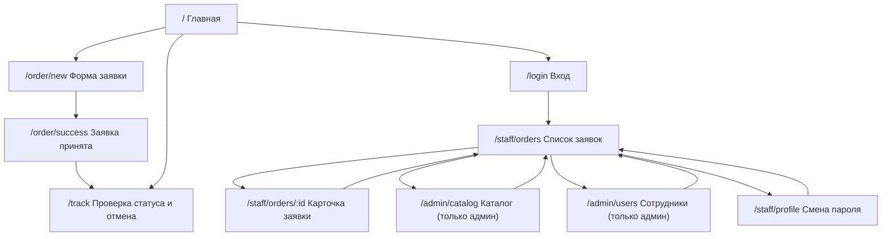

# Страницы сайта

> Часть проекта **uniform-orders**. Тот же текст, что в [architecture.md](architecture.md) (разделы 7), вынесен в отдельный файл.

## 7. Страницы сайта

### 7.1. Список страниц по ролям

| Страница | Адрес | Кто видит | Что на ней |
|---|---|---|---|
| Главная | `/` | Все | Краткое описание, кнопки «Оформить заявку», «Проверить статус», «Вход для сотрудников» |
| Форма заявки | `/order/new` | Все | Переключатель Физлицо/Организация, контакты, позиции («+ Добавить изделие»), срок, комментарий, файлы, ориентировочная цена |
| Заявка принята | `/order/success` | Все | Номер заявки крупно, кнопка «Скопировать номер», подсказка «Сохраните номер и телефон». Номер хранится в `sessionStorage` (память вкладки браузера), поэтому не пропадает при обновлении страницы. Потерянный номер сотрудник находит по телефону |
| Проверка статуса | `/track` | Все | Поля «номер» и «телефон», результат со статусами и историей. Кнопка «Отменить заявку» видна, пока статус «Новая» или «На рассмотрении». Дальше вместо неё подсказка «Заявка уже в работе, позвоните в ателье» и контакты |
| Вход | `/login` | Все | Email и пароль |
| Мой профиль | `/staff/profile` | Сотрудник, Админ | Смена пароля. После входа с временным паролем пользователя сразу переводит сюда |
| Список заявок | `/staff/orders` | Сотрудник, Админ | Таблица, поиск (в том числе по телефону), фильтр по статусу, фильтр «Мои», пагинация |
| Карточка заявки | `/staff/orders/:id` | Сотрудник, Админ | Данные клиента (кнопка «Исправить контакты»), позиции, файлы, смена статуса, история (статус, цена, ответственный). Кнопка «В производство» неактивна, пока нет цены («Попросите администратора проставить цену»). При отмене открывается окно с обязательной причиной. Для админа ещё: цена и назначение |
| Каталог | `/admin/catalog` | Админ | Изделия и ткани |
| Сотрудники | `/admin/users` | Админ | Список, добавление, отключение |
| Страница «Нет доступа» / «Не найдено» | `/403`, `*` | Все | Сообщение об ошибке |

### 7.2. Карта страниц

> **Почему так:** страницы `/staff/*` и `/admin/*` на клиенте закрыты специальной «охраной маршрутов» (компонент, который проверяет вход и роль перед показом страницы). Это только удобство. Настоящую защиту делает сервер (раздел 9).
